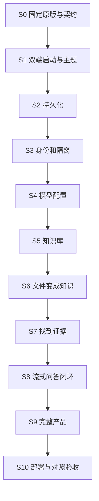

# 从 `0` 到 `1` 重构 `WeKnora`：学习与实施入口

这套教程集中放在 `refactor/docs/从0到1重构WeKnora/`。目标是自己实现 `Python` 后端与 `Vue 3` 前端，按当前原版逐项复刻功能、交互和视觉。前端采用原版 `TDesign`、主题与素材，加上 `Tailwind CSS ^4.3.3`，减少新增布局样式。

先读总路线，再按阶段动手；遇到具体技术问题再翻开发手册。不要同时维护前端、后端和学习计划三套阶段：全套只有 `S0–S10`。

## 1. 先知道这套资料怎么用

| 层次 | 你要解决的问题 | 去哪里 |
| --- | --- | --- |
| 入口 | 我应该从哪里开始 | 本文 |
| 总路线 | 最终做成什么，分几步 | [01 总路线与学习方法](./01-总路线与学习方法.md) |
| 分步实施 | 今天读什么、写什么、怎么检查 | 下表的 `02–12` |
| 进度记录 | 哪一步真的完成，还有什么卡点 | [13 进度与验收记录](./13-进度与验收记录.md) |
| 随查手册 | 代码骨架、技术写法、概念和原版入口 | `90–92` |
| 原理补充 | 原版上传、检索和回答究竟怎样工作 | [文档上传到用户问答全链路](../文档上传到用户问答全链路/00-目录.md) |

实施章节借鉴全链路文档的写法：用同一个用户故事串起页面、接口、业务服务、数据库与后台任务，再用失败场景验证理解。原理文档描述原版；实施章节指导你动手建立新工程，二者不能当作已经完成的代码报告。

## 2. 按这个顺序实现

| 顺序 | 实施章节 | 完成本章后能证明什么 |
| --- | --- | --- |
| `S0` | [02 原版基线与契约](./02-S0-原版基线与契约.md) | 知道复刻哪个版本，行为、接口、数据与截图有依据 |
| `S1` | [03 工程初始化与页面骨架](./03-S1-工程初始化与页面骨架.md) | 新页面能请求新后端，主题与工具类生效 |
| `S2` | [04 数据库与迁移](./04-S2-数据库与迁移.md) | 数据能保存，迁移与事务有验证 |
| `S3` | [05 登录与租户隔离](./05-S3-登录与租户隔离.md) | 用户能登录，不能读取别人的空间 |
| `S4` | [06 模型配置与网关](./06-S4-模型配置与网关.md) | 页面能配置和测试模型，假模型可重复验收 |
| `S5` | [07 知识库管理](./07-S5-知识库管理.md) | 创建、查看、编辑和删除真正落库 |
| `S6` | [08 上传解析与索引](./08-S6-上传解析与索引.md) | 文件经过解析、分块和索引，状态可追踪 |
| `S7` | [09 检索与证据组织](./09-S7-检索与证据组织.md) | 问题能找到有权限的资料，证据能追溯 |
| `S8` | [10 会话与流式问答](./10-S8-会话与流式问答.md) | 回答逐步显示、持久保存，支持停止与恢复 |
| `S9` | [11 完整功能逐项复刻](./11-S9-完整功能逐项复刻.md) | 知识管理、智能体、工具、组织、渠道等逐组补齐 |
| `S10` | [12 部署与全量验收](./12-S10-部署与全量验收.md) | 干净环境可独立运行，功能与视觉有完整证据 |

`02–12` 是文件排序，`S0–S10` 是实施阶段。例如 `08-S6` 表示第八号文件讲第六阶段，不是两套实施顺序。每章内的 `S6.1` 等编号只是当章任务。

## 3. 每章怎样才算学完

每次只做一个小任务。先看前置条件，再读对应原版入口；明确输入输出后写实现，把页面接上，最后做成功与失败验证。

一章结束要留下以下证据：

1. 新增或修改了哪些文件，分别负责哪一步。
2. 一次真实用户操作，以及对应请求、状态变化与保存结果。
3. 一次故意制造的失败，说明失败后留下什么数据、如何恢复。
4. 实际执行的测试命令和结果，不能只记录“应该通过”。
5. 对照原版的截图与交互差异，包括暗色、弹窗和错误状态。
6. 未完成项及下次第一个动作，写入进度记录。

`S8` 通过表示主闭环通过；`S9`、`S10` 仍然必须完成。只验证浏览器端时，要注明浏览器范围，不能替代桌面、外部渠道或其他客户端的验收。

## 4. 随查手册

- [90 Python 后端开发手册](./90-Python后端开发手册.md)：分层、最小健康接口、数据库、认证和后台任务的技术背景。
- [91 Vue 与 Tailwind 前端开发手册](./91-Vue与Tailwind前端开发手册.md)：工程创建、`Tailwind v4` 配置、原版主题映射、页面与状态组织。
- [92 知识词典与原版功能地图](./92-知识词典与原版功能地图.md)：陌生术语、原版功能范围、源码阅读入口。

开发手册中的概念和样例不需要再复制一份到每个章节。实施章节告诉你何时使用它、怎样接到业务链路以及如何验收。

## 5. 原四篇文档现在在哪里

| 原路径（相对 `refactor/docs/`） | 当前文件 |
| --- | --- |
| `Python全栈重构逐步实施计划.md` | [01 总路线](./01-总路线与学习方法.md) |
| `architecture/Python后端技术架构与从0到1迁移指南.md` | [90 后端开发手册](./90-Python后端开发手册.md) |
| `architecture/frontend从0到1实现指南.md` | [91 前端开发手册](./91-Vue与Tailwind前端开发手册.md) |
| `analysis/frontend-knowledge-map.md` | [92 知识词典与功能地图](./92-知识词典与原版功能地图.md) |

原文内容已经移动，仓库内相关导航同步更新；旧的本地书签需要改为本目录。原有全链路资料继续放在原目录，作为原理参考，不再复制出另一份。

## 6. 路径、现状与证据约定

源码索引相对于仓库根目录 `WeKnora/`；新代码计划放在 `refactor/python/backend/` 与 `refactor/python/frontend/`。终端示例标注工作目录，默认 `macOS + zsh`。本次整理时这两个新工程目录尚不存在。

所有阶段初始状态为“未开始”。此前对手册最小示例的临时验证，不等于项目阶段已经通过。原版参考资料有各自的基线日期，动手时以 `S0` 固定的提交、部署模式及实际行为为准。

学习记录统一由[13 进度与验收记录](./13-进度与验收记录.md)管理。需要保存较长的样例和截图时，在本目录下创建 `实践记录/`，按阶段收纳。不要将令牌、模型密钥、私人文档或真实业务数据库放进证据。

**今天第一步：** 打开 [02 原版基线与契约](./02-S0-原版基线与契约.md)，完成第一项基线任务，记录原版提交和“登录 → 创建知识库”的操作证据。能够解释“按钮、请求、权限、数据库”之间的关系后再进入工程初始化。
