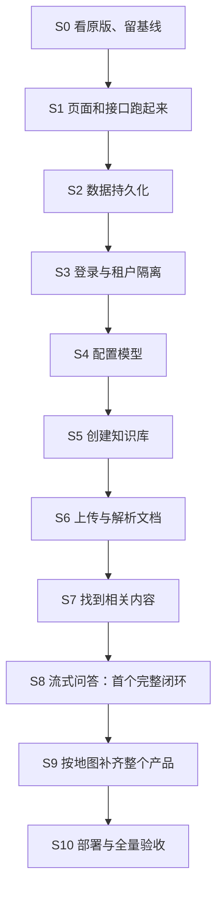

# 从零实现 `WeKnora`：总路线与学习方法

[返回目录](./00-目录.md) · [下一章：原版基线与契约](./02-S0-原版基线与契约.md)

这套文档的目标是：让你亲手搭建 `Python` 后端和 `Vue 3` 前端，逐步复刻当前仓库中的 `WeKnora`，最终对齐原版功能、页面、交互和样式。先做出一个可以运行的小闭环，再逐块补齐整个产品。

你不用第一天就理解向量数据库、智能体和沙箱。先理解“点击按钮后，数据去了哪里”，后面的知识都围绕实际功能展开。每学完一段，都应该有能打开的页面、能执行的请求或能重复的测试。

## 1. 总路线、实施章节与开发手册各管什么

| 文档 | 解决的问题 | 什么时候读 |
| --- | --- | --- |
| **本文：总路线** | 今天做什么、前后端怎样配合、何时可以进入下一步 | 首先阅读；每完成一阶段回到这里 |
| [后端动手指南](90-Python后端开发手册.md) | 用 `Python` 接请求、存数据、处理文档和调用模型 | 做到对应阶段时阅读 |
| [前端动手指南](91-Vue与Tailwind前端开发手册.md) | 用 `Vue` 和 `Tailwind CSS` 做出原版页面并接上接口 | 与后端同阶段交替阅读 |
| [学习词典与功能地图](92-知识词典与原版功能地图.md) | 术语是什么意思、原版实现在哪、还有哪些功能没做 | 遇到陌生概念或准备补齐功能时查阅 |

本目录所有章节共用 `S0–S10`，没有第二套阶段编号。详细操作按[目录中的 `02–12` 实施章节](./00-目录.md)推进，下面三份手册按需查阅。不要先通读并实现全部后端，再开始全部前端；每阶段都完成一小段可操作的功能。

## 2. 先认清目录和当前状态

本文核验日期为 `2026-11-09`，静态阅读的仓库提交为 `930cc8c`。实际动手时重新记录自己的提交，后续以那个版本为复刻基准。

| 路径（相对于仓库根目录 `WeKnora/`） | 当前用途 |
| --- | --- |
| `frontend/` | 原版前端：页面、交互、样式和素材的参照 |
| `internal/`、`cmd/server/` | 原版 `Go` 后端：接口和业务规则的参照 |
| `migrations/` | 原版数据库结构与迁移脚本 |
| `docreader/` | 已有的 `Python` 文档解析服务，可复用 |
| `refactor/docs/从0到1重构WeKnora/` | 本套学习文档 |
| `refactor/python/backend/` | **待新建**的 `Python` 后端 |
| `refactor/python/frontend/` | **待新建**的学习版前端 |
| `refactor/integration-web/` | 独立集成演示，不作为本次复刻的功能或界面基准 |

本次核验时 `refactor/python/` 尚不存在。文中“创建某文件”“运行某测试”是后续动手任务，不代表代码已经写好。现有 `AGENTS.md` 中的这些目录和命令也是工程约定，不能据此推断实现已经完成。

除特别说明，源码索引从仓库根目录计算；终端操作从 `refactor/` 开始。命令以你当前的 `macOS + zsh` 为例。每个新终端都先确认 `pwd`，避免创建出嵌套的 `python/python/`。

## 3. “完全一样”怎样变成可以检查的目标

“看起来差不多”和“完整复刻”不是同一项验收。需要同时检查下面四件事。

| 对齐内容 | 要保存的参照 | 如何判断通过 |
| --- | --- | --- |
| 功能 | 页面入口、按钮、设置项、用户角色、原版操作结果 | 相同身份和数据能完成相同操作；错误路径也一致 |
| 接口 | 方法、路径、请求字段、响应、状态码、鉴权、流式事件 | 新实现通过逐项契约测试；不能自行改字段让新前端迁就 |
| 数据 | 原版表、字段、索引、约束、状态值、删除规则 | 独立测试库中的读写和迁移保持兼容 |
| 视觉和交互 | 相同尺寸下的截图、主题、字体、弹窗、加载和失败状态 | 对照截图和实际操作逐项确认，差异有记录并修复 |

先以原版浏览器端为主线，同时把嵌入页、桌面专用行为、外部渠道和其他客户端列入范围表。浏览器版本通过，只能叫“浏览器端复刻完成”；如果要宣布“整个项目完成”，范围表中其余入口也必须实现并验证。环境暂时无法验证的功能标记“待验证”，不能算通过。

`Tailwind CSS` 能减少你手写的布局样式，但不会自动让页面变成原版。采用以下组合：

- 保留原版 `TDesign Vue Next` 组件及其行为，避免重新实现表格、弹窗和表单。
- 复用原版主题变量、字体、图标与图片；保留素材许可说明。
- 新页面用 `Tailwind CSS ^4.3.3` 写布局、间距和响应式规则。
- 保留主题覆盖、聊天富文本、预览器等必要的少量专用样式。它们不必硬改成工具类。

具体接入、禁用全局重置和视觉验收见前端指南。先固定原版组件库版本，再逐页比较；依赖升级与复刻分开进行。

## 4. 开始前只学这些基础

如果完全没写过代码，先按下面顺序各做一个小练习；已经会的可以用练习证明后跳过。

| 基础 | 用一句话理解 | 过关练习 |
| --- | --- | --- |
| 终端与目录 | 命令总是在某个文件夹里执行 | 用 `pwd`、`ls` 找到本教程目录 |
| `Git` | 保存并比较代码的版本 | 用 `git status --short` 看修改，用 `git diff` 看内容 |
| `HTML` / `CSS` | 页面结构与外观 | 做一个标题、输入框和按钮，理解盒子、间距、布局 |
| `JavaScript` / `TypeScript` | 页面逻辑与数据类型 | 写一个数组筛选函数，理解对象、异步请求和类型 |
| `Vue` | 数据改变后自动更新页面 | 输入知识库名称，页面同步显示名称 |
| `Python` | 后端处理规则的语言 | 写一个函数，校验名称是否为空 |
| `HTTP` / `JSON` | 前后端传递消息的方式 | 说出请求地址、请求体、状态码和响应体分别是什么 |
| `SQL` | 存取数据库记录的语言 | 在临时数据库里插入、查询一条记录 |

暂时不要求会训练模型，也不要求掌握所有容器和云服务。你是在开发使用模型的应用。

## 5. 全程只有这一张路线图



| 阶段 | 页面上能看到什么 | 后端必须提供什么 | 完成证据 |
| --- | --- | --- | --- |
| `S0` | 原版截图和操作记录 | 接口、数据和事件样例 | 基线记录与功能清单 |
| `S1` | 应用壳、服务状态 | `/health` | 启动命令、成功与断网反馈 |
| `S2` | 原有状态页即可 | 数据库连接、迁移和事务 | 空库初始化与回滚测试 |
| `S3` | 登录、注册、工作空间 | 认证、刷新、权限隔离 | 登录闭环和越权失败测试 |
| `S4` | 模型配置与连接测试 | 模型配置、假模型和真实适配 | 密钥脱敏、成功和失败反馈 |
| `S5` | 知识库列表和详情 | 知识库增删改查 | 刷新后数据仍在 |
| `S6` | 文件列表、上传和解析进度 | 解析、分块、入库和任务状态 | 文档可以查看、失败可处理 |
| `S7` | 原版检索入口与来源展示 | 关键词、向量和重排 | 固定文档得到预期来源 |
| `S8` | 历史、逐步生成的回答和引用 | 消息持久化、检索增强与流式响应 | 登录到问答的完整录像或测试 |
| `S9` | 原版剩余页面和完整操作 | 对应功能、权限和长任务 | 功能矩阵逐项验收 |
| `S10` | 独立部署的完整应用 | 真实依赖、备份、监控、升级恢复 | 干净环境复现与全量对照 |

下面按阶段解释“为什么现在做”和“今天从哪里下手”。详细任务跟着同阶段实施章节做，代码写法按需查开发手册，不需要同时打开全部文件。

### 5.1 把大阶段拆成可验证的小实验

打开[14 全链路 60 步实践路线](./14-全链路60步实践路线.md)：步骤 `01–07` 建立基础，`08–21` 完成摄取，`22–30` 完成检索，`31–40` 完成问答，`41–58` 延伸到完整产品，`59–60` 做生产验证与签收。每步都有既有阶段任务映射、可见产物和失败或理解检查。步骤号只是学习顺序，进度仍按 `S0–S10` 记录。

全链路资料的 `7` 篇主题文档已逐篇纳入这条路线。学习时把“读过原理”和“通过实现验收”分开；尤其不要把 `S6–S8` 当作一次性的大任务。

## 6. `S0`：先当一次原版用户

先阅读仓库的 [本地部署说明](../../../WeKnora本地部署与使用说明.md)，按实际运行方式准备原版。运行原版是为了认识目标；新项目最终必须能独立运行。原版和新后端都可能使用端口 `8080`，对照时分别启动或明确改端口，不让两个服务抢占端口。

选一个最简单的故事：“我有一份文档，希望问它一个问题。”在原版中依次登录、配置模型、建库、上传、提问。记录每次点击后出现的页面及请求。无法启动时可以先做源码清单，但截图和真实行为必须补验。

在本教程的 `实践记录/S0/` 准备以下记录，按[进度与验收记录](./13-进度与验收记录.md)收纳，文件在这一阶段由你创建：

1. `rebuild-baseline.md`：原版提交、运行方式、账号角色、主题、语言、浏览器及截图尺寸。
2. `feature-parity.md`：从功能地图展开到页面、按钮、设置项及后台任务，逐项标记状态。
3. `api-contract.md`：前端调用、后端路由、成功和错误样例，以及字段来源。
4. `database-contract.md`：表结构、关系、迁移版本及删除规则。
5. `visual-parity.md`：截图位置、颜色和尺寸依据、当前差异。

开始时只详细填登录和知识库两组，其余模块先列名称。每进入一个阶段再补齐该阶段的样例，避免花数周写完规格却没写出一个页面。

**过关：** 能说明登录成功后进入哪里、知识库数据存在哪里、原版页面有哪些状态。当前进度一律从“未开始”记录，不沿用旧文档的完成率。

## 7. `S1–S2`：让页面、接口、数据库分别活起来

先做 `S1`：后端只返回健康状态，前端显示一个同风格的应用壳，并请求这个状态。此时不需要模型，也不需要数据库。按后端指南创建虚拟环境与 `FastAPI`，按前端指南创建 `Vue + Tailwind` 工程。

然后关闭后端，再刷新前端。页面应该显示服务不可用，而不是空白。这次人为制造失败，是你理解前后端边界的第一个练习。

`S1` 过关后进入 `S2`。数据库像一个可长期保存的账本：刷新页面不能把数据抹掉。先从原版迁移中确认用户、租户、成员关系、模型和知识库的结构，再建立对应数据访问和事务。不要把教程里的简化字段直接当作新协议。

本地学习可先使用原版兼容的 `SQLite` 结构、独立测试数据库和假模型；遇到 `PostgreSQL` 特有字段、搜索或索引时，使用独立 `PostgreSQL` 实例验证，不能把它们改没了。`SQLite` 通过只证明本地模式通过。

**动手产物：** 前后端启动入口、依赖清单和锁定记录、健康测试、数据库初始化与事务测试。测试脚本也要在这一阶段创建，文中提到的 `stage_check.py` 等历史约定并不是现成工具。

**过关：** 页面能请求后端；断开服务能看到失败；测试库可从空库初始化；失败事务不留下半条业务数据。

## 8. `S3–S5`：先解决“谁的数据”，再创建知识库

`S3` 先做登录。租户可以理解为一个工作空间：甲空间的文档不能被乙空间的人看到。前端隐藏按钮只影响操作界面，后端仍必须检查身份和资源归属。

先完成登录、刷新页面恢复会话、退出，再验证两个用户跨空间访问失败。刷新令牌、角色和切换空间不能拖到最后，否则后面所有数据查询都要返工。

`S4` 配置模型。先用固定回答的假模型，让开发结果可重复；然后接真实的聊天、向量和重排模型。向量是用于比较内容相似度的一串数字，不是模型回答本身。界面按原版展示供应商、模型类型、测试结果和默认选择，服务端不把完整密钥返回列表。

`S5` 创建知识库。把它想成一个装文档的文件夹，但额外带有解析和检索设置。从“列表 → 创建 → 详情 → 修改 → 删除”完成一次完整流程，再补齐原版字段和状态。

**动手产物：** 登录和空间模块、模型配置模块、知识库模块；每个模块包含页面、接口、业务服务、数据访问和测试。

**过关：** 重启后记录仍存在；登录过期有明确反馈；跨租户访问被拒绝；删除的关联数据按原版规则处理；页面截图与原版对应状态比较过。

## 9. `S6–S8`：完成第一次“问文档”

`S6` 上传与解析分开理解：上传只是把文件送到服务器，解析才是提取文字，再切成小段。页面上的上传完成不等于可以提问。先跑通文本文件，再复用 `docreader` 完成原版支持的文件格式、图片识别和表格等能力。

长任务要把状态保存到数据库。用户切页或服务重启，不应该让任务无声消失。使用原版状态值和接口，内部实现可以逐步从单任务演进为可靠队列。

`S7` 做检索。先用固定文档验证能找到正确段落，再增加关键词、向量、融合和重排。返回来源位置，才能让用户知道答案依据哪里。原版全局检索入口已经由命令面板承接，不要照旧文单独造一个不同的搜索页面。

`S8` 把检索结果送给模型，并让前端边接收边显示回答，这就是流式问答。先做普通知识库问答，再补历史、引用、停止、重试、断流和富文本。原版流式协议的业务类型使用 `response_type`；应根据源码固定完整结构，不能随手设计一个新的 `/api/v1/chat` 示例替代它。

**动手产物：** 文档流水线、检索服务、会话和消息、流式客户端、安全渲染，以及对应浏览器流程。

**过关故事：** 新用户登录 → 配置模型 → 建库 → 上传 → 等待解析 → 找到内容 → 提问 → 查看引用 → 停止或完成 → 刷新后恢复消息。假模型和真实模型分别记录结果。

到这里可以庆祝第一个完整闭环，但整个 `WeKnora` 还没有复刻完。

## 10. `S9`：沿着依赖关系补齐产品

使用[功能地图](92-知识词典与原版功能地图.md)逐项展开，下面是实现顺序，不是可以丢弃的候选功能。每组都重复“原版操作 → 契约 → 后端 → 页面 → 功能/视觉验收”。不要同时开启所有模块。

| 顺序 | 功能组 | 为什么放在这里 | 不能遗漏的验收 |
| --- | --- | --- | --- |
| 一 | 知识管理全量 | 已有建库和解析基础 | 标签、文件夹、批量操作、`FAQ`、`Wiki`、图谱、版本与冲突处理 |
| 二 | 文档来源与完整预览 | 复用文件流水线 | 网页/数据源同步、受保护资源、各文件格式预览、重新解析与删除一致性 |
| 三 | 聊天完整体验 | 已有消息与流式基础 | 编辑、重试、分支/回退、附件、语音、收藏/置顶、引用与产物库等原版操作 |
| 四 | `Agent`、技能、记忆与工具 | 依赖模型、会话和权限 | 配置、工具事件、审批、暂停继续、取消、上下文及执行限制 |
| 五 | `MCP`、凭据、环境与沙箱 | 依赖工具执行及隔离边界 | 服务/端点、密钥脱敏、终端、浏览器连接、权限、超时和资源清理 |
| 六 | 自动化与外部渠道 | 依赖稳定的智能体执行 | 定时触发、运行记录、重复执行、消息渠道、回调与权限 |
| 七 | 组织、共享与系统管理全量 | 基础租户隔离早已在 `S3` 完成 | 成员邀请、角色、共享、`API Key`、`OIDC`、系统设置、队列和配额 |
| 八 | 嵌入及其他运行入口 | 复用已稳定的业务能力 | 独立鉴权、宿主通信、嵌入主题；桌面等运行时单列真实验收 |
| 九 | 跨页面体验收口 | 贯穿全部模块 | 原版语言、主题、字体、键盘操作、窄屏、加载/失败/空状态和动画 |

这张表是总览；实际范围由 `S0` 固定版本的路由、设置弹窗、菜单、接口及功能开关共同确定。只统计路由会漏掉弹窗里的功能，只统计截图会漏掉后台任务。

**过关：** 功能清单不存在未说明的遗漏。依赖外部服务而暂时无法运行的项目必须保持“待验证”，不能用模拟成功截图替代实测。

## 11. `S10`：让别人也能按文档运行

部署可以理解为“把你电脑上能跑的东西，搬到另一台机器上仍能跑”。先固定依赖，再写配置说明与启动步骤，最后从干净环境验证。

1. 用真实的 `PostgreSQL`、任务队列、对象存储和向量检索服务复测已实现功能；保留目标部署模式的兼容性。
2. 配置前端静态资源、页面路由回退、`API` 代理、`SSE` 和 `WebSocket`，避免开发服务器正常、生产环境失效。
3. 验证数据库备份恢复、任务重启恢复、版本升级及部署回退。
4. 保存功能矩阵、接口测试、浏览器流程和截图差异结果；从原版菜单重新完整走查一次。
5. 整理启动文档和 `.env.example`，让另一台机器照步骤完成主流程。

这里的回退指新项目自身的部署恢复。原生产系统双写、灰度切流和下线 `Go` 是另一个运维任务，不是本次从零学习的前置条件。

## 12. 每次学习怎样安排

一次学习只选择一个能看见结果的小目标，例如“创建知识库后刷新仍能看到它”。推荐循环：读一段概念 → 看一个原版入口 → 写一段实现 → 制造一次失败 → 记录证据。

初次学习可这样分配，复杂阶段可以拆成多天：

| 轮次 | 内容 | 最小交付 |
| --- | --- | --- |
| 第一轮 | 基础与 `S0` | 原版操作记录、版本与首批截图 |
| 第二轮 | `S1–S2` | 双端启动与数据库测试 |
| 第三轮 | `S3–S5` | 登录后管理自己的模型和知识库 |
| 第四轮 | `S6–S8` | 文档问答完整闭环 |
| 后续多轮 | 每轮一个 `S9` 功能组 | 对应功能和视觉对照证据 |
| 最后一轮 | `S10` | 干净环境运行及完整验收 |

统一更新本目录的[进度与验收记录](./13-进度与验收记录.md)，详细证据放到对应 `实践记录/S阶段/`，不需要另建进度台账。每次追加：

```text
阶段与本次目标：
原版参照（提交、页面、源码）：
本次完成的文件与行为：
实际运行的命令和结果：
成功、失败、权限、持久化、视觉证据：
状态：未开始 / 实现中 / 待验收 / 已验收
卡点及下次第一个动作：
```

每周用自己的话解释一次：数据从点击按钮到数据库再回到页面，经过哪些文件？解释不清哪一段，就回到词典和源码，只补那一段。

## 13. 今天从哪里开始

今天先完成 `S0` 的第一小步：找到原版登录和知识库页面，记录当前提交及操作截图，写出“创建知识库”涉及的前端页面、接口和后端入口。学习证据放入上述基线和功能记录。

然后打开[后端指南](90-Python后端开发手册.md)的 `S1` 和[前端指南](91-Vue与Tailwind前端开发手册.md)的 `S1`，做出第一个能显示服务状态的页面。

自测一句话：**为什么“页面有创建按钮”不能证明“知识库功能已经完成”？** 能用请求、权限、持久化和失败反馈解释，就可以继续。

本文是实施路线。本次整理核对了目录与原版关键源码，没有把未来的实现、全量接口兼容或视觉一致性标记为已经验收。
