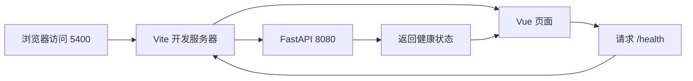

# `S1`：建立工程，显示第一个真实服务状态

[目录](./00-目录.md) · [上一章](./02-S0-原版基线与契约.md) · [下一章](./04-S2-数据库与迁移.md)

**上一健康增量（`2026-11-20`，历史快照）：**（以下验证状态为开发阶段快照） 只推进 S1 的点击健康检查子项，不交付本章全部主题、外壳和视觉对齐。实际源码函数行号已核对，安装/构建和页面成功/停后端失败/恢复已完成 developer 自检；独立测试 not-run。精确运行说明见[后端 README](../../python/backend/README.md)、[前端 README](../../python/frontend/README.md)，逐步原理见[本轮学习指南](../../artifacts/weknora-python-vue3-rebuild/03-code/learning-guide.md)。后续完整范围见[技术方案第五节](../../artifacts/weknora-python-vue3-rebuild/02-design/tech-design.md#五完整重构路线仅规划不进入本轮实现白名单)。每轮一个小需求，审核、测试、知识记录后由 main 持久化 `awaiting_user_continue=true` 并暂停；用户明确继续后才新建独立增量目录，不自动进入下一章。

**上一健康子项验证更新（`2026-11-21`，历史证据）：** 独立 CODE-REVIEW 已 PASSED（P0/P1/P2 均 0）；TASK-04 已 completed，38 项自动测试（pytest 11 + Node 27）与 11 个浏览器检查组全部 passed，必需行为 failed/blocked 均 0。测试执行日期按正式报告为 2026-11-20（UTC），本次文档同步日期为 2026-11-21；不是重新执行测试。 [独立审查](../../artifacts/weknora-python-vue3-rebuild/03-code/code-review-report.md) · [正式测试报告](../../artifacts/weknora-python-vue3-rebuild/04-e2e/test-report.md) · [新增用例](../../artifacts/weknora-python-vue3-rebuild/04-e2e/added-cases.md)。上述待执行/not-run 仅属开发阶段历史，当前以正式报告为准；仅健康子项，不表示全 S1 或上传问答完成。main 收尾后暂停等待用户明确继续，本轮未提交推送。

**本轮导航增量（`2026-11-21`，与上轮健康验收分开）：** 仅共享外壳与服务检测 `/#/health`、开发进度 `/#/progress` 两页；根地址跳转健康页，未知 hash 保留错误地址并提供返回入口。健康页进入不自动请求，切到进度或未知页应取消在途请求，重入为待检测，迟到响应不得污染新页。本轮已取得独立 CODE-REVIEW `PASSED`（`P0/P1=0`，唯一 `P2` 报告定位文字已修）及 TASK-04 实际结果：Node `27` 项、浏览器 `25` 组（导航 `13`／健康 `11`／真实服务 `1`）均通过，必要项 failed/blocked 为 `0`；frozen 安装、类型检查／构建通过，未发现生产缺陷。[独立审查](../../artifacts/weknora-learning-workbench/03-code/code-review-report.md) · [正式测试](../../artifacts/weknora-learning-workbench/04-e2e/test-report.md) · [测试用例](../../artifacts/weknora-learning-workbench/04-e2e/added-cases.md)。本次仅同步证据，不重跑测试；真实失败恢复为浏览器离线／在线，未停后端，受控取消及迟到注入不冒称真实服务端故障。详见[本轮导航学习指南](../../artifacts/weknora-learning-workbench/03-code/learning-guide.md)。

开发进度是版本化静态事实，不是实时工作流、服务状态或运行 `trace`；本轮无后端行为变化。数据库、上传、解析、检索、问答未开始，整个 `S1` 未全量验收；原版主题与完整视觉对齐仍属后续范围。每轮只做一个需求，完成审核、测试、知识与讲解后暂停等明确继续，不自动进入数据库章节。

## 1. 本章要解决什么

先让浏览器与后端说上话。这个阶段不需要文档解析、数据库或模型：后端返回健康状态，前端显示状态与错误，再建立同风格页面外壳。

**前置条件：** `S0` 的目录、版本和端口记录完成；已准备 `Python 3.12+`、`uv`、`Node.js >=22.12`、`pnpm 10.11.0` 和编辑器。S0 完整操作基线仍需后续补齐，不由本轮健康合同调研推断已完成。



## 2. 本章文件与阅读入口

本轮以双端 README、冻结 C1–C5 和实际锁文件为准。后端/前端手册第 3 节保留作为通用背景，不直接复制旧依赖、npm 或自动请求示例来覆盖本轮工程。以下任务仍保留 S1.1–S1.8 导航，未实施部分是后续规划。

| 本章目标位置（仓库根目录起，非完成证明） | 职责 |
| --- | --- |
| `refactor/python/backend/pyproject.toml` | 运行、开发依赖及检查规则 |
| `refactor/python/backend/app/main.py` | 启动应用及健康接口 |
| `refactor/python/backend/tests/unit/test_health.py` | 自动验证接口 |
| `refactor/python/frontend/vite.config.ts` | 插件、端口和代理 |
| `refactor/python/frontend/src/main.ts` | 注册 `Pinia`、`VueQueryPlugin` 与 router、导入样式 |
| `refactor/python/frontend/src/App.vue` | 组合 `WorkbenchLayout` 与 `RouterView`（本轮合同） |
| `refactor/python/frontend/src/router/index.ts` | `createRouter` / `createWebHashHistory`，根跳转、两页与未知页回退 |
| `refactor/python/frontend/src/layouts/WorkbenchLayout.vue` | 两个 `RouterLink`、导航与唯一 `main` |
| `refactor/python/frontend/src/views/health/index.vue` | 健康页入口，不另建 `main` |
| `refactor/python/frontend/src/views/progress/index.vue` | 版本化静态进度，不请求 API |
| `refactor/python/frontend/src/views/not-found/index.vue` | 未知 hash 提示与返回服务检测 |
| `refactor/python/frontend/src/views/health/components/HealthPanel.vue` | `onCheckClick()` 与可访问状态展示 |
| `refactor/python/frontend/src/views/health/hooks/useHealthCheck.ts` | `useHealthCheck()` / `check()` 与 query 状态、作用域取消 |
| `refactor/python/frontend/src/api/health.ts` | fetchHealth、HealthCheckError、协议校验和超时 |
| `refactor/python/frontend/src/style.css` | 本轮 Tailwind v4 入口；原版主题移植后续 |

原版参考：`frontend/src/main.ts`、`frontend/src/views/platform/index.vue`、`frontend/src/assets/theme/`。先读当前任务需要的部分，不必移植全部启动副作用。

## 3. 按顺序完成任务

### `S1.1` 确认工具版本和目标目录

**输入：** `S0` 基线记录。

在 `refactor/` 执行：

```sh
pwd
python3 --version
node --version
uv --version
pnpm --version
```

1. 版本不满足手册要求时先处理工具安装，不在报错后修改模板绕过版本检查。
2. 检查 `python/` 是否已有内容；已有工程继续完善，不重新生成覆盖。
3. 使用两个终端分别运行后端与前端，第三个终端用来执行测试。

**结果：** 工具版本与每个终端工作位置可确认。

**检查：** 本章命令从 `refactor/` 起步；进入后端后，不直接把前端创建命令粘到同一位置。

#### 具体拆解：先分清三个工作位置

1. 后端终端最终位于 `refactor/python/backend/`，执行 `Python` 启动与测试；前端终端最终位于 `refactor/python/frontend/`，执行 `pnpm` 命令。
2. 第三个终端只负责发请求和检查结果。每次复制创建目录的命令之前先看 `pwd`，避免产生 `python/python/`。
3. 对已有目录先查看入口和依赖文件；只补缺失部分。不存在才按手册初始化，不把重新生成当作修复方式。
4. 把工具版本原样记下。报“命令不存在”说明工具尚不可调用；报包无法导入则是下一层问题，两者不要混着修。

**小检查：** 能指出哪个终端服务保持运行，哪个终端可以继续输入验证命令。启动进程占着终端等待请求是正常现象。

### `S1.2` 创建后端虚拟环境

**输入：** 可用的 `Python`。

1. 确认 `python/backend/` 已有工程不被覆盖；应用入口由本轮 PT-01 提供，测试由 TASK-04 独立添加。
2. 在后端目录执行 `uv sync --frozen --extra dev`，按 `pyproject.toml` 和 `uv.lock` 同步 `.venv`。
3. 用 `uv run --frozen` 调用工程解释器，记录实际安装结果；工具受限则报 blocked。
4. 虚拟环境和后续本地数据库不纳入提交；示例配置不放真实密钥。

**结果：** `python` 指向本工程虚拟环境，依赖可导入。

**检查：** 不使用系统环境“恰好装过”的包来证明项目依赖完整。

#### 具体拆解：解释器、依赖声明与业务文件分开建立

1. uv 同步后执行 `uv run --frozen python -c 'import sys; print(sys.executable)'`；输出应落到本后端的 `.venv`。虚拟环境是本项目使用的独立工具包环境。
2. 编辑 `pyproject.toml`，先声明运行接口与测试所需包；此时不增加数据库、队列或模型依赖。
3. 执行同步后验证 `uv run --frozen python -c 'import fastapi, uvicorn'`。成功表示能导入，还不表示应用已经启动。
4. 创建 `app/__init__.py` 和 `app/main.py`；前者标识包，后者放实际应用入口。依赖版本记录与代码分开保存。
5. 新开终端仍进入后端目录并使用 `uv run --frozen`；不要因为系统解释器恰好能导入包就跳过路径检查。

**先定位再修改：** 导入失败时对照解释器路径、安装命令使用的解释器、依赖声明三者，先让它们一致。

### `S1.3` 跑通健康接口

**输入：** 手册中的 `app/main.py` 最小示例。

1. 创建应用并实现 `GET /health`，返回原版健康结构。
2. 在 `python/backend/` 启动 `uvicorn`，确认监听 `8080`。
3. 用 `curl` 请求，再打开开发接口说明。
4. 若端口被占用，不停止不明实例；本次 Python 可改 8081，并将前端 `BACKEND_PROXY_TARGET` 同步改为 `http://127.0.0.1:8081`。

**实际 developer HTTP 自检结果：** 200、application/json、正文严格为 `{"status":"ok"}`，并有 `X-WeKnora-Implementation: python-fastapi`。该 header 仅是误连诊断，不是鉴权。

**检查：** 停止新后端时健康请求失败，确保没有误连原版。

#### 具体拆解：应用对象怎样变成可访问接口

1. 在 `app/main.py` 引入 `FastAPI`，建立一个应用对象 `app`；启动器将从这个名字找到应用。
2. 按手册添加 `/health` 的读取路由和处理函数。路由负责匹配“方法加路径”，函数返回的对象再被框架编码为响应。
3. 在后端目录执行手册启动命令。`app.main:app` 左边指模块，右边指模块里的应用对象，不是任意文件路径。
4. 在验证终端执行 `curl -i http://127.0.0.1:8080/health`，分开检查状态码、内容类型和正文。
5. 请求不存在的路径，对比“收到错误响应”与停服务后“连接失败”。前者说明服务接到了请求，后者尚未进入路由。

**本步不做：** 不给健康接口加用户表或模型调用；先让最短调用链能单独验证。

### `S1.4` 留下第一个自动检查（TASK-04 独立阶段）

**输入：** 已可调用的健康接口。

1. 由独立 test-engineer 按实际代码和合同添加 `tests/unit/test_health.py`，developer 不提前写测试或测试通过报告。
2. 测试通过应用测试客户端验证状态码和响应内容，不依赖手工启动的后台服务。
3. 运行 `uv run --frozen python -m pytest -q` 和 `uv run --frozen python -m ruff check .`。
4. 记录真实输出，不将文档示例的通过结果复制成自己的结果。

**结果：** 下次改动可以重复检查接口没有被破坏。

**检查：** 修改返回值后测试应失败，恢复后再次通过。

#### 具体拆解：测试失败能指出哪条约定破了

1. 在 `tests/unit/test_health.py` 按手册导入应用，创建测试客户端；客户端在测试进程里调用应用，不要求另开真实服务。
2. 先断言状态码，再断言解析后的正文。两项检查分别回答“请求成功了吗”和“返回了约定内容吗”。
3. 只运行这一项：在后端目录执行 `uv run --frozen python -m pytest -q tests/unit/test_health.py`；通过后再执行本阶段完整检查。
4. 临时改错测试预期确认会失败，再恢复。不得改生产返回结构来迎合一个写错的测试。
5. 将真实端口请求结果和测试客户端结果各留一份，前者覆盖网络启动，后者方便以后回归接口逻辑。

**排错：** 测试收集失败先检查文件位置与导入；请求返回不符再检查路由和响应，不立即重装所有包。

### `S1.5` 创建前端工程并固定依赖

**输入：** 前端手册第 `3.1` 节命令。

1. 另开终端回到 `refactor/`，创建 `python/frontend/`。
2. 本轮指定 Vue 3、Vite、TypeScript、pnpm、Tailwind CSS v4 与 Vite 插件、vue-query、Pinia；不为未来原版视觉复刻预装 TDesign、图标或 Less。
3. 检查生成的脚本，确保生产构建包含类型检查。
4. 保存真实生成的 `pnpm-lock.yaml`；用 `pnpm install --frozen-lockfile` 复现，不生成 npm 锁文件。
5. 原版依赖覆盖规则不整包复制，尤其不把 `lightningcss` 覆盖为不可用值。

**结果：** 模板页面可启动，构建工具能找到指定插件。

**检查：** `pnpm list tailwindcss @tailwindcss/vite vite` 显示实际版本；记录范围声明与解析版本的区别。

#### 具体拆解：前端从哪个文件开始显示

1. 按手册初始化后，找到 `package.json` 的 `scripts`，确认 `dev` 和 `build` 实际执行什么；命令名相同不代表检查内容相同。
2. 找到页面入口加载的 `src/main.ts`，再找到其中导入的 `App.vue`。前者启动应用，后者提供当前页面内容。
3. 本轮只启动健康工作台并接入必要样式；`pnpm build` 应运行 `vue-tsc --noEmit && vite build`，类型/构建与页面行为分开验证。
4. 保留自动生成的锁文件，记录实际解析版本；版本范围是允许安装的集合，锁文件记录本次具体选中了谁。
5. 打开终端实际打印的访问地址，确认端口符合约定；不要打开旧书签后误把另一个前端当作当前工程。

**交付：** 工程入口、启动脚本、构建脚本和锁文件都能指出位置，模板启动与后端请求是两个独立验收点。

### `S1.6` 接入原版主题和工具类（完整主题移植为后续规划）

**本轮边界：** 只配置 Tailwind v4 Vite 插件和普通 CSS 入口 `@import "tailwindcss"`；下述 TDesign、主题覆盖、暗色对照不在健康子项实现范围，待用户继续后的独立需求，不据此宣布主题已验收。

**输入：** 原版主题文件与前端手册第 `3.2–3.4` 节。

1. 配置 `vue()`、`tailwindcss()` 插件与 `5400` 端口。
2. 复制原版主题和组件覆盖，保持资源路径正确。
3. 建立普通 `.css` 工具类入口，映射原版主题变量。
4. 不引入 `Preflight` 全局重置；不要把 `@theme` 放进 `.less`。
5. 删除模板默认样式导入，避免默认居中和按钮外观污染。
6. 用小页面确认背景、文字与圆角类生效，然后再开始复刻原版外壳。

**结果：** `TDesign` 控件保留原版风格，工具类控制你自己的页面布局。

**检查：** 开发者工具能看到类规则与变量值；对照暗色属性 `theme-mode`，没有另造主题开关。

#### 具体拆解：先接组件样式，再接业务布局

1. 在 `main.ts` 按手册注册组件库并导入其基础样式；先确认一个原版按钮能正常显示与操作。
2. 再导入原版主题及覆盖文件，确认按钮颜色和尺寸由正确变量控制。主题变量是多个组件共同使用的一组显示值。
3. 在 `vite.config.ts` 注册样式插件，在普通 `.css` 文件建立工具类入口；确认该文件确实被 `main.ts` 导入。
4. 只对外层容器增加一项布局类，再在开发者工具检查对应规则是否生成并生效；不生效时先查导入与层叠，不能靠堆叠更多类修复。
5. 移除模板默认样式引用后重新比较页面，避免把模板居中规则误当成主题问题。

**连接关系：** 组件库负责控件行为与基本外观，原版主题负责统一颜色等值，工具类负责你新增容器的布局。

### `S1.7` 将健康结果显示在页面内

**输入：** 可用的前端、后端和 `/health`。

1. 在开发代理中配置 `/health` 指向后端。
2. 页面发请求前设置“检查中”，收到响应后先检查状态码，再解析内容。
3. 成功显示服务正常；网络失败或非成功响应显示失败与重试按钮。
4. 重试时禁止重复提交或忽略旧响应，离开组件时清理相关请求。
5. 让页面显示实际结果，不能只放一个跳转链接就算联调完成。

**结果：** 后端开关直接影响页面状态。

**检查：** 请求走相对地址；业务前端不写死本机绝对地址。

#### 具体拆解：把一个健康请求接到页面状态

本轮服务端结果与错误只由 vue-query 管理。`useHealthCheck()` 暴露 `idle/checking/success/failure`、result、error、checkedAt 与 `check()`；Pinia 只注册，不建立空 store 或复制请求结果。

1. `HealthPanel.vue` 的 `onCheckClick()` 调用 `useHealthCheck.ts` 暴露的 `check()`；模板按真实状态显示，按钮可键盘操作、请求中禁用，结果区域有 aria-live。
2. query 配置 `enabled:false`、`retry:false`、`refetchOnWindowFocus:false`、`refetchOnReconnect:false`，queryKey 为 `['health','python']`。初始待检测，不自动请求；点击才 refetch，check 内另做并发保护。
3. `health.ts` 的 `fetchHealth(signal?)` 用相对 `/health`，接收 query AbortSignal，附 5000ms 超时，在 finally 清理定时器和监听器。取消不伪装成功或误报超时。
4. 成功必须同时满足 HTTP 200、JSON 内容类型、对象 status=ok、Python 身份 header。返回的 HealthResult 附 httpStatus/implementation 诊断，不改后端 JSON。
5. `HealthCheckError.kind` 完整覆盖 network、timeout、http、protocol；固定诊断不显示原始 HTML 或堆栈。failure 隐藏旧成功结果，checking 不把缓存当本次成功。
6. `checkedAt` 表示浏览器本次终态时间，非后端时钟；刷新回到待检测，无 DB、localStorage、sessionStorage、SSE 或 trace 持久化。
7. Vite 仅代理 `/health`，默认 5400 → 本机8080；可配置 FRONTEND_PORT/BACKEND_PROXY_TARGET 且 strictPort。改配置后重启 Vite。
8. 本轮静态方法解释不是逐方法运行追踪；实际函数行号由主 developer 集成后补实，不能引用未来上传问答方法。

**逐个验证：** 正常后端 → 关闭后端 → 重启并重试 → 快速重复点击 → 请求未返回就离开页面。每次只制造一种条件，检查按钮能恢复，旧结果不覆盖新页面。

**定位方向：** 直连后端失败先查服务；直连成功、页面失败先查代理；网络正文正确、界面仍错再查状态赋值和模板条件。

### `S1.8` 建立同风格外壳和检查脚本（部分导航切片，完整视觉后续规划）

**本轮边界：** 共享外壳与两个业务页面只是导航切片，不代表原版同风格侧栏、主题和完整视觉复刻；以下完整外壳任务仍需后续独立需求，不为本轮引入新测试框架或预建业务菜单。

本轮页面链为 `WorkbenchLayout.vue` 的 `RouterLink` → `router/index.ts` 的 `createRouter` / `createWebHashHistory(import.meta.env.BASE_URL)` → `App.vue` 的 `RouterView`。根 `/` 重定向健康页；hash 的 `/health`、`/progress` 匹配对应页面；catch-all 为错误回退，不是第三个业务入口。hash 不发给服务器，裸 `/progress` 不承诺深链接，裸 `/health` 仍受开发代理处理；生产请求转发不能依赖 `Vite` 开发代理。

检测链则为 `onCheckClick()` → `check()` → `query.refetch()` → `fetchHealth()` → `Vite` HTTP `/health` → `FastAPI`。本 worker 已只读核对前端当前行号：`src/views/health/components/HealthPanel.vue:47–49`、`src/views/health/hooks/useHealthCheck.ts:12–67`（`check:48–57`、`dispose:60–64`）、`src/api/health.ts:33–74`、`vite.config.ts:23–28`。路由文件位置是冻结合同，不编造并行新增文件的行号或运行结果。

外壳只保留一个 `main`，每页一个 `h1`，导航有键盘焦点和精确当前项；不使用 `KeepAlive`。切离健康页由 `onScopeDispose(dispose)` 触发 `cancelQueries()`，再用 `AbortSignal` 中止请求；`gcTime: 0` 与新组件状态配合保证重入待检测，这是本轮必须独立验证的生命周期目标。

**输入：** `S0` 的侧栏、内容区与截图。

1. 将静态外壳分成必要组件，用原图标、文字、主题变量与工具类布局。
2. 此阶段菜单可只展示已实现内容，其余在进度记录中明确待做，不能冒充功能完成。
3. 添加前端测试依赖和脚本，先验证健康状态成功与失败，不为每个静态标签写测试。
4. 执行构建并记录页面截图；原版尺寸差异单列，后面逐页修正。

**结果：** 有可以继续放业务页面的工程基础。

**检查：** 状态页没有数据库依赖，前端关闭后后端接口仍可单独访问。

#### 具体拆解：从状态页逐步长出应用外壳

1. 先对照 `S0` 截图建立侧栏和主内容区；仅把重复或独立职责拆成组件，不按每个盒子建立文件。
2. 把已验证的状态显示放进主内容区，确认拆组件后请求只发一次、卸载清理仍有效。
3. 先接已实现的页面入口，未实现功能在验收清单保留；不能用只会跳静态页的菜单当成对应业务完成。
4. 前端测试先覆盖正常、错误、重复点击与离开后迟到响应，测试替身只替网络边界；检查用户实际看到的文本和按钮状态。
5. 运行类型检查与生产构建，再采集与原版同条件截图。若构建命令未包含类型检查，先补上明确脚本，不把打包成功当成类型正确。

**本章最终证据：** 停掉后端、页面提示失败、重启后重试恢复这一条完整操作，以及对应测试和构建输出。

## 4. 验收和排错

**成功案例（验收目标，不是已通过记录）：** 初始待检测且无自动请求；点击后本次 Python 身份、200 与 JSON 一致。独立测试、类型/构建和页面验证分别留真实证据，当前待协调者核验。

**失败案例：** 停掉后端，点击重试，页面显示失败；重启后再次重试能恢复，不需要刷新整个应用。

- [ ] 两个工程各自有依赖说明和锁定记录。
- [ ] 健康请求、失败反馈和重试可重复验证。
- [ ] 原版主题与 `Tailwind` 没有全局重置冲突。
- [ ] 模板样式不再影响外壳，构建与类型检查通过。
- [ ] 命令、截图、失败结果写入[进度记录](./13-进度与验收记录.md)。

| 现象 | 优先检查 |
| --- | --- |
| 后端找不到模块 | 工作目录、虚拟环境和包安装 |
| 页面请求失败但 `curl` 成功 | 代理路径、端口、浏览器网络面板 |
| 工具类无效 | 插件、入口导入、完整类名和层叠覆盖 |
| 运行的是原版 | 端口占用、代理目标和停服试验 |

自测：浏览器为什么请求 `5400/health`，最终却由 `8080` 返回？
