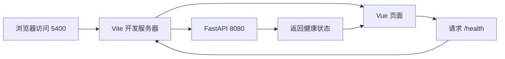

# `S1`：建立工程，显示第一个真实服务状态

[目录](./00-目录.md) · [上一章](./02-S0-原版基线与契约.md) · [下一章](./04-S2-数据库与迁移.md)

## 1. 本章要解决什么

先让浏览器与后端说上话。这个阶段不需要文档解析、数据库或模型：后端返回健康状态，前端显示状态与错误，再建立同风格页面外壳。

**前置条件：** `S0` 的目录、版本和端口记录完成；已准备 `Python 3.12+`、符合前端模板要求的 `Node.js`、`npm` 和编辑器。



## 2. 本章文件与阅读入口

可复制的工程代码集中在[后端手册第 3 节](./90-Python后端开发手册.md)和[前端手册第 3 节](./91-Vue与Tailwind前端开发手册.md)。下面负责告诉你按什么顺序操作，不再维护第二份相同代码。

| 待新建位置（仓库根目录起） | 职责 |
| --- | --- |
| `refactor/python/backend/pyproject.toml` | 运行、开发依赖及检查规则 |
| `refactor/python/backend/app/main.py` | 启动应用及健康接口 |
| `refactor/python/backend/tests/unit/test_health.py` | 自动验证接口 |
| `refactor/python/frontend/vite.config.ts` | 插件、端口和代理 |
| `refactor/python/frontend/src/main.ts` | 注册组件库，导入主题 |
| `refactor/python/frontend/src/App.vue` | 初始页面与健康状态 |
| `refactor/python/frontend/src/assets/` | 原版主题和工具类入口 |

原版参考：`frontend/src/main.ts`、`frontend/src/views/platform/index.vue`、`frontend/src/assets/theme/`。先读当前任务需要的部分，不必移植全部启动副作用。

## 3. 按顺序完成任务

### `S1.1` 确认工具版本和目标目录

**输入：** `S0` 基线记录。

在 `refactor/` 执行：

```sh
pwd
python3 --version
node --version
npm --version
```

1. 版本不满足手册要求时先处理工具安装，不在报错后修改模板绕过版本检查。
2. 检查 `python/` 是否已有内容；已有工程继续完善，不重新生成覆盖。
3. 使用两个终端分别运行后端与前端，第三个终端用来执行测试。

**结果：** 工具版本与每个终端工作位置可确认。

**检查：** 本章命令从 `refactor/` 起步；进入后端后，不直接把前端创建命令粘到同一位置。

### `S1.2` 创建后端虚拟环境

**输入：** 可用的 `Python`。

1. 按后端手册第 `3.1` 节建立 `python/backend/app/`、测试目录与 `.venv`。
2. 激活虚拟环境，再创建 `pyproject.toml` 和 `app/__init__.py`。
3. 安装后端与开发依赖，记录实际解析版本。
4. 虚拟环境和后续本地数据库不纳入提交；示例配置不放真实密钥。

**结果：** `python` 指向本工程虚拟环境，依赖可导入。

**检查：** 不使用系统环境“恰好装过”的包来证明项目依赖完整。

### `S1.3` 跑通健康接口

**输入：** 手册中的 `app/main.py` 最小示例。

1. 创建应用并实现 `GET /health`，返回原版健康结构。
2. 在 `python/backend/` 启动 `uvicorn`，确认监听 `8080`。
3. 用 `curl` 请求，再打开开发接口说明。
4. 若原版占用端口，先停止冲突实例或明确改端口并同步代理。

**结果：** 响应为 `200` 与 `{"status":"ok"}`。

**检查：** 停止新后端时健康请求失败，确保没有误连原版。

### `S1.4` 留下第一个自动检查

**输入：** 已可调用的健康接口。

1. 按后端手册创建 `test_health.py`。
2. 测试通过应用测试客户端验证状态码和响应内容，不依赖手工启动的后台服务。
3. 运行 `python -m pytest -q` 和 `python -m ruff check .`。
4. 记录真实输出，不将文档示例的通过结果复制成自己的结果。

**结果：** 下次改动可以重复检查接口没有被破坏。

**检查：** 修改返回值后测试应失败，恢复后再次通过。

### `S1.5` 创建前端工程并固定依赖

**输入：** 前端手册第 `3.1` 节命令。

1. 另开终端回到 `refactor/`，创建 `python/frontend/`。
2. 使用 `Vue + TypeScript` 模板，安装 `TDesign`、图标、`Tailwind CSS ^4.3.3`、对应 `Vite` 插件和 `Less`。
3. 检查生成的脚本，确保生产构建包含类型检查。
4. 保存锁文件；后续通过 `npm ci` 重装，避免不同机器解析出不同组件版本。
5. 原版依赖覆盖规则不整包复制，尤其不把 `lightningcss` 覆盖为不可用值。

**结果：** 模板页面可启动，构建工具能找到指定插件。

**检查：** `npm ls tailwindcss @tailwindcss/vite vite` 显示实际版本；记录范围声明与解析版本的区别。

### `S1.6` 接入原版主题和工具类

**输入：** 原版主题文件与前端手册第 `3.2–3.4` 节。

1. 配置 `vue()`、`tailwindcss()` 插件与 `5400` 端口。
2. 复制原版主题和组件覆盖，保持资源路径正确。
3. 建立普通 `.css` 工具类入口，映射原版主题变量。
4. 不引入 `Preflight` 全局重置；不要把 `@theme` 放进 `.less`。
5. 删除模板默认样式导入，避免默认居中和按钮外观污染。
6. 用小页面确认背景、文字与圆角类生效，然后再开始复刻原版外壳。

**结果：** `TDesign` 控件保留原版风格，工具类控制你自己的页面布局。

**检查：** 开发者工具能看到类规则与变量值；对照暗色属性 `theme-mode`，没有另造主题开关。

### `S1.7` 将健康结果显示在页面内

**输入：** 可用的前端、后端和 `/health`。

1. 在开发代理中配置 `/health` 指向后端。
2. 页面发请求前设置“检查中”，收到响应后先检查状态码，再解析内容。
3. 成功显示服务正常；网络失败或非成功响应显示失败与重试按钮。
4. 重试时禁止重复提交或忽略旧响应，离开组件时清理相关请求。
5. 让页面显示实际结果，不能只放一个跳转链接就算联调完成。

**结果：** 后端开关直接影响页面状态。

**检查：** 请求走相对地址；业务前端不写死本机绝对地址。

### `S1.8` 建立同风格外壳和检查脚本

**输入：** `S0` 的侧栏、内容区与截图。

1. 将静态外壳分成必要组件，用原图标、文字、主题变量与工具类布局。
2. 此阶段菜单可只展示已实现内容，其余在进度记录中明确待做，不能冒充功能完成。
3. 添加前端测试依赖和脚本，先验证健康状态成功与失败，不为每个静态标签写测试。
4. 执行构建并记录页面截图；原版尺寸差异单列，后面逐页修正。

**结果：** 有可以继续放业务页面的工程基础。

**检查：** 状态页没有数据库依赖，前端关闭后后端接口仍可单独访问。

## 4. 验收和排错

**成功案例：** 启动两端，页面显示正常，后端测试与前端构建通过。

**失败案例：** 停掉后端，点击重试，页面显示失败；重启后再次重试能恢复，不需要刷新整个应用。

- [ ] 两个工程各自有依赖说明和锁定记录。
- [ ] 健康请求、失败反馈和重试可重复验证。
- [ ] 原版主题与 `Tailwind` 没有全局重置冲突。
- [ ] 模板样式不再影响外壳，构建与类型检查通过。
- [ ] 命令、截图、失败结果写入[进度记录](./13-进度与验收记录.md)。

| 现象 | 优先检查 |
| --- | --- |
| 后端找不到模块 | 工作目录、虚拟环境和包安装 |
| 页面请求失败但 `curl` 成功 | 代理路径、端口、浏览器网络面板 |
| 工具类无效 | 插件、入口导入、完整类名和层叠覆盖 |
| 运行的是原版 | 端口占用、代理目标和停服试验 |

自测：浏览器为什么请求 `5400/health`，最终却由 `8080` 返回？
