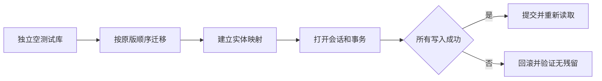

# `S2`：让数据重启以后仍然存在

[目录](./00-目录.md) · [上一章](./03-S1-工程初始化与页面骨架.md) · [下一章](./05-S3-登录与租户隔离.md)

## 1. 先认识账本、账页与修改记录

数据库是持久账本；表规定记录有哪些字段；迁移说明账本结构从旧版怎样变成新版；事务保证一次业务操作不会只做一半。

本章先做数据基础，不急着开发页面。新后端要能读写与原版兼容的结构，而不是让页面看起来相同、数据库却换了一套含义。

**前置条件：** `S1` 健康接口、测试及前端构建通过；`S0` 已记录首批实体和迁移来源。

## 2. 原版入口与目标文件

原版路径从仓库根目录起：`migrations/sqlite/`、`migrations/versioned/`、`internal/database/migration.go`、`internal/types/user.go`、`tenant.go`、`tenant_member.go`、`model.go`、`knowledgebase.go`。

不要只看类型名；还要看 `internal/application/repository/` 对应查询，了解软删除、排序和条件如何使用。

| 待创建位置（后端目录内） | 职责 |
| --- | --- |
| `app/core/config.py` | 读取明确的数据库配置 |
| `app/core/database.py` | 引擎、异步会话和释放资源 |
| `app/core/migrations.py` | 执行与记录兼容迁移 |
| `app/domain/entities/` | 按原版结构映射实体 |
| `app/repositories/` | 当前用到的数据库操作 |
| `scripts/migrate.py` | 你将新建的迁移命令入口 |
| `tests/conftest.py` | 独立测试库与清理夹具 |
| `tests/contract/test_migrations.py` | 结构和迁移行为 |
| `tests/unit/test_transactions.py` | 原子提交与失败回滚 |

文件名是目标建议，不是已有实现。迁移入口由本章建立后才能运行；不要从旧文档复制一个尚不存在的脚本命令。

## 3. 按顺序完成任务

### `S2.1` 整理最终表结构

**输入：** `S0` 数据记录与原版迁移。

1. 列出用户、租户、成员关系、模型、知识库相关表。
2. 按迁移顺序追踪新增字段、默认值、索引、唯一约束和删除行为。
3. 建立“字段 → 数据库类型 → 可空 → 默认值 → 来源迁移”的表格。
4. 标记不同数据库的类型差异，尤其标识符、时间、布尔值和结构化配置。
5. 业务只映射当前需要的实体，但空库结构初始化不能擅自跳过有依赖的迁移。

**结果：** 得到最终结构而非最初建表的过期快照。

**检查：** 每个映射字段有依据，没有为了方便把复杂字段统一改成字符串。

### `S2.2` 隔离学习数据和测试数据

**输入：** 已确定的数据结构与本地运行方案。

1. 配置独立学习库，测试使用另一份临时库。
2. 测试数据库地址由夹具明确提供，禁止默认回退到开发或原版库。
3. 配置从环境读取；启动时打印脱敏连接信息，便于辨认目标。
4. 不在提交中包含数据库文件、真实连接密码或备份。

**结果：** 删除测试数据不会影响原版或日常学习记录。

**检查：** 测试结束后开发库记录数量不变；测试报告不含密码。

### `S2.3` 建立连接和实体映射

**输入：** 原版兼容的 `SQLite` 本地方案。

1. 在后端依赖中加入 `SQLAlchemy 2` 和对应异步驱动，再记录锁定版本。
2. 在 `database.py` 创建引擎和会话工厂，在请求结束时关闭会话。
3. 按原字段建立映射，约束和关系遵循原版数据含义。
4. 先通过一个仓储读取测试记录，确认时间与标识符不会被错误转换。
5. `PostgreSQL` 特有能力使用该数据库单独验证，不用 `SQLite` 的通过结果代替。

**结果：** 有可复用的数据访问入口，业务路由不用自己建立连接。

**检查：** 同时运行两个测试不会共享一个全局会话；异常后连接能够释放。

### `S2.4` 实现兼容迁移入口

**输入：** 原版迁移序列、版本表和失败标记行为。

1. 明确目标数据库对应的迁移集合，不交叉执行两种数据库脚本。
2. 读取当前版本，只执行尚未完成的升级。
3. 对失败和中断保留可诊断状态，不自动抹掉失败标记。
4. 防止两个进程同时迁移；数据库支持的锁与事务机制要按实际环境实现。
5. 将命令参数、数据库选择方式与错误退出约定写入脚本说明。
6. `metadata.create_all()` 只可用于明确隔离的教学实验，不能替代迁移验收。

**结果：** 同一空库能初始化，第二次运行不会再执行同一迁移。

**检查：** 失败脚本让进程非成功退出；不会跳过错误继续执行后面的版本。

### `S2.5` 明确事务由谁提交

**输入：** 一个需要写入多条关联记录的业务场景。

1. 服务层划定完整业务事务，仓储负责查询和写入，不各自随意提交。
2. 在同一事务写入第一条记录，再写入关联记录。
3. 成功后提交，另开会话查询结果。
4. 故意让第二次写入违反原版约束，捕获错误后回滚。
5. 再查询第一条记录，证明它没有残留。

**结果：** 一次业务写入不会留下半完成数据。

**检查：** 回滚测试必须检查数据库状态，而不只是断言抛出异常。

### `S2.6` 留下重复可跑的测试

**输入：** 迁移入口、实体和会话夹具。

1. 测空库升级、重复执行、失败中断、再次启动及事务回滚。
2. 验证关键字段、索引与约束，不只检查“表存在”。
3. 在升级前写入一条兼容样例，升级后确认数据保留。
4. 分开记录 `SQLite` 已验证内容与 `PostgreSQL` 待验证内容。
5. 不在有学习数据的库上演练破坏性回滚；使用可丢弃测试副本。

**结果：** 以后修改模型或迁移时能够检查兼容性。

**检查：** 执行命令只引用本章实际创建的测试文件。

## 4. 成功和失败案例

**成功：** 测试库初始化后插入合法记录，关闭连接并重新启动测试进程，仍能读出相同标识和内容。

**失败：** 让关联写入违反约束，确认无半条记录；让某次迁移失败，确认版本与错误可见，后续迁移没有继续。

## 5. 过关清单与排错

- [ ] 空库可以从原版兼容迁移初始化。
- [ ] 字段、约束、时间和删除规则有来源。
- [ ] 重复迁移不重复改表，失败不会静默跳过。
- [ ] 事务回滚与连接释放有测试证据。
- [ ] 测试与学习库隔离，原版数据没有被修改。
- [ ] 数据库差异和命令结果登记到[进度记录](./13-进度与验收记录.md)。

| 卡点 | 检查方向 |
| --- | --- |
| 字段不存在 | 是否漏读后续迁移，是否连错数据库 |
| 测试之间互相影响 | 是否共享数据文件、会话或没有清理 |
| 插入成功但重启消失 | 是否实际提交，是否用了临时内存库 |
| 升级失败后继续报错 | 先查失败版本与原始错误，不能直接清除版本标记 |

前端本阶段继续使用 `S1` 外壳。自测：为什么“能建表”不能证明“迁移兼容”？
