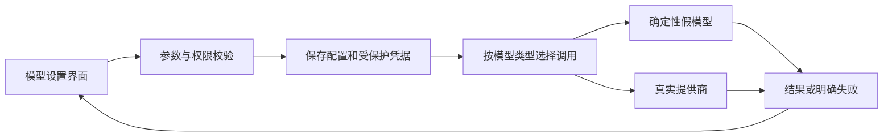

# `S4`：配置模型，并让调用可以验证

[目录](./00-目录.md) · [上一章](./05-S3-登录与租户隔离.md) · [下一章](./07-S5-知识库管理.md)

## 1. 先分清三类模型

聊天模型负责写回答，向量模型负责把内容转换成用于检索的数字，重排模型负责给已找到的候选重新排序。三种模型职责不同，不能把一个“模型可调用”的检查当作全部能力通过。

**前置条件：** `S3` 认证与租户隔离通过；`S2` 已有模型结构映射；知道哪些角色能管理模型。

“网关”在这里就是集中调用模型的边界，不需要先建一个独立服务平台。

## 2. 原版入口与目标文件

| 原版路径（仓库根目录起） | 要核对什么 |
| --- | --- |
| `frontend/src/views/settings/ModelSettings.vue` | 表单、列表、连接测试和模型设置交互 |
| `frontend/src/api/model/index.ts` | 模型接口、字段和请求方式 |
| `internal/router/routes_infra.go` | 模型管理及调试路由权限 |
| `internal/handler/model.go`、`model_credentials.go` | 请求校验、凭据处理与响应 |
| `internal/types/model.go` | 模型类型、配置与数据含义 |
| `internal/application/repository/model.go` | 模型存取与租户查询 |

目标后端位置相对于 `refactor/python/backend/`，建立 `app/api/v1/routes/models.py`、`app/api/v1/schemas/models.py`、`app/services/models.py`、`app/repositories/models.py`、`app/integrations/models/`。假模型优先放测试夹具；开发联调需要时再提供明确启用的测试适配。

目标前端在 `src/api/model/`、`src/types/`、`src/views/settings/` 实现对应内容。原版设置是全局弹窗，不另建一套重复设置页面。

## 3. 按顺序完成任务

### `S4.1` 固定模型配置契约

**输入：** 原版表单、接口和模型类型。

1. 记录聊天、向量、重排各自的字段及必填条件。
2. 区分模型显示名称、提供商标识、调用模型名、连接地址与凭据。
3. 记录创建、读取、修改、删除、调试和默认选择的真实请求。
4. 核对编辑时未提交凭据、显式删除凭据与更新凭据的不同含义。
5. 梳理当前原版支持的提供商清单，先做一条完整调用，剩余逐项记为待补齐。

**结果：** 可以明确一份配置能用于哪类任务。

**检查：** 不能用新增字段或统一响应结构掩盖原版差异。

### `S4.2` 建立确定性假模型

**输入：** 三类模型实际调用所需的最小输入与输出。

1. 聊天固定返回可识别答案，后续可按固定片段模拟流。
2. 向量固定维度、固定映射；相同输入必须得到相同结果，不依赖进程随机哈希。
3. 重排为固定测试候选给出可预测顺序和分数。
4. 提供可注入的超时、无效响应和认证失败，便于验证错误路径。
5. 不把测试替身注册成对所有用户默认开放的生产模型。

**结果：** 无真实模型凭据也能检验应用编排。

**检查：** 同一测试重复运行结果不漂移；假向量结果不被当作语义质量证明。

### `S4.3` 实现配置的持久化与权限

**输入：** 模型映射、可信租户上下文和契约样例。

1. 仓储按当前授权范围查询，不只按模型主键读取。
2. 服务校验类型、参数和可见范围，写入时使用事务。
3. 保存凭据时遵循既有安全存储策略；普通列表与详情返回脱敏信息。
4. 更新时保留未变更字段，避免表单未提交密钥就把旧凭据清空。
5. 删除前核对引用和默认配置规则，按原版拒绝或清理，不能留悬空引用。

**结果：** 重启后配置仍在，其他空间不能任意查看或修改。

**检查：** 响应、日志、异常和构建产物不包含完整模型密钥。

### `S4.4` 用一个真实适配完成调用边界

**输入：** 假模型已覆盖的调用接口，以及一个已选提供商。

1. 把地址、凭据、超时等处理集中到适配层，业务服务不拼厂商请求。
2. 校验上游响应结构，区分认证失败、连接失败、限流、超时和无效响应。
3. 明确重试条件，避免无条件重试可能产生重复费用的生成请求。
4. 校验向量数量、维度和有效数值，确保与保存配置及后续索引一致。
5. 模型连接地址属于外部输入；按部署允许范围校验协议与目标，不能让普通用户任意探测内部服务。

**结果：** 服务可以替换假模型和真实模型，调用者不需要改变业务流程。

**检查：** 断开上游后得到明确失败，不返回一个假成功答案。

### `S4.5` 实现连接测试与调试反馈

**输入：** 原版调试接口、权限和页面反馈。

1. 使用正确模型类型的小输入执行测试，限制调用时间和资源。
2. 返回原版格式的成功信息或可理解失败，保留服务端诊断关联标识。
3. 失败中不泄露凭据或完整内部请求。
4. 确认连接测试不会擅自覆盖用户尚未保存的配置。
5. 涉及真实模型时明确使用测试凭据，并单独记录结果。

**结果：** 用户能知道配置失败在哪一层。

**检查：** 聊天成功不能代替向量或重排能力通过，分别验证。

### `S4.6` 复刻设置弹窗与表单

**输入：** 原版模型设置截图和操作记录。

1. 从平台设置入口打开同一弹窗，保留分类和导航语义。
2. 使用原版组件、主题和字段布局，`Tailwind` 负责外层排列与间距。
3. 按模型类型显示正确字段，提供加载、空态、失败和提交中状态。
4. 保存成功刷新列表，失败保留用户输入；密钥字段遵循原版保留与清除语义。
5. 默认选择、删除确认、调试结果以及暗色状态逐一对照。

**结果：** 页面能管理真实持久配置，而非只改变本地数组。

**检查：** 切空间后看不到上一空间模型；无管理权限的操作由后端拒绝。

### `S4.7` 建立测试与阶段证据

**输入：** 假模型、真实适配与页面。

1. 默认测试仅使用假模型，验证成功、超时、无效响应与错误类型映射。
2. 验证编辑保留凭据、显式更新、显式清除以及列表脱敏。
3. 验证跨租户、角色、删除引用和默认模型一致性。
4. 真实模型测试使用显式 `RUN_REAL_LLM=1` 与独立凭据，不混入默认测试。
5. 将未支持的原版提供商和能力列入完整性记录，后续必须补齐。

**结果：** 调用成功、配置正确和质量验收有各自证据。

**检查：** 报告不能只写“模型连通”，而应说明哪种模型、哪种环境和测试路径。

## 4. 成功与失败案例

**成功：** 新建向量模型配置 → 连接测试 → 保存 → 重启后重新读取；假模型重复输入得到一致维度和结果。

**失败：** 使用无效凭据或模拟超时，页面显示对应错误；列表不泄露密钥，失败不会把原有有效配置清空。

## 5. 验收与卡点

- [ ] 三种模型职责、字段和调用边界明确。
- [ ] 配置持久化、权限、凭据更新及脱敏通过。
- [ ] 假模型稳定，默认测试不依赖公网或真实费用。
- [ ] 上游失败、无效向量和超时可控。
- [ ] 设置弹窗和所有操作状态与原版比较。
- [ ] 结果、待支持能力登记到[进度记录](./13-进度与验收记录.md)。

| 现象 | 先检查 |
| --- | --- |
| 保存后不能调用 | 模型类型、提供商模型名、地址与凭据 |
| 编辑后原凭据丢失 | 缺省字段与清除字段的区分 |
| 测试偶发失败 | 是否混入真实服务、随机输出或无上限重试 |
| 向量能返回却不能建索引 | 数量、维度、数值类型和索引配置 |

自测：为什么“连接成功”不能证明检索会找到正确资料？
