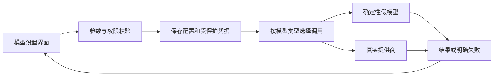

# `S4`：配置模型，并让调用可以验证

[目录](./00-目录.md) · [上一章](./05-S3-登录与租户隔离.md) · [下一章](./07-S5-知识库管理.md)

## 1. 先分清三类模型

聊天模型负责写回答，向量模型负责把内容转换成用于检索的数字，重排模型负责给已找到的候选重新排序。三种模型职责不同，不能把一个“模型可调用”的检查当作全部能力通过。

**前置条件：** `S3` 认证与租户隔离通过；`S2` 已有模型结构映射；知道哪些角色能管理模型。

“网关”在这里就是集中调用模型的边界，不需要先建一个独立服务平台。

## 2. 原版入口与目标文件

| 原版路径（仓库根目录起） | 要核对什么 |
| --- | --- |
| `frontend/src/views/settings/ModelSettings.vue` | 表单、列表、连接测试和模型设置交互 |
| `frontend/src/api/model/index.ts` | 模型接口、字段和请求方式 |
| `internal/router/routes_infra.go` | 模型管理及调试路由权限 |
| `internal/handler/model.go`、`model_credentials.go` | 请求校验、凭据处理与响应 |
| `internal/types/model.go` | 模型类型、配置与数据含义 |
| `internal/application/repository/model.go` | 模型存取与租户查询 |

目标后端位置相对于 `refactor/python/backend/`，建立 `app/api/v1/routes/models.py`、`app/api/v1/schemas/models.py`、`app/services/models.py`、`app/repositories/models.py`、`app/integrations/models/`。假模型优先放测试夹具；开发联调需要时再提供明确启用的测试适配。

目标前端在 `src/api/model/`、`src/types/`、`src/views/settings/` 实现对应内容。原版设置是全局弹窗，不另建一套重复设置页面。

## 3. 按顺序完成任务

### `S4.1` 固定模型配置契约

**输入：** 原版表单、接口和模型类型。

1. 记录聊天、向量、重排各自的字段及必填条件。
2. 区分模型显示名称、提供商标识、调用模型名、连接地址与凭据。
3. 记录创建、读取、修改、删除、调试和默认选择的真实请求。
4. 核对编辑时未提交凭据、显式删除凭据与更新凭据的不同含义。
5. 梳理当前原版支持的提供商清单，先做一条完整调用，剩余逐项记为待补齐。

#### 从表单字段追到实际调用参数

“显示名称”给人识别配置，“调用模型名”交给提供商；两者可能完全不同。先选原版支持的一种模型，把这两个值分别追踪到保存与调用位置。

1. 在 `app/api/v1/schemas/models.py` 先描述创建输入和读取输出，凭据字段不要直接复用为列表输出。
2. 每种类型列出输入条件、默认值、上游所需参数；区分“字段没提交”和“显式清空”。
3. 用原版样例建立三行调用关系：聊天输入与回答、文本数组与向量数组、问题候选与评分排序。
4. 核对提供商配置哪些字段通用、哪些只属于某个提供商，不为了统一把不支持的选项发给所有厂商。

**小结果：** 一份配置可以明确解释保存在哪里、调用时读哪些值、页面能显示哪些值。若字段看起来重复，先查用途，不急着删掉以简化接口。

**结果：** 可以明确一份配置能用于哪类任务。

**检查：** 不能用新增字段或统一响应结构掩盖原版差异。

### `S4.2` 建立确定性假模型

**输入：** 三类模型实际调用所需的最小输入与输出。

1. 聊天固定返回可识别答案，后续可按固定片段模拟流。
2. 向量固定维度、固定映射；相同输入必须得到相同结果，不依赖进程随机哈希。
3. 重排为固定测试候选给出可预测顺序和分数。
4. 提供可注入的超时、无效响应和认证失败，便于验证错误路径。
5. 不把测试替身注册成对所有用户默认开放的生产模型。

#### 让模型替身接入真实业务调用位置

测试替身应替换外部调用，不替换整个业务服务。这样测试仍会执行真实权限、参数检查和结果处理，只是不访问收费服务。

1. 找到服务调用模型的唯一边界，在测试夹具中提供同样输入输出的替身；无须先建立通用插件平台。
2. 聊天替身记录收到的问题与上下文，返回固定答案；断言输入正确，而不只断言页面出现固定句子。
3. 向量替身按预先定义的文本映射输出固定维度列表，未知样本明确处理，不使用运行时随机哈希。
4. 重排替身保持候选身份对应关系，返回可预测排序；重复分数的处理按调用契约核对。
5. 为每类调用分别注入抛错、无效结构和受控超时，确认服务不会将其转换成正常空结果。

**检查：** 默认测试在断网时仍可执行，业务服务确实调用了替身；替身未配置时不自动退回真实模型。开发联调启用方式与生产配置明确分开。

**结果：** 无真实模型凭据也能检验应用编排。

**检查：** 同一测试重复运行结果不漂移；假向量结果不被当作语义质量证明。

### `S4.3` 实现配置的持久化与权限

**输入：** 模型映射、可信租户上下文和契约样例。

1. 仓储按当前授权范围查询，不只按模型主键读取。
2. 服务校验类型、参数和可见范围，写入时使用事务。
3. 保存凭据时遵循既有安全存储策略；普通列表与详情返回脱敏信息。
4. 更新时保留未变更字段，避免表单未提交密钥就把旧凭据清空。
5. 删除前核对引用和默认配置规则，按原版拒绝或清理，不能留悬空引用。

#### 保存配置时把公开信息与凭据分开处理

先完成 `app/repositories/models.py` 的授权查询，再在 `app/services/models.py` 组织保存。只知道一个模型标识不代表可以读取或使用其凭据。

1. 仓储接收可信范围查询配置；服务验证创建、修改或删除权限，避免页面之外的调用绕过限制。
2. 保存时将普通字段与凭据更新意图分别判断，采用项目既定凭据存储方式，不发明新的不兼容格式。
3. 未提交凭据时保留旧值，显式更新才替换，清除按原版规则处理；展示掩码永远不能被当真实密钥写回。
4. 提交成功后通过响应模式生成脱敏结果；不能将仓储实体直接序列化到浏览器。
5. 删除前查询使用此模型的关联与默认选择，按原版完成拒绝或更新；失败时保留原有效关系。

**具体样本：** 创建配置后仅改显示名，再调用模型检查旧凭据仍生效；随后分别测试更新、允许的清除及越权读取。证据只记录结果，不记录凭据原文。

**结果：** 重启后配置仍在，其他空间不能任意查看或修改。

**检查：** 响应、日志、异常和构建产物不包含完整模型密钥。

### `S4.4` 用一个真实适配完成调用边界

**输入：** 假模型已覆盖的调用接口，以及一个已选提供商。

1. 把地址、凭据、超时等处理集中到适配层，业务服务不拼厂商请求。
2. 校验上游响应结构，区分认证失败、连接失败、限流、超时和无效响应。
3. 明确重试条件，避免无条件重试可能产生重复费用的生成请求。
4. 校验向量数量、维度和有效数值，确保与保存配置及后续索引一致。
5. 模型连接地址属于外部输入；按部署允许范围校验协议与目标，不能让普通用户任意探测内部服务。

#### 一个适配器先闭环，再扩展提供商

适配器负责把项目内部调用转换成一个提供商接受的请求，并把响应转回项目需要的结果。业务服务不应该知道厂商的响应嵌套层级。

1. 在 `app/integrations/models/` 选定一种现有提供商协议，输入已授权配置与任务数据，输出对应类型结果或明确错误。
2. 发请求前验证地址策略及类型参数，配置有限超时；按部署规则允许需要的内部模型服务，而不是简单允许任意目标。
3. 收到响应先检查状态，再解析结构，最后检查业务内容：向量条数对应输入条数、维度匹配、数值有效。
4. 将上游错误映射为可诊断类别；保留内部关联标识，但不要把厂商原始响应中的密钥和受保护文本整体输出。
5. 用本地模拟响应先测成功、限流、超时与结构错误，再使用明确开启的真实测试验证协议。

**排错顺序：** 配置是否读对 → 请求是否到上游 → 上游是否成功 → 响应是否能解析 → 结果是否满足当前类型。不能因为收到 `200` 就接受任意正文。

**结果：** 服务可以替换假模型和真实模型，调用者不需要改变业务流程。

**检查：** 断开上游后得到明确失败，不返回一个假成功答案。

### `S4.5` 实现连接测试与调试反馈

**输入：** 原版调试接口、权限和页面反馈。

1. 使用正确模型类型的小输入执行测试，限制调用时间和资源。
2. 返回原版格式的成功信息或可理解失败，保留服务端诊断关联标识。
3. 失败中不泄露凭据或完整内部请求。
4. 确认连接测试不会擅自覆盖用户尚未保存的配置。
5. 涉及真实模型时明确使用测试凭据，并单独记录结果。

#### 连接测试沿用调用适配，不另写一套请求

连接测试证明某种配置能完成一次受限调用，不证明生成质量，也不等于配置已经保存。

1. 先核对原版调试接口接受已存配置标识还是未保存参数，再实现路由与请求模式；两种路径的凭据读取责任不同。
2. 服务执行同样权限和参数检查，然后调用上一任务的适配器；不要在调试路由直接拼厂商请求。
3. 聊天使用固定短问题；向量使用固定短文本并检查数量维度；重排使用固定问题和少量候选。
4. 将成功或失败映射为原版反馈结构，响应只包含页面需要的内容和允许的诊断信息。
5. 测试完成后重新读取持久配置，确认未保存的编辑没有被调试动作悄悄写入。

**检查：** 按三种模型分别验收，设置超时后请求能结束且页面按钮恢复。错误可定位到连接、鉴权或结构层，而不统一提示“模型不可用”后丢失内部原因。

**结果：** 用户能知道配置失败在哪一层。

**检查：** 聊天成功不能代替向量或重排能力通过，分别验证。

### `S4.6` 复刻设置弹窗与表单

**输入：** 原版模型设置截图和操作记录。

1. 从平台设置入口打开同一弹窗，保留分类和导航语义。
2. 使用原版组件、主题和字段布局，`Tailwind` 负责外层排列与间距。
3. 按模型类型显示正确字段，提供加载、空态、失败和提交中状态。
4. 保存成功刷新列表，失败保留用户输入；密钥字段遵循原版保留与清除语义。
5. 默认选择、删除确认、调试结果以及暗色状态逐一对照。

#### 设置弹窗按读取、编辑、调试、保存逐个接

先保留原版设置入口和弹窗层级，让模型页成为其中一项，不同时新建另一条路由。

1. `src/api/model/` 先接列表，页面只展示脱敏数据；零条配置显示空态，加载失败显示重试，不能都显示空列表。
2. 打开编辑时加载真实详情，再复制为本地表单状态；取消仅丢弃本地编辑，不修改列表对象。
3. 类型切换按契约切换适用字段，处理不再适用的旧值，避免隐藏字段仍被误提交。
4. 调试与保存分别维护进行中状态；调试成功只展示本次结果，保存成功才更新已持久状态。
5. 保存失败保留表单，保存成功重新获取脱敏记录；不要把请求中的明文凭据塞进列表缓存。

**检查：** 编辑后取消再打开，恢复服务端原值；切空间后旧详情不得回填新空间表单；无权限调用仍被后端拒绝，即使界面按钮已隐藏。

**结果：** 页面能管理真实持久配置，而非只改变本地数组。

**检查：** 切空间后看不到上一空间模型；无管理权限的操作由后端拒绝。

### `S4.7` 建立测试与阶段证据

**输入：** 假模型、真实适配与页面。

1. 默认测试仅使用假模型，验证成功、超时、无效响应与错误类型映射。
2. 验证编辑保留凭据、显式更新、显式清除以及列表脱敏。
3. 验证跨租户、角色、删除引用和默认模型一致性。
4. 真实模型测试使用显式 `RUN_REAL_LLM=1` 与独立凭据，不混入默认测试。
5. 将未支持的原版提供商和能力列入完整性记录，后续必须补齐。

#### 把“配置正确”“协议正确”“质量正确”分开验

默认测试要回答配置与编排是否正确，真实调用测试回答适配是否能连接提供商，后续检索和问答样本才检查模型实际效果。

1. 在配置接口测试中完成创建 → 读取 → 更新 → 重读 → 删除，并比较字段、权限和凭据更新行为。
2. 在适配测试中提供固定上游响应，断言有效输入输出关系及错误分类，特别检查向量条数和维度。
3. 在页面流程中验证调试失败后可修改再试，保存失败不丢输入，取消不保存。
4. 真实测试显式开启后记录提供商、模型类型、配置版本与结果，测试报告不包含密钥或完整请求头。
5. 将未测提供商逐项标记，不用一种模型成功覆盖整个清单。

**执行位置：** 后端在 `python/backend/` 运行本章实际创建的模型测试路径，前端在对应工程执行检查和构建。若默认测试开始访问公网，先修复替身注入，不继续用真实费用完成默认回归。

**结果：** 调用成功、配置正确和质量验收有各自证据。

**检查：** 报告不能只写“模型连通”，而应说明哪种模型、哪种环境和测试路径。

## 4. 成功与失败案例

**成功：** 新建向量模型配置 → 连接测试 → 保存 → 重启后重新读取；假模型重复输入得到一致维度和结果。

**失败：** 使用无效凭据或模拟超时，页面显示对应错误；列表不泄露密钥，失败不会把原有有效配置清空。

## 5. 验收与卡点

- [ ] 三种模型职责、字段和调用边界明确。
- [ ] 配置持久化、权限、凭据更新及脱敏通过。
- [ ] 假模型稳定，默认测试不依赖公网或真实费用。
- [ ] 上游失败、无效向量和超时可控。
- [ ] 设置弹窗和所有操作状态与原版比较。
- [ ] 结果、待支持能力登记到[进度记录](./13-进度与验收记录.md)。

| 现象 | 先检查 |
| --- | --- |
| 保存后不能调用 | 模型类型、提供商模型名、地址与凭据 |
| 编辑后原凭据丢失 | 缺省字段与清除字段的区分 |
| 测试偶发失败 | 是否混入真实服务、随机输出或无上限重试 |
| 向量能返回却不能建索引 | 数量、维度、数值类型和索引配置 |

自测：为什么“连接成功”不能证明检索会找到正确资料？
