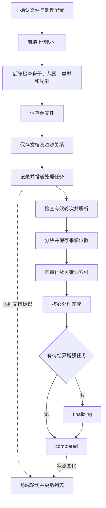

# `S6`：从上传一个文件到获得可检索的片段

[目录](./00-目录.md) · [上一章：知识库管理](./07-S5-知识库管理.md) · [下一章：检索与证据](./09-S7-检索与证据组织.md)

本章回答一个具体问题：用户选中 `采购规则.md` 后，服务器怎样把它变成之后能搜索的资料？先完成一份文本，再接原版解析器和处理分支。

本文是待实现步骤，不代表新工程已经存在。源码路径从仓库根目录计算；目标后端路径相对于 `refactor/python/backend/`，目标前端路径相对于 `refactor/python/frontend/`。任务完成证据统一记录到[进度与验收记录](./13-进度与验收记录.md)。

证据统一存放本目录的 `实践记录/S6/`，不要把未来的验收写成已通过。

## 1. 开始之前与本章出口

进入条件：`S3` 的认证和租户隔离、`S4` 的模型配置与假模型、`S5` 的知识库管理已经验收。准备一个能写入的知识库、一个无权写入它的测试用户、独立文件目录与测试数据库。

自己创建 `采购规则.md`，写两条容易区分的规则，例如“超过十万元的采购由财务负责人复核”和“设备申领由部门主管确认”。这是测试材料，不是原版内置数据。

本章结束时必须能从页面上传材料、观察后台状态、查看解析正文和分块，并在后端检查对应索引记录。下一章才正式验证问题如何命中它。

先区分三个动作：上传是搬运文件；解析是提取文字；建索引是为搜索准备目录。浏览器进度达到 `100%` 只说明传输完成，不能把这三个动作都标成成功。

## 2. 先看原版的输入与输出

| 要确认的事实 | 原版入口 |
| --- | --- |
| 前端队列、取消和轮询 | [上传任务](../../../frontend/src/stores/uploadTasks.ts)、[队列核心](../../../frontend/src/stores/uploadQueue.ts) |
| 上传接口、字段和响应 | [上传入口分析](../文档上传到用户问答全链路/02-上传入口.md)及其对应处理器 |
| 文档状态与业务字段 | [文档类型](../../../internal/types/knowledge.go) |
| 分块、状态汇合和操作语义 | [后台摄取分析](../文档上传到用户问答全链路/03-后台摄取、状态与数据模型.md) |
| 删除及失败恢复 | [删除服务](../../../internal/application/service/knowledge_delete.go)、[巡检服务](../../../internal/application/service/knowledge_housekeeping.go) |
| 解析服务 | [解析器入口](../../../docreader/parser/parser.py)、[服务入口](../../../docreader/main.py) |

参考分析的基线为较早提交；实际实施时以 `S0` 固定版本和对应源码为准，尤其重新核对大小限制、并发数和轮询间隔，不把分析中的默认值当永久常量。

上传入口为 `POST /api/v1/knowledge-bases/{kb_id}/knowledge/file`。表单包含文件 `file`、展示名称 `fileName`，可包含 `tag_ids` 和 `process_config`。后者是表单里的字符串，不能把整个请求误发成普通 `JSON`。

原版上传可能在文档创建成功、后台投递失败时仍返回成功外壳，同时文档状态为 `failed`。必须检查返回的文档状态。逐接口记录真实状态码，不能只照注释推断应该返回 `201`。

## 3. 实现顺序图

这里没有一个能同时撤销文件、数据库、队列和索引的万能事务。每个跨系统边界都要说明：前一步成功而后一步失败时，留下什么，怎样重试或清理。

## 4. 本章逐步新增的文件

这些名称是目标建议，不是当前已经存在的源码；如果前一阶段已有同职责文件，继续扩展。

| 位置 | 只负责什么 |
| --- | --- |
| `app/api/v1/routes/knowledge.py` | 上传、文档状态、取消和重解析的协议适配 |
| `app/api/v1/schemas/knowledge.py` | 原版请求、响应和状态字段 |
| `app/services/knowledge.py` | 上传及处理操作的业务顺序 |
| `app/repositories/knowledge.py`、`chunks.py` | 文档、块、轮次条件更新 |
| `app/storage/local.py` | 安全保存和读取源文件 |
| `app/workers/document.py` | 接收任务，恢复上下文，调用处理服务 |
| `app/integrations/docreader.py` | 调用既有解析服务 |
| `app/services/chunking.py`、`indexing.py` | 确定性分块、模型调用与索引写入 |
| `src/api/knowledge/` | 前端文档操作请求 |
| `src/stores/uploadTasks.ts` | 跨页面的上传与解析跟踪 |
| `src/views/knowledge/` | 原版文件列表、确认框、状态和预览 |
| `tests/unit/`、`tests/contract/`、`tests/e2e/` | 纯逻辑、契约、上传到索引的验证 |

别先创建全部空文件。下面每做一步，再建立该步需要的文件。

## 5. 按顺序完成十个任务

### 5.1 `S6.1`：冻结一次真实上传

**输入：** 有权限的知识库和测试文件。

1. 在原版上传文件，在网络面板记录表单字段、返回体和后续状态查询。
2. 再上传相同内容、同名不同内容、非法类型，记录差异。
3. 在契约记录里列出文件类型、大小、配额、标签与解析配置的校验位置。
4. 明确展示文件名、逻辑文件夹与物理存储路径是三种概念。

**结果与检查：** 有一份脱敏的上传样例与失败样例；不会把“名称一样”当成内容去重依据，也不会信任客户端提供的磁盘路径。

### 5.2 `S6.2`：先实现安全保存和受保护读取

**输入：** 经过基本边界校验的文件流及可信租户上下文。

1. 在存储实现中生成服务器控制的存储标识，限制实际写入目录。
2. 检查真实类型、大小和可用配额；文件扩展名只是一项输入，不能代替内容校验。
3. 保存原件并记录资源引用。读取时通过受保护接口验证文档权限，不暴露任意文件路径。
4. 添加保存失败、恶意文件名、同名不同内容测试。

**结果与检查：** 一份文件能写入并由有权限用户读取；无权限用户即使知道标识也不能下载。先不调用解析器。

### 5.3 `S6.3`：把文件和文档记录关联起来

**输入：** 已保存源文件和原版文档字段定义。

1. 在服务中处理知识库类型、模型关联、内容哈希和去重规则。
2. 用数据库事务保存文档、标签与资源关系，设置原版初始状态。
3. 若数据库写入失败，尝试清理本次新保存的孤立文件；补偿失败必须可追踪。
4. 按契约返回真实文档标识，而不是内存数组位置或展示文件名。

**结果与检查：** 重启服务后仍能查到记录及源文件；重复上传按原版约定处理，不能跨知识库或租户错误合并。

### 5.4 `S6.4`：加入持久任务状态，再执行后台工作

**输入：** 文档标识、租户、处理配置与当前处理轮次。

1. 记录可恢复的处理事实，再投递任务。队列不可用时把失败写回，保持原版对外响应语义。
2. 后台入口重新加载文档和权限上下文，不相信投递时的旧对象仍有效。
3. 开始工作前检查文档是否已取消、正在删除或被新轮次取代。
4. 先用可控的测试执行器跑一个任务；明确进程退出后如何识别未完成任务。
5. 生产队列可以在 `S10` 收口，但内存执行不能被描述成持久队列。

**结果与检查：** 上传请求无需等待整篇解析；后台未启动或投递失败都能从状态中看见。强制投递失败不能留下永远“处理中”的记录。

### 5.5 `S6.5`：从文本解析过渡到原版解析服务

**输入：** 安全资源引用和处理配置。

1. 用自己的短文本实现最小解析，保留正文与来源信息。
2. 接入 `docreader`，根据其协议获取正文、元数据、图片与来源块。
3. 区分解析器不支持方法与真正调用失败；只有原版允许的情形才回退调用方式。
4. 逐个加入基线支持的格式，先测试文本型 `PDF`，再测试扫描件和办公文档。
5. 记录超时、损坏文件、空正文和部分图片失败；不要把空结果一律当正常成功。

**结果与检查：** 可以查看规范化正文，页码或段落信息没有在清洗时丢失。大文件仍受内存和大小限制，使用流协议不等于没有内存上限。

### 5.6 `S6.6`：实现可重复的分块与来源关系

**输入：** 规范化正文、分块参数和来源位置。

1. 先写纯分块函数，用固定文本检查顺序、边界和重叠。
2. 保存块正文、所属文档、顺序、类型和定位信息。
3. 再加入原版父子分块：子块便于精细检索，父块提供完整上下文。
4. 使同一轮重试不会插入第二套同义块；先验证失败后重跑，再验证正常重复执行。
5. 为句子边界、表格、空白和长段落准备小样本。

**结果与检查：** 一个块能回到文档及其位置；重试不重复污染；父子关系不是靠数组位置临时猜出来。

### 5.7 `S6.7`：写索引并处理半成功

**输入：** 已保存块和知识库的模型、索引配置。

1. 按配置调用 `Embedding`，保持写入与将来查询使用同一模型空间。
2. 保存向量或关键词索引，并携带文档、块和权限范围标识。
3. 区分块保存成功与索引写入成功；注入索引失败，验证重跑、替换和清理策略。
4. 同一任务重试必须按稳定标识更新或清理，不重复追加不可区分的记录。
5. 分别记录模型调用重试与队列任务重试，避免叠加成无限调用。

**结果与检查：** 块能回查正文，索引能回查块；故意失败后重新执行不会生成重复候选。假向量只验证流程，不代表语义质量通过。

### 5.8 `S6.8`：用原版状态解释完成程度

保留 `pending`、`processing`、`finalizing`、`completed`、`failed`、`deleting`、`cancelled`。内部任务状态与这个字段分开，不把 `succeeded` 直接返回成文档状态。

| 状态 | 本阶段应怎样处理 |
| --- | --- |
| `pending` | 记录已存在，等待有效任务处理 |
| `processing` | 核心处理进行中，持续更新活动信息 |
| `finalizing` | 核心已完成，仍有计数增强任务；可用性仍需结合启用、索引与权限 |
| `completed` | 主处理和相关计数已收敛，不等于每项增强都成功 |
| `failed` | 保留失败阶段和原因，允许符合条件的重解析 |
| `cancelled` | 停止当前处理轮次，不等于删除原文及所有已生成内容 |
| `deleting` | 禁止旧任务继续写回，等待关联清理 |

增强任务按配置加入；失败、成功或跳过是否释放名额依原版规则实现，不能每次中间重试都减计数。计数归零与有条件状态提升在数据库事务内完成。

**结果与检查：** 一项增强失败能说明自己的结果，主状态不会无限等待；取消后迟到的结算不能把状态改回成功。

### 5.9 `S6.9`：再接前端队列、轮询和预览

1. 先复刻原版单文件确认框，用 `FormData` 发送；浏览器生成上传边界。
2. 传输结束而响应未到时显示保存中，收到文档标识后才进入解析跟踪。
3. 把上传任务放进全局 `Pinia`，切页不丢；列表与上传面板可以有不同的状态呈现，但语义必须一致。
4. 再加入并发、取消、重传、按知识库批量轮询。前端 `generation` 保护清空、重试和切租户后的迟到响应。
5. 只按原版缺失判定策略移除文档，网络失败不等于文档被删除。
6. 复刻状态文案、图标、预览与错误反馈；用 `TDesign` 控件、原版主题和 `Tailwind CSS ^4.3.3` 布局。

**结果与检查：** 用户能分辨“尚未发出、正在传输、保存中、解析中、可用但还在增强、彻底结束”。刷新后从后端恢复任务状态，不能假装浏览器仍持有已经丢失的 `File`。

### 5.10 `S6.10`：补齐重解析、取消和删除

1. 前端重传需要原 `File`；后台重解析使用已保存原件，两者提供不同操作。
2. 重解析按原版清理旧派生内容并开启新 `attempt`；每个后续写入都校验有效轮次。
3. 取消解析记录业务终态并尽力停止执行，保留规则符合原版，不承诺外部模型瞬时中止。
4. 删除先阻止写回，再清理索引、块、资源关联和必要派生数据；关键失败保留可重试记录。
5. 故意暂停旧任务，重解析或删除后再放行旧任务，观察是否复活数据。

**结果与检查：** `/reparse` 与 `/cancel-parse` 按原版完整路径实现；异步删除受理不被误报为所有资源已消失。共享 `Wiki` 来源按引用关系清理，不能整页误删。

## 6. 联调和失败验收表

| 操作 | 必须看到的结果 |
| --- | --- |
| 正常上传测试文档 | 真实标识、可读原件、稳定分块、对应索引与终态 |
| 无权限上传 | 拒绝且不留下可读孤立文件 |
| 文件保存后数据库失败 | 补偿或明确的待清理记录 |
| 数据库成功但任务投递失败 | 文档失败可见，不只看响应外壳 |
| 块成功但索引失败 | 可重跑，重复索引不增长 |
| 取消或重解析后放行旧任务 | 旧轮次不能写回正文、状态或计数 |
| 删除途中清理失败 | 记录可重试，不复活、不丢失追踪依据 |
| 切租户时上传返回 | 旧响应不进入新空间界面 |
| 进程重启 | 已声明的恢复策略实际生效，不能无声丢任务 |

依赖和测试文件建立后，在后端目录运行本阶段测试，例如 `python -m pytest -q tests/unit tests/contract tests/e2e`；实际选择已创建的文件。前端运行已有状态测试、构建与浏览器流程，不声称本文已经执行这些未来测试。

## 7. 过关清单与今天的最小任务

- [ ] 同一测试文件可以从上传追到原件、文档、块和索引。
- [ ] 已区分前端传输、后台任务和文档状态。
- [ ] 权限、半成功、重复执行和旧轮次回写都有失败证据。
- [ ] 取消、重解析、删除不会互相替代。
- [ ] 原版上传弹窗、列表与预览状态已逐项截图对照。
- [ ] 已把支持格式和未完成增强记录到 `S9` 清单，没有默默删减。

今天只做 `S6.1–S6.3`：保存一份文件并取得可重新查询的文档标识。交付一条正常上传和一条无权限失败的证据，再进入后台解析。

如果卡住，沿“请求 → 文档记录 → 当前轮次 → 解析输出 → 块 → 索引 → 状态”查找第一个缺失结果，不先增加轮询时间。

完成上述出口后，进入[检索与证据组织](./09-S7-检索与证据组织.md)。
