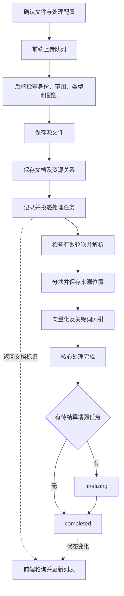

# `S6`：从上传一个文件到获得可检索的片段

[目录](./00-目录.md) · [上一章：知识库管理](./07-S5-知识库管理.md) · [下一章：检索与证据](./09-S7-检索与证据组织.md)

本章回答一个具体问题：用户选中 `采购规则.md` 后，服务器怎样把它变成之后能搜索的资料？先完成一份文本，再接原版解析器和处理分支。

本文是待实现步骤，不代表新工程已经存在。源码路径从仓库根目录计算；目标后端路径相对于 `refactor/python/backend/`，目标前端路径相对于 `refactor/python/frontend/`。任务完成证据统一记录到[进度与验收记录](./13-进度与验收记录.md)。

证据统一存放本目录的 `实践记录/S6/`，不要把未来的验收写成已通过。

细化学习顺序见[14 全链路 60 步实践路线](./14-全链路60步实践路线.md)的步骤 `08–21`，每步映射回本章任务，配套原理阅读、可见产物与理解检查。

## 1. 开始之前与本章出口

进入条件：`S3` 的认证和租户隔离、`S4` 的模型配置与假模型、`S5` 的知识库管理已经验收。准备一个能写入的知识库、一个无权写入它的测试用户、独立文件目录与测试数据库。

自己创建 `采购规则.md`，写两条容易区分的规则，例如“超过十万元的采购由财务负责人复核”和“设备申领由部门主管确认”。这是测试材料，不是原版内置数据。

本章结束时必须能从页面上传材料、观察后台状态、查看解析正文和分块，并在后端检查对应索引记录。下一章才正式验证问题如何命中它。

先区分三个动作：上传是搬运文件；解析是提取文字；建索引是为搜索准备目录。浏览器进度达到 `100%` 只说明传输完成，不能把这三个动作都标成成功。

## 2. 先看原版的输入与输出

| 要确认的事实 | 原版入口 |
| --- | --- |
| 前端队列、取消和轮询 | [上传任务](../../../frontend/src/stores/uploadTasks.ts)、[队列核心](../../../frontend/src/stores/uploadQueue.ts) |
| 上传接口、字段和响应 | [上传入口分析](../文档上传到用户问答全链路/02-上传入口.md)及其对应处理器 |
| 文档状态与业务字段 | [文档类型](../../../internal/types/knowledge.go) |
| 分块、状态汇合和操作语义 | [后台摄取分析](../文档上传到用户问答全链路/03-后台摄取、状态与数据模型.md) |
| 删除及失败恢复 | [删除服务](../../../internal/application/service/knowledge_delete.go)、[巡检服务](../../../internal/application/service/knowledge_housekeeping.go) |
| 解析服务 | [解析器入口](../../../docreader/parser/parser.py)、[服务入口](../../../docreader/main.py) |

参考分析的基线为较早提交；实际实施时以 `S0` 固定版本和对应源码为准，尤其重新核对大小限制、并发数和轮询间隔，不把分析中的默认值当永久常量。

上传入口为 `POST /api/v1/knowledge-bases/{kb_id}/knowledge/file`。表单包含文件 `file`、展示名称 `fileName`，可包含 `tag_ids` 和 `process_config`。后者是表单里的字符串，不能把整个请求误发成普通 `JSON`。

原版上传可能在文档创建成功、后台投递失败时仍返回成功外壳，同时文档状态为 `failed`。必须检查返回的文档状态。逐接口记录真实状态码，不能只照注释推断应该返回 `201`。

## 3. 实现顺序图

这里没有一个能同时撤销文件、数据库、队列和索引的万能事务。每个跨系统边界都要说明：前一步成功而后一步失败时，留下什么，怎样重试或清理。

## 4. 本章逐步新增的文件

这些名称是目标建议，不是当前已经存在的源码；如果前一阶段已有同职责文件，继续扩展。

| 位置 | 只负责什么 |
| --- | --- |
| `app/api/v1/routes/knowledge.py` | 上传、文档状态、取消和重解析的协议适配 |
| `app/api/v1/schemas/knowledge.py` | 原版请求、响应和状态字段 |
| `app/services/knowledge.py` | 上传及处理操作的业务顺序 |
| `app/repositories/knowledge.py`、`chunks.py` | 文档、块、轮次条件更新 |
| `app/storage/local.py` | 安全保存和读取源文件 |
| `app/workers/document.py` | 接收任务，恢复上下文，调用处理服务 |
| `app/integrations/docreader.py` | 调用既有解析服务 |
| `app/services/chunking.py`、`indexing.py` | 确定性分块、模型调用与索引写入 |
| `src/api/knowledge/` | 前端文档操作请求 |
| `src/stores/uploadTasks.ts` | 跨页面的上传与解析跟踪 |
| `src/views/knowledge/` | 原版文件列表、确认框、状态和预览 |
| `tests/unit/`、`tests/contract/`、`tests/e2e/` | 纯逻辑、契约、上传到索引的验证 |

别先创建全部空文件。下面每做一步，再建立该步需要的文件。

## 5. 按顺序完成十个任务

### 5.1 `S6.1`：冻结一次真实上传

**输入：** 有权限的知识库和测试文件。

1. 在原版上传文件，在网络面板记录表单字段、返回体和后续状态查询。
2. 再上传相同内容、同名不同内容、非法类型，记录差异。
3. 在契约记录里列出文件类型、大小、配额、标签与解析配置的校验位置。
4. 明确展示文件名、逻辑文件夹与物理存储路径是三种概念。

**结果与检查：** 有一份脱敏的上传样例与失败样例；不会把“名称一样”当成内容去重依据，也不会信任客户端提供的磁盘路径。

#### 实现拆解：先拿到能够复放的请求

1. 在 `实践记录/S6/` 保存自制的采购文件，固定正文；之后测试只改变一种条件，避免文件内容和配置一起变化。
2. 在浏览器网络面板筛选上传请求，分别抄出路径参数、请求头、表单字段。`multipart/form-data` 表示一份请求里可以同时装文件和文字字段，不是把文件名写进 `JSON` 就完成上传。
3. 打开前端上传函数，逐项对应 `FormData.append` 的键与处理器读取的键；为 `process_config` 标注“对象先序列化成字符串”，为文件标注“实际字节内容”。
4. 把成功响应中前端真正读取的字段逐一标到状态处理函数上，追踪文档标识怎样进入后续批量查询。不要把整个响应都当文档对象。
5. 在 `tests/contract/` 准备这一份请求及预期结构的夹具；将动态标识与时间单独断言，不能把某次运行的标识固定成永远的期望值。
6. 用相同夹具再构造无权限、缺文件、非法配置三种请求；先记录原版响应，再写新接口的断言。

**这一小段接通的边界：** 文件选择 → 前端表单 → 后端参数读取。先不接解析器和队列；本步交付的是可复现的协议输入。

**卡住时查：** 若后端认为没有文件，先检查表单键与请求类型；若配置丢失，查字符串序列化与服务端解析位置，不先调整分块参数。

### 5.2 `S6.2`：先实现安全保存和受保护读取

**输入：** 经过基本边界校验的文件流及可信租户上下文。

1. 在存储实现中生成服务器控制的存储标识，限制实际写入目录。
2. 检查真实类型、大小和可用配额；文件扩展名只是一项输入，不能代替内容校验。
3. 保存原件并记录资源引用。读取时通过受保护接口验证文档权限，不暴露任意文件路径。
4. 添加保存失败、恶意文件名、同名不同内容测试。

**结果与检查：** 一份文件能写入并由有权限用户读取；无权限用户即使知道标识也不能下载。先不调用解析器。

#### 实现拆解：先做写入，再做按权限读取

1. 在 `app/storage/local.py` 定义保存操作：接收已校验的字节流和服务器生成的存储身份，返回后续能够重新读取的资源引用；显示文件名只作为元数据。
2. 在 `app/services/knowledge.py` 先调用 `S3` 的可信上下文与知识库写权限检查，再读取上传内容。类型、大小、配额的最终判断留在服务端。
3. 读取时按块累计实际字节数，达到限制就停止并清理本次临时内容；不能只相信客户端声明的大小，也不要为了得到大小先把任意大文件全部装进内存。
4. 保存完成后关闭文件句柄，再返回资源引用；中途写入失败时让异常传回服务，不能返回一个不存在的路径。
5. 读取入口只接收契约中的资源身份，由服务查绑定关系并授权，存储层再读取实际位置。浏览器传来的任意路径不进入磁盘读取函数。
6. 在独立测试目录写入采购文件，先用 `S2` 的数据库夹具建立真实文档与资源绑定，再通过受保护接口读回并比较字节；完整上传后自动建立绑定的闭环在 `S6.3` 验证。文件名改成 `../采购规则.md` 时，存储根目录外不能出现文件。

**下一步的输入：** 原件已可靠保存及其资源引用，交给 `S6.3` 建立文档关系。读取功能以真实绑定关系为准，不新增临时开放下载端点。

**失败检查：** 强制存储写入报错，断言没有成功资源响应；换用户下载，断言未返回文件正文。检查对象是文件和响应，不只是日志写了“拒绝”。

### 5.3 `S6.3`：把文件和文档记录关联起来

**输入：** 已保存源文件和原版文档字段定义。

1. 在服务中处理知识库类型、模型关联、内容哈希和去重规则。
2. 用数据库事务保存文档、标签与资源关系，设置原版初始状态。
3. 若数据库写入失败，尝试清理本次新保存的孤立文件；补偿失败必须可追踪。
4. 按契约返回真实文档标识，而不是内存数组位置或展示文件名。

**结果与检查：** 重启服务后仍能查到记录及源文件；重复上传按原版约定处理，不能跨知识库或租户错误合并。

#### 实现拆解：把三类身份放到同一条记录链上

1. 在 `app/repositories/knowledge.py` 先实现按原结构保存和查询文档；把资源绑定、标签关联需要的字段从现有实体和迁移中列出来，再写映射。
2. 在服务中计算或接收受控的内容哈希；哈希是文件内容的指纹，用来判断内容是否相同，不是文档权限凭据，也不是密码验证方式。
3. 查询重复内容时带上原版规定的知识库及归属范围；分别测试同名不同内容、异名相同内容、不同租户相同内容，不能跨范围合并资源。
4. 将文档及必要关联写入同一数据库事务，提交后再将真实文档标识放入响应。资源引用与文档标识各有用途，不能互相冒充。
5. 数据库写入失败时，只清理本次新保存且未被其他记录使用的资源；清理失败保留可定位信息，不能掩盖最初的保存失败。
6. 用返回的文档标识再次调用详情和下载；关闭并重建数据库连接后重复查询，证明绑定关系不是临时字典。

**本步完成后的链：** 租户 → 知识库 → 文档记录 → 资源引用 → 原文件。每个箭头都应能用一条实际查询证明。

**排错顺序：** 有文件没记录查事务和补偿；有记录读不到文件查资源绑定与存储配置；重复上传异常查去重范围，别只比较文件名。

### 5.4 `S6.4`：加入持久任务状态，再执行后台工作

**输入：** 文档标识、租户、处理配置与当前处理轮次。

1. 记录可恢复的处理事实，再投递任务。队列不可用时把失败写回，保持原版对外响应语义。
2. 后台入口重新加载文档和权限上下文，不相信投递时的旧对象仍有效。
3. 开始工作前检查文档是否已取消、正在删除或被新轮次取代。
4. 先用可控的测试执行器跑一个任务；明确进程退出后如何识别未完成任务。
5. 生产队列可以在 `S10` 收口，但内存执行不能被描述成持久队列。

**结果与检查：** 上传请求无需等待整篇解析；后台未启动或投递失败都能从状态中看见。强制投递失败不能留下永远“处理中”的记录。

#### 实现拆解：把“收到请求”与“执行处理”分开

1. 在 `app/workers/document.py` 建立任务入口，输入只携带需要重新查证的文档身份、可信执行来源和处理轮次；不要序列化整份已过时的数据库对象。
2. 服务先保存原版要求的处理状态，再调用任务投递操作。投递操作的输出只是受理或任务身份，不是解析结果。
3. 后台入口重新查询文档，核对当前轮次、取消和删除状态；有效才进入处理。`attempt` 表示本次重解析的业务轮次，不是队列第几次重试。
4. 将改变状态的仓储更新加上轮次及允许状态条件；仅在任务开始时检查一次不够，后续写块、写索引及结算还要守住同一边界。
5. 先使用测试执行器接收任务而暂不执行，断言上传已返回、文档仍可查询；再放行任务，观察进入处理状态。
6. 让投递操作报错，按上传接口原有语义写回失败，测试响应外壳与文档状态各自的值；不要为统一响应擅自改契约。
7. 将处理阶段和活动时间接到已有日志或处理记录，能用文档标识找到“尚未执行”与“执行中失败”的区别。

**重启检查：** 在独立环境停止工作进程，重启后查询未完成记录，明确由重新投递、巡检或人工操作恢复；内存任务消失时不能假称自动恢复。

### 5.5 `S6.5`：从文本解析过渡到原版解析服务

**输入：** 安全资源引用和处理配置。

1. 用自己的短文本实现最小解析，保留正文与来源信息。
2. 接入 `docreader`，根据其协议获取正文、元数据、图片与来源块。
3. 区分解析器不支持方法与真正调用失败；只有原版允许的情形才回退调用方式。
4. 逐个加入基线支持的格式，先测试文本型 `PDF`，再测试扫描件和办公文档。
5. 记录超时、损坏文件、空正文和部分图片失败；不要把空结果一律当正常成功。

**结果与检查：** 可以查看规范化正文，页码或段落信息没有在清洗时丢失。大文件仍受内存和大小限制，使用流协议不等于没有内存上限。

#### 实现拆解：先固定解析结果，再替换来源

1. 在 `app/integrations/docreader.py` 明确适配器输入：安全资源读取结果、格式及处理配置；输出保留正文、元数据、来源块和图片信息，以实际协议为准。
2. 先对自制短文本返回确定性解析结果，让处理服务不依赖真实解析进程也能往下走。替身只放测试夹具，产品请求仍走实际配置的解析器。
3. 处理服务收到结果后先检查是否有效，再规范化文本；不要清洗掉页码、段落或图片位置与正文的对应关系。
4. 接真实 `DocReader` 客户端：连接、请求、消费返回、关闭资源逐步完成。先用一页文本型 `PDF` 比对正文，再增加扫描件，不同时切换模型和解析配置。
5. 对流式接口的不支持方法错误才走原版允许的回退；认证失败、超时、损坏内容不能被当作“不支持”反复调用。
6. 将一次解析超时交回处理服务，由服务更新文档失败阶段；适配器不自行操作文档表，避免两层争抢状态。

**可见结果：** 测试中能够查看“解析前原件”和“解析后正文及位置”，下一步直接使用这一份结果分块，无需先接聊天模型。

**定位办法：** 原件正常而正文为空，先查解析器结果与配置；正文正确而页码丢失，查规范化转换，不先修改引用组件。

### 5.6 `S6.6`：实现可重复的分块与来源关系

**输入：** 规范化正文、分块参数和来源位置。

1. 先写纯分块函数，用固定文本检查顺序、边界和重叠。
2. 保存块正文、所属文档、顺序、类型和定位信息。
3. 再加入原版父子分块：子块便于精细检索，父块提供完整上下文。
4. 使同一轮重试不会插入第二套同义块；先验证失败后重跑，再验证正常重复执行。
5. 为句子边界、表格、空白和长段落准备小样本。

**结果与检查：** 一个块能回到文档及其位置；重试不重复污染；父子关系不是靠数组位置临时猜出来。

#### 实现拆解：让每个片段都有正文和来处

1. 在 `app/services/chunking.py` 先写不访问数据库的分块函数：输入规范化正文和已校验参数，输出有顺序的片段及来源映射。纯函数表示同一输入应给出相同结果，便于逐个检查边界。
2. 用采购规则拆出“金额条件”“审批人”“例外”三个相邻内容，记录块边界、重叠和顺序；空白、超长段落与表格各加一份固定输入。
3. 在 `app/repositories/chunks.py` 保存片段时分配稳定身份并记录文档归属，不能用页面数组位置充当永久块标识。
4. 先保存普通块并读回核对，再增加父子块：父块保留上下文，子块指向实际父块身份；父子记录写入顺序和关联约束按真实结构处理。
5. 将块保存接到处理服务的解析输出之后、索引之前；写入前检查当前轮次，在事务内避免旧轮次更新新资料。
6. 同一处理轮次故意执行两遍，分别查块数、顺序、正文和父子关系；以原版幂等策略替换或复用，不能无条件追加第二套。

**下一步的输入：** 已持久化的块及其身份。索引必须使用这批身份，不能自行生成一套无法回查正文的号码。

**失败定位：** 内容缺失查分块边界；重复命中查是否重复存块或父子重复索引；引用错页查解析到分块的来源映射。

### 5.7 `S6.7`：写索引并处理半成功

**输入：** 已保存块和知识库的模型、索引配置。

1. 按配置调用 `Embedding`，保持写入与将来查询使用同一模型空间。
2. 保存向量或关键词索引，并携带文档、块和权限范围标识。
3. 区分块保存成功与索引写入成功；注入索引失败，验证重跑、替换和清理策略。
4. 同一任务重试必须按稳定标识更新或清理，不重复追加不可区分的记录。
5. 分别记录模型调用重试与队列任务重试，避免叠加成无限调用。

**结果与检查：** 块能回查正文，索引能回查块；故意失败后重新执行不会生成重复候选。假向量只验证流程，不代表语义质量通过。

#### 实现拆解：每次先证明一批索引能够回查

1. 在 `app/services/indexing.py` 接收已保存的块和知识库配置，整理标题、正文、身份与授权过滤所需信息；模型调用复用 `S4` 网关。
2. 先用一批块调用确定性向量替身，校验返回数量、维度与块的对应顺序；缺一项结果时不能把后面的向量错绑到前面的块。
3. 根据真实模型与索引配置写入目标后端，保存完成后按稳定块身份读取一项，回查 `chunks.py` 的正文，确认两边指向同一块。
4. 再接真实向量服务，记录写入使用的模型配置身份；后续查询必须使用匹配的向量空间，不能只比较数字个数。
5. 关键词索引按实际启用配置单独接入；能保存向量不证明关键词路径已经存在，关闭某种索引时也不应错误调用它。
6. 在批处理中让第二批失败，观察已保存块、已写入索引及文档状态；重跑后按稳定身份收敛，不重复增加同义索引项。
7. 分别限制外部模型调用重试和文档任务重试，日志标明属于哪一层；同一业务轮次被重跑不应变成无限收费调用。

**应留下的断言：** 块与向量数量对应、索引可回查、失败不宣布可用、重跑后无重复。此时证明的是数据链完整，语义命中留给 `S7` 验收。

### 5.8 `S6.8`：用原版状态解释完成程度

保留 `pending`、`processing`、`finalizing`、`completed`、`failed`、`deleting`、`cancelled`。内部任务状态与这个字段分开，不把 `succeeded` 直接返回成文档状态。

| 状态 | 本阶段应怎样处理 |
| --- | --- |
| `pending` | 记录已存在，等待有效任务处理 |
| `processing` | 核心处理进行中，持续更新活动信息 |
| `finalizing` | 核心已完成，仍有计数增强任务；可用性仍需结合启用、索引与权限 |
| `completed` | 主处理和相关计数已收敛，不等于每项增强都成功 |
| `failed` | 保留失败阶段和原因，允许符合条件的重解析 |
| `cancelled` | 停止当前处理轮次，不等于删除原文及所有已生成内容 |
| `deleting` | 禁止旧任务继续写回，等待关联清理 |

增强任务按配置加入；失败、成功或跳过是否释放名额依原版规则实现，不能每次中间重试都减计数。计数归零与有条件状态提升在数据库事务内完成。

**结果与检查：** 一项增强失败能说明自己的结果，主状态不会无限等待；取消后迟到的结算不能把状态改回成功。

#### 实现拆解：两次汇合分别接，不用一个总计数糊住

1. 在状态仓储集中实现带轮次条件的状态更新；处理服务提交“发生了什么”，仓储执行有条件写入，不让多个分支随意把状态改为完成。
2. 先关闭可选增强，验证基础处理成功后的终态；再打开一项增强，明确何时进入 `finalizing`、该任务何时到达终态。
3. 图片汇合先初始化本轮待处理图片集合或原版计数，再分发图片任务；成功、最终失败和允许跳过才结算，中间重试不结算。
4. 图片全部结束后，按原版条件触发后处理；后处理再建立摘要、问题生成等增强任务的计数。两次汇合的范围和结束动作不同。
5. 在 `app/repositories/knowledge.py` 将增强终态结算与有条件状态提升放到同一事务；复用原版轮次和终态保护，防重复通知多扣名额。
6. 给两个任务设置可控完成顺序：先完成一个，仍应等待；最后一个最终失败时应按规则收敛，并保留独立失败信息。
7. 在最后一个任务返回前先取消或删除文档，再放行结果，断言它不能把主状态恢复成成功。并发测试必须检查最终数据库值，不只检查返回消息。

**页面对接：** 展示主状态、启用状态和独立增强结果各自含义；索引可用与增强结束是不同时间点。卡住时先查当前轮次剩余的具体任务，再查计数，不能只延长轮询。

### 5.9 `S6.9`：再接前端队列、轮询和预览

1. 先复刻原版单文件确认框，用 `FormData` 发送；浏览器生成上传边界。
2. 传输结束而响应未到时显示保存中，收到文档标识后才进入解析跟踪。
3. 把上传任务放进全局 `Pinia`，切页不丢；列表与上传面板可以有不同的状态呈现，但语义必须一致。
4. 再加入并发、取消、重传、按知识库批量轮询。前端 `generation` 保护清空、重试和切租户后的迟到响应。
5. 只按原版缺失判定策略移除文档，网络失败不等于文档被删除。
6. 复刻状态文案、图标、预览与错误反馈；用 `TDesign` 控件、原版主题和 `Tailwind CSS ^4.3.3` 布局。

**结果与检查：** 用户能分辨“尚未发出、正在传输、保存中、解析中、可用但还在增强、彻底结束”。刷新后从后端恢复任务状态，不能假装浏览器仍持有已经丢失的 `File`。

#### 实现拆解：先单文件闭环，再扩展并发队列

1. 在 `src/api/knowledge/` 只实现单文件请求，接收真实 `File`、知识库身份和确认后的处理配置，返回原版上传响应；不在请求层直接改页面列表。
2. 在上传状态仓库创建本地任务，保存文件对象和传输状态；收到响应后将本地任务与真实文档身份关联，后续按文档状态更新。
3. 先只显示一个文件的待发送、传输、等待响应、后台处理和失败；每个状态安排一个可暂停的请求替身，证明页面不会跳过保存阶段。
4. 成功拿到文档身份后才加入解析轮询集合；按知识库批量查询并合并最新状态，不能每次刷新都新建一组定时器。
5. 切页保留需要持续跟踪的上传任务，退出或切租户时停止不再适用的轮询并推进请求代际。代际就是给当前一组请求编号，旧编号响应不再写当前界面。
6. 单文件正常后再接并发上限、排队与重传；重传按钮必须确认仍有原 `File`，页面刷新后只恢复服务端可查询的处理状态。
7. 打开预览时调用受保护读取接口；列表状态变化与资源读取权限分别处理，不能让预览地址绕过当前授权。

**失败重放：** 在甲空间发出上传后切到乙空间，再返回甲的响应；乙界面不得增加甲文档。轮询网络失败只显示查询异常，不删除文档卡片。

### 5.10 `S6.10`：补齐重解析、取消和删除

1. 前端重传需要原 `File`；后台重解析使用已保存原件，两者提供不同操作。
2. 重解析按原版清理旧派生内容并开启新 `attempt`；每个后续写入都校验有效轮次。
3. 取消解析记录业务终态并尽力停止执行，保留规则符合原版，不承诺外部模型瞬时中止。
4. 删除先阻止写回，再清理索引、块、资源关联和必要派生数据；关键失败保留可重试记录。
5. 故意暂停旧任务，重解析或删除后再放行旧任务，观察是否复活数据。

**结果与检查：** `/reparse` 与 `/cancel-parse` 按原版完整路径实现；异步删除受理不被误报为所有资源已消失。共享 `Wiki` 来源按引用关系清理，不能整页误删。

#### 实现拆解：每种管理操作先明确保留什么

1. 在 `app/services/knowledge.py` 为重解析、取消、删除分别编排流程；共享权限及资源查询复用已有辅助操作，不用一个“重置文档”函数处理所有语义。
2. 重解析先核对原件可读，按原版清理派生内容并开启新轮次，再投递任务；投递失败后保持可诊断状态，不把旧处理轮次重新装成成功。
3. 取消先记录当前轮次的业务终态，再向执行器传播停止；各等待点观察取消，已生成内容按原版规则保留，不偷偷执行删除。
4. 删除先进入禁止回写的状态并返回原版任务受理信息，再按依赖清理索引、块、引用与资源关系；关键失败时保留继续处理所需的记录。
5. 每完成一项清理都能重复执行而不破坏其他资源；共享来源只解除本资源的关联，不能因删一篇文档误删共享 `Wiki` 页面。
6. 设计一组受控时序：旧解析停在写块前 → 新轮次开始或删除受理 → 旧解析继续。分别检查块、索引、主状态和增强计数，没有任何旧结果复活。
7. 前端按钮调用对应接口并重新查询实际状态；删除任务受理显示删除中，不能直接宣称所有存储已清空。重传则回到上传队列，不冒充后台重解析。

**完成依据：** 每项操作都记录原件、文档、块、索引、任务五项的前后变化。若页面正确但旧索引还能命中，优先查异步清理与旧轮次写入条件。

## 6. 联调和失败验收表

| 操作 | 必须看到的结果 |
| --- | --- |
| 正常上传测试文档 | 真实标识、可读原件、稳定分块、对应索引与终态 |
| 无权限上传 | 拒绝且不留下可读孤立文件 |
| 文件保存后数据库失败 | 补偿或明确的待清理记录 |
| 数据库成功但任务投递失败 | 文档失败可见，不只看响应外壳 |
| 块成功但索引失败 | 可重跑，重复索引不增长 |
| 取消或重解析后放行旧任务 | 旧轮次不能写回正文、状态或计数 |
| 删除途中清理失败 | 记录可重试，不复活、不丢失追踪依据 |
| 切租户时上传返回 | 旧响应不进入新空间界面 |
| 进程重启 | 已声明的恢复策略实际生效，不能无声丢任务 |

依赖和测试文件建立后，在后端目录运行本阶段测试，例如 `python -m pytest -q tests/unit tests/contract tests/e2e`；实际选择已创建的文件。前端运行已有状态测试、构建与浏览器流程，不声称本文已经执行这些未来测试。

## 7. 过关清单与今天的最小任务

- [ ] 同一测试文件可以从上传追到原件、文档、块和索引。
- [ ] 已区分前端传输、后台任务和文档状态。
- [ ] 权限、半成功、重复执行和旧轮次回写都有失败证据。
- [ ] 取消、重解析、删除不会互相替代。
- [ ] 原版上传弹窗、列表与预览状态已逐项截图对照。
- [ ] 已把支持格式和未完成增强记录到 `S9` 清单，没有默默删减。

今天只做 `S6.1–S6.3`：保存一份文件并取得可重新查询的文档标识。交付一条正常上传和一条无权限失败的证据，再进入后台解析。

如果卡住，沿“请求 → 文档记录 → 当前轮次 → 解析输出 → 块 → 索引 → 状态”查找第一个缺失结果，不先增加轮询时间。

完成上述出口后，进入[检索与证据组织](./09-S7-检索与证据组织.md)。
