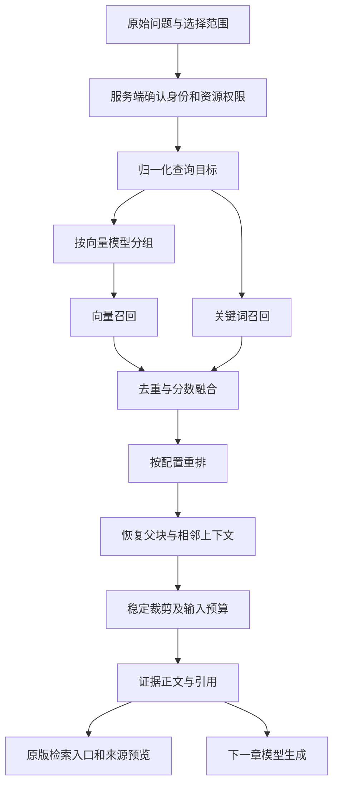

# `S7`：先找到正确资料，再整理模型可用的证据

[目录](./00-目录.md) · [上一章：上传解析与索引](./08-S6-上传解析与索引.md) · [下一章：会话与流式问答](./10-S8-会话与流式问答.md)

本章先不让聊天模型回答问题，而是观察“问题查到了哪些段落”。检索正确，才有条件解释答案为什么可信；模型流畅的文字不能代替检索验收。

所有目标文件仍是待创建产物。后端路径相对于 `refactor/python/backend/`，前端路径相对于 `refactor/python/frontend/`；源码参照以仓库根目录为起点。完成记录写入[进度与验收记录](./13-进度与验收记录.md)。

证据统一存放本目录的 `实践记录/S7/`，不要把未来的验收写成已通过。

## 1. 前置条件和贯穿案例

`S6` 的文档、分块、索引与权限测试已通过。准备三个自己制作的测试文档：采购、休假、设备申领。再在另一个租户准备一份相似采购文档，用来检查隔离。

给采购文档设置一个标签，准备以下问题：

| 问题或操作 | 目的 |
| --- | --- |
| “采购十二万元找谁复核？” | 验证语义相关内容 |
| 查询文档中的特定编号 | 验证关键词匹配 |
| 只选采购文件提问 | 验证显式文档范围 |
| 只选标签提问 | 验证标签范围不会被当成纯聊天 |
| 问文档完全没有的内容 | 验证真正无结果 |
| 换成无权读取的文档标识 | 验证服务端范围授权 |

本章出口：这些请求得到可解释、可追溯、权限正确的候选；可为下一章输出受预算约束的证据及引用。假模型测试只能证明编排，再单独使用真实模型检验语义质量。

## 2. 原版入口与术语

| 概念 | 用普通话解释 | 原版入口 |
| --- | --- | --- |
| 查询范围 | 允许在哪些资料里找 | [问答请求类型](../../../internal/handler/session/types.go)、[搜索类型](../../../internal/types/search.go) |
| 召回 | 先找一批可能有用的片段 | [并行召回](../../../internal/application/service/chat_pipeline/search_parallel.go) |
| 融合 | 合并不同搜索方式找到的候选 | [融合实现](../../../internal/application/service/knowledgebase_search_fusion.go) |
| 重排 | 再比较哪些片段更能回答问题 | [重排实现](../../../internal/application/service/knowledgebase_search_rerank.go) |
| 合并上下文 | 把重复或过碎的证据整理好 | [块合并](../../../internal/application/service/chat_pipeline/merge.go) |
| 输入预算 | 限制交给模型的总内容规模 | [消息准备](../../../internal/application/service/chat_pipeline/common.go) |
| 引用 | 让用户回到答案依据 | [引用视图](../../../frontend/src/components/ChatReferenceSourceView.vue) |

详细原版链路见[用户提问与检索](../文档上传到用户问答全链路/04-用户提问与检索.md)和[证据与模型输入](../文档上传到用户问答全链路/05-证据、Prompt与流式回答.md)。这些分析用于理解；接口和配置参数仍按 `S0` 版本核对。

## 3. 本章数据流

图表示职责先后，不要求把每个方框实现成类。图谱、联网与 `Wiki` 补充召回在 `S9` 按原版配置加入，不应无条件出现在每一次请求中。

## 4. 目标文件和职责

| 位置 | 本章工作 |
| --- | --- |
| `app/api/v1/routes/search.py` | 对齐已有独立检索入口 |
| `app/api/v1/schemas/search.py` | 请求范围与结果结构 |
| `app/services/retrieval.py` | 授权范围、召回和排序编排 |
| `app/services/evidence.py` | 去重、来源、上下文与预算 |
| `app/repositories/chunks.py` | 按权限回查块、父块和邻居 |
| `app/integrations/` | 复用 `S4` 模型及 `S6` 索引访问 |
| `src/api/knowledge/`、`src/types/` | 检索请求和有类型的结果 |
| `src/components/` | 命令面板结果、引用与受保护预览 |
| `tests/unit/` | 范围、融合、去重与预算测试 |
| `tests/contract/`、`tests/e2e/` | 原版响应结构及实际资料检索 |

如果前章已有相同职责文件，直接扩展。不要为了一个查询另建一套模型网关、请求客户端或身份系统。

## 5. 按顺序完成九个任务

### 5.1 `S7.1`：先写“应该找到什么”

**输入：** 固定测试文档与前述问题。

1. 记录每个问题预期命中的文档和证据句；允许的其他候选也写清楚。
2. 记录原版独立检索入口的请求与响应；区别 `POST /api/v1/knowledge-search`、知识库级检索和聊天接口。
3. 核对标识、正文、分数、来源位置、分页或数量等字段，不另造统一外壳。
4. 为无结果、越权和后端异常各留一个样例。

**结果与检查：** 得到一张可重复执行的查询表，评判依据不再是“模型回答听起来不错”。先不实现聊天。

### 5.2 `S7.2`：把各种选择转换成可信查询范围

**输入：** 知识库、文件、标签、提及项及可信身份。

1. 分别解析选择来源，查真实归属，不相信请求里自称的来源租户。
2. 检查知识库可读权限和共享授权，生成明确的目标集合。
3. 测试同时选择知识库和文件时的原版合并规则；不能自行设成简单交集或任意扩大集合。
4. 只有标签时也解析出有效范围；不能只检查知识库数组是否非空。
5. 将最终范围传入每一路搜索和块回查，确保不可见内容没有进入模型或日志。

**结果与检查：** 每个目标都能解释授权来源。非法目标被按契约拒绝或处理，不能默默退化为“搜所有资料”。

共享资料是特别重要的例子：执行租户与资料所属租户可能不同。不能用“全部限定当前租户”误伤合法共享，也不能为了共享跳过授权。

### 5.3 `S7.3`：先打通一种确定性的召回

**输入：** 授权目标与原始问题。

1. 先用固定索引和假向量检验范围、块标识和结果回查。
2. 确认返回结果能回到正文和来源位置，而不是只有相似度数字。
3. 测试空问题、空目标、无匹配和不存在的块；明确各自响应。
4. 再接入 `S4` 的真实向量模型和 `S6` 的索引。

**结果与检查：** 相同固定输入得到稳定结果，越权候选不会进入返回体。向量维度相同也不意味着模型语义空间相同。

### 5.4 `S7.4`：按模型分组并加入关键词路径

1. 根据知识库实际配置分组，组内复用问题向量，不跨不同模型复用。
2. 关键词检索使用已建立的关键词索引，不能把不存在的索引当作故障回退。
3. 区分某一路失败、全部召回失败与正常零候选；记录失败来源。
4. 在相同问题下分别观察单路与混合结果，再决定是否进入融合。

**结果与检查：** 两个使用不同模型的知识库各得到自己的查询向量；向量服务失败时，只有原版允许且实际可用的关键词路径才继续。

### 5.5 `S7.5`：按原版融合，再按配置重排

1. 保留候选来自哪一路以及原始排序，先按稳定标识去重。
2. 阅读原版融合规则；关键词分数与向量相似度不能直接相加。
3. 对混合路径实现相应加权排名融合，参数来自契约和配置，不能照教学公式猜默认值。
4. 重排只处理适用候选；重排关闭、失败或超时按原版回退规则处理。
5. 记录召回数量、重排数量和最终证据数量，它们不是一个参数。

**结果与检查：** 同一个块被两路命中时不会重复显示；排序稳定；重排失败不会被伪装成真正无结果。

简单验证方法：手工准备两组候选排序，先算出预期顺序，再测试实现。这个测试不需要真实模型，也不应该只复制代码里的公式作为期望值。

### 5.6 `S7.6`：恢复完整条件，避免断章取义

**输入：** 已排序候选与原版分块关系。

1. 去掉重复候选，保留必要的不同来源信息。
2. 按原版条件补入历史引用；现在可先用固定历史样例，下一章接真实会话。
3. 子块命中后按关系读取父块；回查时仍检查权限。
4. 同一文档中的连续或重叠片段按规则合并，必要时补相邻块。
5. 对支持的 `FAQ` 恢复回答正文，不能只把命中的问题文本交给模型；完整功能在 `S9` 补齐。
6. 再次去重并稳定裁剪，保留来源定位。

**结果与检查：** “超过十万元”与“由谁复核”在同一可用上下文里。补父块和邻居不能跨文档误拼，也不能绕过租户权限。

### 5.7 `S7.7`：组织证据和引用，限制输入预算

**输入：** 合并后的证据、当前问题、模型上下文限制。

1. 为每份证据保留文档、块、标题、位置和原版所需字段。
2. 将正文当作资料数据，不让文档里的“忽略之前规则”获得工具执行或扩大权限的能力。
3. 分配系统要求、历史、问题、证据和输出预留的预算；不能把所有候选直接塞进模型。
4. 裁剪时优先保留能解释问题的完整证据单元，保持正文与引用对应。
5. 记录被裁剪的数量与原因，不在普通日志输出全部敏感正文。

**结果与检查：** 超长文档不会无限扩大输入；用户看到的引用确实对应送入模型的资料；没有证据时不生成假的来源标识。

字符数不是准确的令牌数。教学阶段如暂用估算，要明确偏差与替换条件；正式适配目标模型时按其预算和计数规则验证。

### 5.8 `S7.8`：在原版入口展示检索结果

1. 从原版全局命令面板进入检索；历史 `/platform/knowledge-search` 是兼容入口，不新增另一套最终搜索页。
2. 展示问题、结果、文档名称、片段、加载、无结果和错误状态。
3. 点击结果通过受保护接口加载原文，按位置定位；缺失或删除的来源显示明确提示。
4. 引用缓存按租户、会话或当前使用范围隔离；连续打开两个来源时，旧请求不能覆盖新预览。
5. 使用原版素材和 `TDesign`，由 `Tailwind CSS ^4.3.3` 负责新增布局，不改原版检索交互。

**结果与检查：** 键盘选择、打开、返回、暗色主题和窄屏行为均有截图或操作证据。调试期间独立查询页只能是开发工具。

### 5.9 `S7.9`：分清无结果、失败和停止

1. 检查是否取消，再检查是否正常没有候选，最后处理系统错误。
2. 无结果按原版约定返回；检索服务错误应可诊断，不要用空数组掩盖。
3. 用户停止导致调用取消时，不生成“没有找到相关资料”的业务结论。
4. 为下章准备三种输入：正常证据、真正无证据、检索异常，保证聊天能区分。

**结果与检查：** 同样是“没有结果列表”，日志、界面和后续生成策略能说明实际原因。

## 6. 必须执行的验证矩阵

| 测试 | 操作 | 通过标准 |
| --- | --- | --- |
| 固定语料命中 | 采购问题搜索采购资料 | 预期规则出现，来源正确 |
| 纯关键词 | 搜精确编号 | 不因只依赖语义而丢失编号匹配 |
| 仅文件 | 只指定一个文档 | 不额外搜索整个知识库 |
| 仅标签 | 只指定合法标签 | 按归一化目标执行检索 |
| 跨租户标识 | 替换文件或块标识 | 无权内容不进入候选与模型 |
| 合法共享 | 使用被授权共享的资料 | 可读且权限撤回后及时失效 |
| 多模型 | 搜使用不同模型的知识库 | 按正确模型分组计算向量 |
| 重排失败 | 注入超时 | 按原版规则回退或报错，非伪无结果 |
| 父子块合并 | 命中拆开的条件和结论 | 上下文完整，引用没有串文档 |
| 超长证据 | 使用远超预算的文档 | 预算生效，引用仍对应保留内容 |
| 旧预览迟到 | 快速打开不同来源 | 最终展示最后选择的来源 |
| 用户停止 | 检索中取消 | 按停止处理，不写无结果兜底 |

将失败注入放在测试替身里，不需要关闭真实生产依赖来试错。真实模型验证保持独立开启并保存配置版本和结果。

## 7. 卡点排查与阶段出口

| 现象 | 先查哪一层 |
| --- | --- |
| 文件存在但搜不到 | 启用状态、索引是否成功、模型空间、目标过滤 |
| 候选很多但都不相关 | 测试问题、原文解析质量、召回及重排配置 |
| 答案条件被截断 | 分块、父块关系、邻居合并和预算裁剪 |
| 指定文件却搜到别的文件 | 范围归一化和额外选择的知识库 |
| 搜索报错却显示无结果 | 异常是否被捕获后无条件变成空列表 |
| 引用打开别的内容 | 标识、来源位置、缓存范围和迟到请求 |

- [ ] 不调用聊天模型，也能验证查询的结果和权限。
- [ ] 固定语料、仅标签、仅文件、合法共享和越权样例已记录。
- [ ] 已验证至少一个系统失败和一个真正无结果。
- [ ] 证据预算与来源映射有测试。
- [ ] 页面入口、结果、预览和状态与原版比较过。
- [ ] 真实模型质量验证与假模型编排验证分开记录。

今天先做 `S7.1–S7.3`：让一个问题命中一段正确正文，并证明另一个租户无法读到。不要先调整模型提示词来弥补检索错误。

过关后进入[会话与流式问答](./10-S8-会话与流式问答.md)，把本章证据作为输入。
