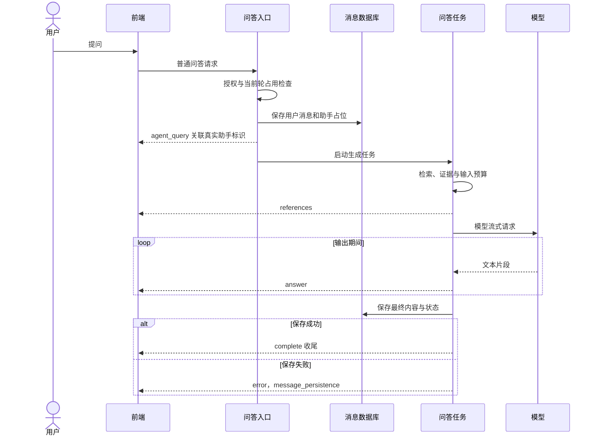

# `S8`：让模型逐段回答，并保存、停止和恢复对话

[目录](./00-目录.md) · [上一章：检索与证据](./09-S7-检索与证据组织.md) · [下一章：完整功能复刻](./11-S9-完整功能逐项复刻.md)

前一章已经找到正确证据。本章把证据交给模型，让用户逐段看到回答，并保证刷新后仍能查看已保存的消息。先完成普通文档问答，再在 `S9` 补智能体及工具循环。

下文目标文件是待建立产物。后端位置相对于 `refactor/python/backend/`，前端位置相对于 `refactor/python/frontend/`；源码索引从仓库根目录计算。记录入口是[进度与验收记录](./13-进度与验收记录.md)，证据放本目录的 `实践记录/S8/`。

细化学习顺序见[14 全链路 60 步实践路线](./14-全链路60步实践路线.md)的步骤 `31–40`，每步映射回本章任务，配套原理阅读、可见产物与理解检查。


## 1. 前置条件与第一条完整故事

进入本章前，能够登录、配置模型、创建知识库、上传文档并查到预期证据。继续使用采购测试材料，普通问题、无结果问题和失败场景都要保留。

首条故事是：新建会话 → 输入“采购十二万元找谁复核” → 接收引用与回答 → 等待保存完成 → 刷新 → 打开引用。

“模型输出完了”“浏览器连接关了”和“答案已经保存”不是一件事。成功必须包含持久化；失败时也要让用户知道哪些内容已经显示、哪些内容尚未保存。

| 名称 | 作用 |
| --- | --- |
| 会话 | 装多轮消息的容器，拥有独立身份与配置 |
| 用户消息 | 这一轮真正发送的输入 |
| 助手占位消息 | 生成开始前分配的真实消息标识，后续不断补内容 |
| 事件缓存 | 让符合条件的连接重放或继续接收这一轮事件 |
| `SSE` | 把服务器连续产生的事件送给浏览器的传输方式 |
| 消息历史 | 已持久化内容，不能只靠事件缓存充当历史 |

## 2. 原版参照与接口边界

| 关心的问题 | 原版入口 |
| --- | --- |
| 创建、停止、消息相关请求 | [聊天接口](../../../frontend/src/api/chat/index.ts)、[后端路由](../../../internal/router/routes_chat.go) |
| 生成接收与消息保存 | [问答处理器](../../../internal/handler/session/qa.go) |
| 对外流格式 | [流处理](../../../internal/handler/session/stream.go)、[聊天类型](../../../internal/types/chat.go) |
| 浏览器传输与旧流隔离 | [流客户端](../../../frontend/src/api/chat/streame.ts) |
| 事件如何改变界面 | [事件处理](../../../frontend/src/composables/useChatStreamHandler.ts) |
| 恢复、停止和故障 | [停止与异常分析](../文档上传到用户问答全链路/06-停止恢复与异常一致性.md) |
| 证据到生成的详细时序 | [证据与流式分析](../文档上传到用户问答全链路/05-证据、Prompt与流式回答.md) |

新建会话使用 `POST /api/v1/sessions`；普通问答使用 `POST /api/v1/knowledge-chat/{session_id}`；智能体问答使用 `/api/v1/agent-chat/{session_id}`。路径占位符换成真实标识，不新增一个不兼容的 `/api/v1/chat`。

历史加载入口为 `/api/v1/messages/{session_id}/load`；停止使用 `/api/v1/sessions/{session_id}/stop`；续流使用 `/api/v1/sessions/continue-stream/{session_id}`，与助手消息标识关联。请求字段、方法、分页和错误以固定版本原码为准，不能只复制路径。

## 3. 一轮问答怎样结束



图展示正常成功和保存失败分支。业务生成失败后也可能保存失败说明并发布 `complete` 收尾；前端不能因此将失败改成成功。内部完成事件不等于浏览器可以提前收到成功完成承诺。

## 4. 本章目标文件

| 位置 | 主要职责 |
| --- | --- |
| `app/api/v1/routes/sessions.py`、`chat.py` | 会话、历史、生成、停止和续流协议 |
| `app/api/v1/schemas/chat.py` | 原版请求与流响应结构 |
| `app/repositories/sessions.py`、`messages.py` | 归属、消息与持久化 |
| `app/services/chat.py` | 复用检索服务，组织输入与生成顺序 |
| `app/services/streams.py` | 运行轮次、事件、取消和恢复范围 |
| `app/integrations/` | 复用模型调用，实现可控假流与真实流 |
| `src/api/chat/` | 普通请求、流传输、停止与续流 |
| `src/composables/useChatStreamHandler.ts` | 事件归约为界面数据 |
| `src/views/chat/`、`src/components/` | 消息列表、输入框、引用和错误反馈 |
| `tests/contract/`、`tests/e2e/` | 流协议、消息生命周期、停止与恢复 |

这不是要求第一天建事件总线平台。先让同一轮生成与浏览器连接解耦，明确记录和取消责任，再按已选部署模式补持久流缓存。

## 5. 依次完成十一个任务

### 5.1 `S8.1`：记录一轮完整原版消息

**输入：** 原版可用会话、测试问题与知识范围。

1. 记录创建会话、发送问题、加载历史的请求与响应。
2. 保存脱敏事件序列，标出握手、引用、答案、结束与保存的关系。
3. 分别采集无结果、模型失败和停止的行为。
4. 记录会话默认配置、恢复配置、未发送草稿的边界；不要假设会话永久绑定一个知识库。

**结果与检查：** 能解释每个事件属于哪一个助手消息，能区分页面本地占位和服务端已接受的消息。

#### 实现拆解：先把消息身份和事件顺序对上

1. 从原版创建一个空会话，记录创建响应与首次历史结果；确认创建容器没有自动调用模型。
2. 发送固定采购问题，在网络面板保存脱敏流内容，并记录历史接口最终保存的用户消息、助手消息和引用。
3. 逐个事件标出业务类型、正文位置、助手身份来源和终止含义；将页面临时消息身份与握手后的真实身份连起来。
4. 将样例放入 `tests/contract/` 的测试夹具，区分固定协议字段与每次变化的标识、时间和内容，不把一次响应全文当永久标准。
5. 对无结果、业务错误、保存失败及停止分别建立样例。实际环境难以制造的失败，从固定版本代码确认并标记尚待动态验证，不能编造抓包记录。
6. 在 `app/api/v1/schemas/chat.py` 按样例建立请求与输出结构，先验证字段兼容，再写生成流程；特别区分业务事件名称与外层传输事件名。

**得到的产物：** 一条能说明“哪个事件修改哪条助手记录”的时间线，作为后端输出和前端消费的共同输入。

**卡住时查：** 如果页面正文与历史不同，先比较事件追加或替换规则与最终保存内容，不先调整模型参数。


### 5.2 `S8.2`：先实现会话与历史，不调用模型

1. 对齐原版创建、列表、详情和历史接口，所有入口检查归属与权限。
2. 保存用户消息及助手占位，使本轮一开始就有真实标识。
3. 助手占位创建失败时避免留下半轮消息；以原版回滚与错误行为为契约。
4. 先使用固定完成内容验证重新打开和历史分页。
5. 加入当前轮占用检查；前端发送按钮锁不能代替服务端并发控制。

**结果与检查：** 刷新后固定消息仍在；两个同时请求不会绕开本轮规则。`X-Request-ID` 便于追踪，不自动证明重复发送幂等。

#### 实现拆解：先做一轮能刷新回来的固定消息

1. 在 `app/repositories/sessions.py` 完成会话归属查询，在 `messages.py` 完成按会话读取历史；查询条件不能仅有一个客户端传来的会话标识。
2. `sessions.py` 路由先接创建与详情，页面取得真实会话身份后再导航；直接刷新详情地址也应从服务端恢复，不依赖上一个页面的临时对象。
3. 在 `app/services/chat.py` 接一次发送请求，确认会话权限和当前轮占用，再保存用户消息及助手占位。占位就是先分配一个真实保存位置，后面答案、停止和恢复都找它。
4. 将相关写入按原版要求放在同一业务事务或明确补偿路径；第二条写入失败时检查第一条的实际结果，不只断言异常出现。
5. 先不检索、不调用模型，将助手占位更新成固定完成内容，再通过历史接口重新读取，确认页面身份映射正确。
6. 补历史分页：使用原版时间或游标参数，准备多于一页的记录，核对排序、边界和重复项。
7. 同时发两个请求测试服务端占用规则；若只禁用发送按钮而两个接口仍能绕过限制，应先修服务端，再继续流式生成。

**过关结果：** 一轮消息可以创建、读回、刷新展示，未授权历史读取失败。之后所有流事件复用这一条助手记录，不另开一批临时记录。


### 5.3 `S8.3`：接入前章证据并组织模型输入

1. 读取当前问题与适用历史，保留原问题，必要的改写只用于检索。
2. 复用 `S7` 范围授权、检索与证据服务，不在聊天里另写一套范围规则。
3. 将系统要求、历史、证据、附件和问题按原版条件组合，执行总输入预算。
4. 区分纯聊天、真实无结果和检索错误；停止状态优先处理。
5. 假模型返回可预测内容，先验证输入和引用映射，再接真实模型。

**结果与检查：** 只有标签的请求会进入正确检索；真正纯聊天不会被强制搜索；文档中恶意指令不能改变授权或工具权限。

#### 实现拆解：明确三份文本分别给谁用

1. 在 `chat.py` 服务中先保留用户原问题，读取原版允许参与本轮的历史；不要从前端传来的完整历史直接信任其身份和内容归属。
2. 如原版条件要求改写，使用模型网关或测试替身得到检索查询。“那设备呢”可以被改写成更适合搜索的句子，但原始用户消息仍保留原话。
3. 将检索查询与本轮选择交给 `S7` 的服务，复用范围授权与证据整理；聊天不自行扩大知识库范围，也不绕开标签解析。
4. 在模型调用前组织系统要求、历史、证据和问题，按原版分支处理附件和纯聊天；最终生成输入是第三份内容，与原问题、检索查询分别记录来源。
5. 用网关替身捕获实际输入结构，断言只有本轮允许的证据、例外条件未被裁掉、预算包含历史和模板，而不是仅检查答案文字。
6. 将 `S7.9` 的成功、无结果、失败、停止逐一接入：检索异常不能生成无结果兜底，停止后不启动生成。

**输入到输出：** 持久用户消息与会话配置 → 授权证据 → 符合预算的模型输入。引用来自同一批最终证据，不能从另一份未裁剪候选列表生成。

**失败定位：** 单轮正确而追问错资料，先比较检索查询与适用历史；证据正确而模型答错，才继续检查最终输入与模型输出。


### 5.4 `S8.4`：实现能控制时序的假流

**输入：** 已持久化的本轮标识、固定答案与引用。

1. 让测试替身分几次产出固定文本，能暂停在首段前和任意片段后。
2. 事件关联现有助手消息，不生成一批临时消息标识。
3. 增加替身的正常完成、异常中断和等待取消三种行为。
4. 用替身检查前端和持久化顺序，避免先付费调用真实模型才发现状态错误。

**结果与检查：** 同一测试多次得到相同内容和事件关系；这只证明协议与编排，不是回答质量验收。

#### 实现拆解：用可控暂停代替碰运气等待

1. 在 `tests/` 的模型夹具中实现与真实网关相同的流输出形状，依次产出“需要”“财务负责人”“复核。”，业务服务不用知道它来自替身。
2. 流输出通过异步迭代逐段交回调用方；每次迭代得到一个增量，不是先拼好全文再按字切开伪装真实上游行为。
3. 在首段前与第二段后各放一个测试可控制的等待点，例如异步事件；测试显式放行后才继续，不用长时间休眠猜服务运行到了哪一步。
4. 让 `chat.py` 消费增量并交给 `streams.py`，后者关联同一个助手身份。生成任务的生命周期与浏览器连接分开，连接断开不自动等于用户停止。
5. 正常路径放行全部片段，失败路径在第二段后抛出受控错误，取消路径发送服务端停止信号；三条路径都检查已产生的内容和最终状态。
6. 测试结束在清理阶段取消未结束任务并释放等待点，避免上一个用例的生成流污染后一个用例。

**可见结果：** 可以精确停在“有助手占位但还没正文”和“已有半段答案”两个时点，然后检查数据库、缓存和页面各自状态。

**注意边界：** 此替身验证编排和时序，不能证明真实模型支持相同取消速度或内容质量。


### 5.5 `S8.5`：输出原版流协议

外层事件名为 `message`，业务类型在 `data` 的 `JSON` 字段 `response_type`。答案正文是顶层 `content`，引用主要在 `knowledge_references`；不要强行从 `data.content` 读取。

以下仅是外层格式示意，不是完整业务事件序列：

```text
event: message
data: {"id":"request-example","response_type":"answer","content":"需要财务负责人复核。","done":false}

```

1. 使用原版结构序列化，不把内部事件总线名称当浏览器协议。
2. 先支持握手关联、引用、答案、错误、完成和停止，其他事件随基线功能补齐。
3. 在测试中把一个事件拆成多块网络数据，再把多个事件放进同一块，验证解析。
4. 测试心跳不显示为正文；`answer.done=true` 不被当作整轮保存成功。

**结果与检查：** 前后端能共同消费脱敏原版事件样例。高级工具事件在 `S9` 完整补齐，不能用“未知事件忽略”作为最终覆盖证明。

#### 实现拆解：只保留一处对外事件序列化

1. 在 `schemas/chat.py` 按固定版本定义流响应字段；在 `streams.py` 或对应协议适配位置把内部生成事件转换成原版对外结构，避免每个分支各拼一段字符串。
2. 先输出握手关联和一条答案事件，核对外层 `event: message`、`data` 内 `response_type` 与顶层 `content`；随后接引用、错误和收尾。
3. 序列化使用标准 `JSON` 转义，再按流协议边界输出；正文含换行、引号或中文时不能破坏帧格式。
4. 传输头、心跳及断开清理参照原版，生成器退出时释放该连接订阅；不要因为某个浏览器断开就误删整轮可恢复事件。
5. 在协议测试中把同一合法事件序列分别作为整块、逐字节、多个事件合块输入前端解析边界，断言得到同一组业务事件。
6. 在答案结束后先暂停持久化，确认 `answer.done=true` 没有让页面宣告整轮保存成功；`complete` 的发布接下一步保存结果。

**实际观察：** 用网络面板或不会缓冲展示的请求工具看事件是否持续到达，再和页面结果比较；服务器已输出而页面最后才一起显示时，检查传输和代理缓冲。

**实现范围：** 产品复用原版已采用的流库，不把仅支持一种换行的小实验解析器放入正式客户端。


### 5.6 `S8.6`：前端分离传输与消息状态

1. 使用原版采用的 `fetch-event-source` 方式发送带鉴权的请求；不要用只能按另一种方式发请求的示例替代。
2. 传输层负责连接、解析、共享令牌刷新和取消；事件处理层负责消息数据变化。
3. 收到 `agent_query` 后保存 `assistant_message_id`，即使普通问答也会使用这个事件名。
4. 按 `answer` 的追加、替换和截断规则更新正文，引用单独维护。
5. 每次新流或停止推进请求代际，旧回调必须同时匹配会话与代际。
6. 及时解除发送锁，但不把后来的收尾事件用于擦掉前面错误。

**结果与检查：** 快速切会话不会串答案；旧流迟到不会把新输入清空；刷新失败能统一退出，不能循环重放生成请求。

#### 实现拆解：先消费事件，再接复杂界面

1. 在 `src/api/chat/` 实现发送和订阅，复用现有身份刷新机制；该层输出已解析的业务事件，不直接操作消息组件的元素。
2. 在 `useChatStreamHandler.ts` 建立事件到消息状态的处理入口：输入当前会话、目标消息和事件，按原版规则更新正文、引用或错误。归约就是根据旧状态和事件得到新状态。
3. 先接 `agent_query`，把本地占位关联到真实 `assistant_message_id`；后续事件始终修改该条消息，不每来一段就新增一条助手消息。
4. 再接正文的追加、替换和截断，各准备一组固定事件序列；引用单独处理，不将引用对象拼到正文字符串。
5. 每次开始新流或停止推进请求代际，回调同时核对会话身份和代际；清空正文并不能阻止旧回调稍后重新写入。
6. 先处理业务错误状态，再处理连接收尾和发送锁释放；收到 `complete` 可以结束等待，但不能覆盖之前保存的业务失败。
7. 接入消息列表后，在甲会话暂停旧流、切乙会话发新问题，再放行甲事件，检查正文、引用、标题和草稿全部没有串入乙。

**排错：** 网络面板事件正确而正文重复，先查追加与替换语义；不同会话串内容查代际和目标身份；不要通过每次事件都全量重载历史来掩盖状态错误。


### 5.7 `S8.7`：持久化成功之后才承诺完成

1. 正常生成结束后整理最终内容、引用、用量和原版状态。
2. 更新助手记录成功后，再发布对外完成事件。
3. 保存失败时发送原版对应错误，例如 `stage=message_persistence`；保留用户已经看到的文字并显示保存失败。
4. 业务生成失败时保存合理的部分内容及失败结果；后续 `complete` 只是收尾，不能改写业务失败。
5. 加入“答案已生成但数据库更新失败”的测试，检查界面和历史的差异说明。

**结果与检查：** 不出现“页面显示成功完成，数据库仍是空占位且没有警告”。`is_completed` 表示处理结束时，也不能直接翻译成回答成功。

#### 实现拆解：将收尾拆成生成结果、保存结果、通知结果

1. 在 `chat.py` 收集本轮最终正文、引用、用量与业务结果，生成结束后先保留这些数据，不立即发成功完成事件。
2. 调用 `messages.py` 更新原助手记录；确认目标属于本轮，写入错误或影响行数异常不能当作正常保存。
3. 等数据库提交成功，再由 `streams.py` 对外发布完成；测试中用暂停的仓储替身证明提交前不会提前发布成功承诺。
4. 保存失败时走原版错误结构，标明消息持久化阶段；浏览器保留已看到的文字和错误提示，不清空为一条看似成功的新历史。
5. 模型中途失败时按原版保存部分内容及失败信息，若随后有 `complete` 收尾，仍保留业务失败。连接结束与回答成功分别维护。
6. 对同一终态的重复处理按既有轮次或消息状态规则保护，避免重复收尾覆盖已停止或已失败结果。

**验收顺序：** 先看事件时间线，再读数据库，最后刷新页面。三者都正确才算正常完成；页面有全文但数据库仍空占位时，应定位保存阶段。

**关键断言：** 仓储提交失败时没有成功完成承诺；刷新前后差异有明确提示，而不是让用户以为答案已经永久保存。


### 5.8 `S8.8`：停止必须到达服务端

1. 点击停止后先隔离旧前端回调，并按原版停止接口提交真实消息标识。
2. 服务端检查消息属于当前会话及用户，不能用任意助手标识停止其他人的任务。
3. 生成任务观察停止信号，取消下游等待，按原版保存部分结果并清理资源。
4. 已完成消息的重复停止按幂等规则处理。
5. 分别测试检索中、首段前、生成中停止；取消检索不应触发无结果兜底。

**结果与检查：** 浏览器不再增长只是第一步，还能证明后端已受理停止。不能保证远端模型瞬间结束或停止计费，应按实际取消能力说明。

#### 实现拆解：从按钮一直追到等待中的任务

1. 停止按钮读取当前真实助手标识，先推进前端代际防迟到回写，再提交原版停止请求；只有关闭本地连接不会自动告诉后台用户要停止。
2. 路由读取可信身份，由服务核对会话、消息、所有者与租户关系；不能让调用者用另一个助手标识停止其他人的任务。
3. `streams.py` 定位本轮运行并写入所选模式下可被任务观察的停止信号。多进程部署不能只修改当前请求进程里的局部变量。
4. 生成任务将取消传到检索、模型等待和输出循环，取消后不进入无结果兜底，也不继续开启下一次调用。
5. 统一收尾保存允许保留的部分内容与停止状态，释放订阅和资源；远端服务是否马上结束依适配器能力，不承诺即时停止计费。
6. 对已完成目标重复停止，按原版幂等响应处理；停止信号已接受和任务已收尾分别观察。
7. 使用 `S8.4` 暂停点依次测试检索中、首段前、第二段后停止，检查数据库和下游调用，而不只检查页面不再增长。

**排错：** 按钮有效但后端继续生成，检查请求是否发出、目标是否匹配、停止信号是否跨进程可见、等待点是否响应取消。


### 5.9 `S8.9`：刷新恢复已有轮次，不重复提问

1. 进入页面先恢复会话和持久化历史，再找未完成助手消息。
2. 对适用消息请求 `continue-stream`，按权限找到对应流，不重新发送原提问。
3. 回放事件按身份和替换规则处理，避免把已显示文本追加第二遍。
4. 缓存不存在、过期或进程重启时给出明确恢复结果，不能无限加载。
5. 区分原版普通问答原连接与智能体连接的自动恢复条件，不承诺所有流都自动重连。

**结果与检查：** 刷新不会多出一条用户消息和第二轮计费；历史恢复与活跃流恢复各有测试。内存缓存不跨进程，持久缓存也有有效期。

#### 实现拆解：先找原消息，再恢复它的输出

1. 页面进入时先加载会话配置和持久历史，按原版条件找未完成助手消息；不要仅凭页面上一次的“生成中”布尔值决定续流。
2. 用该助手身份请求 `continue-stream`，服务再次检查归属并定位现有事件缓存或运行；这一操作不能创建新的用户消息或第二次模型调用。
3. 缓存回放交给同一事件处理器，遵守原版替换及增量规则；先测试历史已显示一部分内容、回放再次包含这部分的情况，避免双重追加。
4. 回放结束后接实时事件，检查这个交接点不会漏掉新片段或重复结束；具体顺序身份和缓存能力按既定协议实现。
5. 缓存未就绪、过期、进程重启失去内存状态分别返回或展示原版允许的结果，设置有边界的恢复策略，不能永久旋转加载图标。
6. 普通问答原连接、智能体连接和页面主动恢复各自核对条件，不能一律让失败请求重放原提问。
7. 对恢复前后的用户消息数、助手身份和模型调用次数做断言，三者不变才证明恢复的是原轮次。

**失败定位：** 刷新多出一条用户消息查是否重新调用生成入口；正文重复查回放语义；始终找不到流查助手身份、缓存模式和有效期。


### 5.10 `S8.10`：补上原版消息外观和安全富文本

1. 复刻消息排列、输入区、引用、生成中和错误状态，使用原版组件和素材。
2. 先纯文本，再加入 `Markdown`、代码高亮、公式、图表、图片和对应预览。
3. 保留 `DOMPurify` 等清理与资源权限，不直接渲染模型提供的任意 `HTML`。
4. 流式更新复用已经稳定的图片和图表节点，避免每段文字都重建整棵内容。
5. `Tailwind CSS ^4.3.3` 负责新增布局；原版富文本和第三方预览样式可以继续复用。
6. 对比相同视口、主题、语言下的长回答、代码块、引用侧栏和停止状态。

**结果与检查：** 长回答期间仍可滚动操作；危险链接被处理；图表不反复闪烁；键盘焦点与原版一致。

#### 实现拆解：显示层每加一种内容就验证一次

1. 在 `src/views/chat/` 先用已验证的消息状态显示纯文字、生成中、失败和停止，不同时引入所有富文本插件。
2. 复用原版消息及渲染组件结构，再接 `Markdown`；原始模型内容是不可信输入，必须沿用安全清理与资源访问规则。
3. 按代码块、公式、表格、图表、图片逐种加入固定样例，每加一种就测试完整输出和输出到一半时的界面，不能只测最终静态全文。
4. 引用点击传递真实来源身份给 `S7` 预览能力；来源删除、撤权与位置不存在分别显示结果，不从历史缓存绕过当前授权。
5. 列表节点使用稳定消息身份，避免每次增量重新创建全部图片或图表；确认长流期间滚动和输入仍可操作。
6. 将原版主题和专用样式接到已工作的内容组件，再比较明暗主题、长内容、窄屏、键盘焦点及弹窗返回位置。
7. 使用不可信链接和脚本样例验证清理，检查浏览器实际行为；不能仅断言清理函数被调用。

**排错：** 原文正确但显示错误查解析与样式；每段增量闪烁查节点身份和重建；引用失败查资源权限与位置，不把失败链接替换成公开地址。


### 5.11 `S8.11`：切换真实模型，再跑完整故事

1. 通过原有模型调用边界切换真实服务，不改流协议来适应某个厂商。
2. 检查真实增量、超时、长度截断和不完整结束，区分它们与正常完成。
3. 完成登录到引用打开的全流程，刷新后检查内容、引用和状态。
4. 保存配置版本和脱敏证据；真实模型验证显式使用 `RUN_REAL_LLM=1` 及测试凭据。

**结果与检查：** 固定采购材料真实命中并正确引用；模型答对但引用越权或保存失败仍是验收失败。

#### 实现拆解：只替换外部能力，不改变已验证的流程

1. 在独立测试配置中选择真实聊天、向量和解析能力，显式设置 `RUN_REAL_LLM=1`；先记录配置版本和材料，不将凭据写入报告。
2. 保持 `chat.py`、流响应和前端消费不变，通过 `S4` 已有边界替换模型适配器。厂商返回结构在适配器转换，不能泄漏为新的客户端协议。
3. 先用单一采购问题走通，再逐项测试没有资料、长输入、超时、长度截断及中途停止。真实输出不要求逐字等于替身答案，但必须满足证据中的事实条件。
4. 每次核对命中来源、实际引用、最终助手记录和刷新结果；答案说对审批人但丢失例外条件仍不算通过。
5. 记录上传处理耗时、检索耗时、首段耗时、生成及保存耗时，沿请求和消息身份串起来；不为排错记录完整敏感上下文。
6. 真实模型完成一次正常故事后，继续用确定性替身执行难以稳定触发的保存失败和迟到回写测试，两类结果分开登记。

**最后一次联调：** 新用户登录 → 建库 → 上传自制文件 → 独立检索 → 创建会话 → 提问 → 完成或停止 → 刷新 → 打开来源。每一步用上一动作真实返回的身份，不在测试里偷换成预置成功记录。

**范围说明：** 本步只验收主闭环，工具事件、渠道、共享全量和部署模式仍由后续阶段逐项验证。


## 6. 成功与故障验证矩阵

| 场景 | 应检查什么 |
| --- | --- |
| 正常流 | 关联标识 → 引用/答案 → 持久化 → 完成，刷新一致 |
| 事件跨网络块 | 无乱码、无半条 `JSON` 被错误解析 |
| 错误后收到完成 | 错误仍保留，连接可结束，发送锁可释放 |
| 答案保存失败 | 明确保存失败，屏幕内容仍可见，不宣告成功 |
| 快速切会话 | 旧消息、引用、标题和输入配置均不污染新会话 |
| 点击停止 | 服务端收到正确目标，越权停止被拒绝 |
| 检索中停止 | 不保存错误的无结果兜底 |
| 刷新未完成消息 | 读取已有轮次，不再次提交问题 |
| 流缓存过期 | 可解释提示或历史恢复，不无限循环 |
| 并发发送 | 服务端占用规则生效，不只依赖按钮禁用 |
| 来源被删除或权限撤回 | 引用读取受当前权限限制，失败可理解 |
| 富文本攻击样例 | 清理策略有效，不执行不可信脚本 |

先用假流执行这些检查，再测真实依赖。自动化用例应该断言消息、事件与持久化结果，不能只看页面出现了某段文字。

## 7. 阶段出口与今天的最小任务

- [ ] 用户消息、助手标识和会话能对应到持久化记录。
- [ ] 页面可以逐段显示真实协议的回答和引用。
- [ ] 业务失败、保存失败、停止和正常完成明确区分。
- [ ] 刷新、断线和停止不会重复生成或串消息。
- [ ] 引用和富文本的安全、权限与视觉状态已验收。
- [ ] 假模型与真实模型结果分开记录。
- [ ] 完成一次登录 → 建库 → 上传 → 检索 → 问答 → 刷新 → 引用打开。

今天只做 `S8.1–S8.2`：创建一轮有真实助手标识的持久消息，并重新加载它。然后再让文字流起来。

这一步通过意味着第一条完整业务闭环完成，不意味着原版全部功能完成。继续到[完整功能逐项复刻](./11-S9-完整功能逐项复刻.md)，补齐聊天全量操作、智能体、工具、组织及其他入口。
