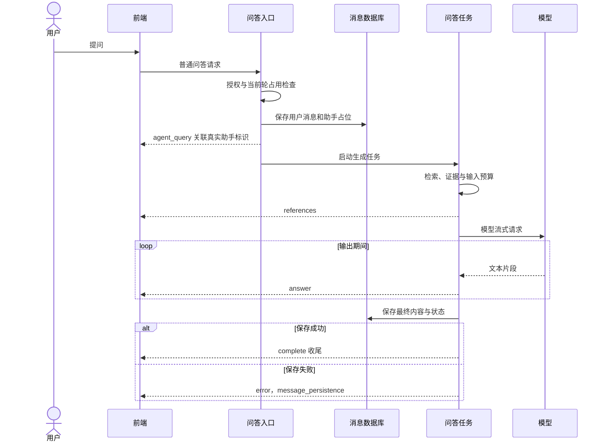

# `S8`：让模型逐段回答，并保存、停止和恢复对话

[目录](./00-目录.md) · [上一章：检索与证据](./09-S7-检索与证据组织.md) · [下一章：完整功能复刻](./11-S9-完整功能逐项复刻.md)

前一章已经找到正确证据。本章把证据交给模型，让用户逐段看到回答，并保证刷新后仍能查看已保存的消息。先完成普通文档问答，再在 `S9` 补智能体及工具循环。

下文目标文件是待建立产物。后端位置相对于 `refactor/python/backend/`，前端位置相对于 `refactor/python/frontend/`；源码索引从仓库根目录计算。记录入口是[进度与验收记录](./13-进度与验收记录.md)，证据放本目录的 `实践记录/S8/`。

## 1. 前置条件与第一条完整故事

进入本章前，能够登录、配置模型、创建知识库、上传文档并查到预期证据。继续使用采购测试材料，普通问题、无结果问题和失败场景都要保留。

首条故事是：新建会话 → 输入“采购十二万元找谁复核” → 接收引用与回答 → 等待保存完成 → 刷新 → 打开引用。

“模型输出完了”“浏览器连接关了”和“答案已经保存”不是一件事。成功必须包含持久化；失败时也要让用户知道哪些内容已经显示、哪些内容尚未保存。

| 名称 | 作用 |
| --- | --- |
| 会话 | 装多轮消息的容器，拥有独立身份与配置 |
| 用户消息 | 这一轮真正发送的输入 |
| 助手占位消息 | 生成开始前分配的真实消息标识，后续不断补内容 |
| 事件缓存 | 让符合条件的连接重放或继续接收这一轮事件 |
| `SSE` | 把服务器连续产生的事件送给浏览器的传输方式 |
| 消息历史 | 已持久化内容，不能只靠事件缓存充当历史 |

## 2. 原版参照与接口边界

| 关心的问题 | 原版入口 |
| --- | --- |
| 创建、停止、消息相关请求 | [聊天接口](../../../frontend/src/api/chat/index.ts)、[后端路由](../../../internal/router/routes_chat.go) |
| 生成接收与消息保存 | [问答处理器](../../../internal/handler/session/qa.go) |
| 对外流格式 | [流处理](../../../internal/handler/session/stream.go)、[聊天类型](../../../internal/types/chat.go) |
| 浏览器传输与旧流隔离 | [流客户端](../../../frontend/src/api/chat/streame.ts) |
| 事件如何改变界面 | [事件处理](../../../frontend/src/composables/useChatStreamHandler.ts) |
| 恢复、停止和故障 | [停止与异常分析](../文档上传到用户问答全链路/06-停止恢复与异常一致性.md) |
| 证据到生成的详细时序 | [证据与流式分析](../文档上传到用户问答全链路/05-证据、Prompt与流式回答.md) |

新建会话使用 `POST /api/v1/sessions`；普通问答使用 `POST /api/v1/knowledge-chat/{session_id}`；智能体问答使用 `/api/v1/agent-chat/{session_id}`。路径占位符换成真实标识，不新增一个不兼容的 `/api/v1/chat`。

历史加载入口为 `/api/v1/messages/{session_id}/load`；停止使用 `/api/v1/sessions/{session_id}/stop`；续流使用 `/api/v1/sessions/continue-stream/{session_id}`，与助手消息标识关联。请求字段、方法、分页和错误以固定版本原码为准，不能只复制路径。

## 3. 一轮问答怎样结束



图展示正常成功和保存失败分支。业务生成失败后也可能保存失败说明并发布 `complete` 收尾；前端不能因此将失败改成成功。内部完成事件不等于浏览器可以提前收到成功完成承诺。

## 4. 本章目标文件

| 位置 | 主要职责 |
| --- | --- |
| `app/api/v1/routes/sessions.py`、`chat.py` | 会话、历史、生成、停止和续流协议 |
| `app/api/v1/schemas/chat.py` | 原版请求与流响应结构 |
| `app/repositories/sessions.py`、`messages.py` | 归属、消息与持久化 |
| `app/services/chat.py` | 复用检索服务，组织输入与生成顺序 |
| `app/services/streams.py` | 运行轮次、事件、取消和恢复范围 |
| `app/integrations/` | 复用模型调用，实现可控假流与真实流 |
| `src/api/chat/` | 普通请求、流传输、停止与续流 |
| `src/composables/useChatStreamHandler.ts` | 事件归约为界面数据 |
| `src/views/chat/`、`src/components/` | 消息列表、输入框、引用和错误反馈 |
| `tests/contract/`、`tests/e2e/` | 流协议、消息生命周期、停止与恢复 |

这不是要求第一天建事件总线平台。先让同一轮生成与浏览器连接解耦，明确记录和取消责任，再按已选部署模式补持久流缓存。

## 5. 依次完成十一个任务

### 5.1 `S8.1`：记录一轮完整原版消息

**输入：** 原版可用会话、测试问题与知识范围。

1. 记录创建会话、发送问题、加载历史的请求与响应。
2. 保存脱敏事件序列，标出握手、引用、答案、结束与保存的关系。
3. 分别采集无结果、模型失败和停止的行为。
4. 记录会话默认配置、恢复配置、未发送草稿的边界；不要假设会话永久绑定一个知识库。

**结果与检查：** 能解释每个事件属于哪一个助手消息，能区分页面本地占位和服务端已接受的消息。

### 5.2 `S8.2`：先实现会话与历史，不调用模型

1. 对齐原版创建、列表、详情和历史接口，所有入口检查归属与权限。
2. 保存用户消息及助手占位，使本轮一开始就有真实标识。
3. 助手占位创建失败时避免留下半轮消息；以原版回滚与错误行为为契约。
4. 先使用固定完成内容验证重新打开和历史分页。
5. 加入当前轮占用检查；前端发送按钮锁不能代替服务端并发控制。

**结果与检查：** 刷新后固定消息仍在；两个同时请求不会绕开本轮规则。`X-Request-ID` 便于追踪，不自动证明重复发送幂等。

### 5.3 `S8.3`：接入前章证据并组织模型输入

1. 读取当前问题与适用历史，保留原问题，必要的改写只用于检索。
2. 复用 `S7` 范围授权、检索与证据服务，不在聊天里另写一套范围规则。
3. 将系统要求、历史、证据、附件和问题按原版条件组合，执行总输入预算。
4. 区分纯聊天、真实无结果和检索错误；停止状态优先处理。
5. 假模型返回可预测内容，先验证输入和引用映射，再接真实模型。

**结果与检查：** 只有标签的请求会进入正确检索；真正纯聊天不会被强制搜索；文档中恶意指令不能改变授权或工具权限。

### 5.4 `S8.4`：实现能控制时序的假流

**输入：** 已持久化的本轮标识、固定答案与引用。

1. 让测试替身分几次产出固定文本，能暂停在首段前和任意片段后。
2. 事件关联现有助手消息，不生成一批临时消息标识。
3. 增加替身的正常完成、异常中断和等待取消三种行为。
4. 用替身检查前端和持久化顺序，避免先付费调用真实模型才发现状态错误。

**结果与检查：** 同一测试多次得到相同内容和事件关系；这只证明协议与编排，不是回答质量验收。

### 5.5 `S8.5`：输出原版流协议

外层事件名为 `message`，业务类型在 `data` 的 `JSON` 字段 `response_type`。答案正文是顶层 `content`，引用主要在 `knowledge_references`；不要强行从 `data.content` 读取。

以下仅是外层格式示意，不是完整业务事件序列：

```text
event: message
data: {"id":"request-example","response_type":"answer","content":"需要财务负责人复核。","done":false}

```

1. 使用原版结构序列化，不把内部事件总线名称当浏览器协议。
2. 先支持握手关联、引用、答案、错误、完成和停止，其他事件随基线功能补齐。
3. 在测试中把一个事件拆成多块网络数据，再把多个事件放进同一块，验证解析。
4. 测试心跳不显示为正文；`answer.done=true` 不被当作整轮保存成功。

**结果与检查：** 前后端能共同消费脱敏原版事件样例。高级工具事件在 `S9` 完整补齐，不能用“未知事件忽略”作为最终覆盖证明。

### 5.6 `S8.6`：前端分离传输与消息状态

1. 使用原版采用的 `fetch-event-source` 方式发送带鉴权的请求；不要用只能按另一种方式发请求的示例替代。
2. 传输层负责连接、解析、共享令牌刷新和取消；事件处理层负责消息数据变化。
3. 收到 `agent_query` 后保存 `assistant_message_id`，即使普通问答也会使用这个事件名。
4. 按 `answer` 的追加、替换和截断规则更新正文，引用单独维护。
5. 每次新流或停止推进请求代际，旧回调必须同时匹配会话与代际。
6. 及时解除发送锁，但不把后来的收尾事件用于擦掉前面错误。

**结果与检查：** 快速切会话不会串答案；旧流迟到不会把新输入清空；刷新失败能统一退出，不能循环重放生成请求。

### 5.7 `S8.7`：持久化成功之后才承诺完成

1. 正常生成结束后整理最终内容、引用、用量和原版状态。
2. 更新助手记录成功后，再发布对外完成事件。
3. 保存失败时发送原版对应错误，例如 `stage=message_persistence`；保留用户已经看到的文字并显示保存失败。
4. 业务生成失败时保存合理的部分内容及失败结果；后续 `complete` 只是收尾，不能改写业务失败。
5. 加入“答案已生成但数据库更新失败”的测试，检查界面和历史的差异说明。

**结果与检查：** 不出现“页面显示成功完成，数据库仍是空占位且没有警告”。`is_completed` 表示处理结束时，也不能直接翻译成回答成功。

### 5.8 `S8.8`：停止必须到达服务端

1. 点击停止后先隔离旧前端回调，并按原版停止接口提交真实消息标识。
2. 服务端检查消息属于当前会话及用户，不能用任意助手标识停止其他人的任务。
3. 生成任务观察停止信号，取消下游等待，按原版保存部分结果并清理资源。
4. 已完成消息的重复停止按幂等规则处理。
5. 分别测试检索中、首段前、生成中停止；取消检索不应触发无结果兜底。

**结果与检查：** 浏览器不再增长只是第一步，还能证明后端已受理停止。不能保证远端模型瞬间结束或停止计费，应按实际取消能力说明。

### 5.9 `S8.9`：刷新恢复已有轮次，不重复提问

1. 进入页面先恢复会话和持久化历史，再找未完成助手消息。
2. 对适用消息请求 `continue-stream`，按权限找到对应流，不重新发送原提问。
3. 回放事件按身份和替换规则处理，避免把已显示文本追加第二遍。
4. 缓存不存在、过期或进程重启时给出明确恢复结果，不能无限加载。
5. 区分原版普通问答原连接与智能体连接的自动恢复条件，不承诺所有流都自动重连。

**结果与检查：** 刷新不会多出一条用户消息和第二轮计费；历史恢复与活跃流恢复各有测试。内存缓存不跨进程，持久缓存也有有效期。

### 5.10 `S8.10`：补上原版消息外观和安全富文本

1. 复刻消息排列、输入区、引用、生成中和错误状态，使用原版组件和素材。
2. 先纯文本，再加入 `Markdown`、代码高亮、公式、图表、图片和对应预览。
3. 保留 `DOMPurify` 等清理与资源权限，不直接渲染模型提供的任意 `HTML`。
4. 流式更新复用已经稳定的图片和图表节点，避免每段文字都重建整棵内容。
5. `Tailwind CSS ^4.3.3` 负责新增布局；原版富文本和第三方预览样式可以继续复用。
6. 对比相同视口、主题、语言下的长回答、代码块、引用侧栏和停止状态。

**结果与检查：** 长回答期间仍可滚动操作；危险链接被处理；图表不反复闪烁；键盘焦点与原版一致。

### 5.11 `S8.11`：切换真实模型，再跑完整故事

1. 通过原有模型调用边界切换真实服务，不改流协议来适应某个厂商。
2. 检查真实增量、超时、长度截断和不完整结束，区分它们与正常完成。
3. 完成登录到引用打开的全流程，刷新后检查内容、引用和状态。
4. 保存配置版本和脱敏证据；真实模型验证显式使用 `RUN_REAL_LLM=1` 及测试凭据。

**结果与检查：** 固定采购材料真实命中并正确引用；模型答对但引用越权或保存失败仍是验收失败。

## 6. 成功与故障验证矩阵

| 场景 | 应检查什么 |
| --- | --- |
| 正常流 | 关联标识 → 引用/答案 → 持久化 → 完成，刷新一致 |
| 事件跨网络块 | 无乱码、无半条 `JSON` 被错误解析 |
| 错误后收到完成 | 错误仍保留，连接可结束，发送锁可释放 |
| 答案保存失败 | 明确保存失败，屏幕内容仍可见，不宣告成功 |
| 快速切会话 | 旧消息、引用、标题和输入配置均不污染新会话 |
| 点击停止 | 服务端收到正确目标，越权停止被拒绝 |
| 检索中停止 | 不保存错误的无结果兜底 |
| 刷新未完成消息 | 读取已有轮次，不再次提交问题 |
| 流缓存过期 | 可解释提示或历史恢复，不无限循环 |
| 并发发送 | 服务端占用规则生效，不只依赖按钮禁用 |
| 来源被删除或权限撤回 | 引用读取受当前权限限制，失败可理解 |
| 富文本攻击样例 | 清理策略有效，不执行不可信脚本 |

先用假流执行这些检查，再测真实依赖。自动化用例应该断言消息、事件与持久化结果，不能只看页面出现了某段文字。

## 7. 阶段出口与今天的最小任务

- [ ] 用户消息、助手标识和会话能对应到持久化记录。
- [ ] 页面可以逐段显示真实协议的回答和引用。
- [ ] 业务失败、保存失败、停止和正常完成明确区分。
- [ ] 刷新、断线和停止不会重复生成或串消息。
- [ ] 引用和富文本的安全、权限与视觉状态已验收。
- [ ] 假模型与真实模型结果分开记录。
- [ ] 完成一次登录 → 建库 → 上传 → 检索 → 问答 → 刷新 → 引用打开。

今天只做 `S8.1–S8.2`：创建一轮有真实助手标识的持久消息，并重新加载它。然后再让文字流起来。

这一步通过意味着第一条完整业务闭环完成，不意味着原版全部功能完成。继续到[完整功能逐项复刻](./11-S9-完整功能逐项复刻.md)，补齐聊天全量操作、智能体、工具、组织及其他入口。
