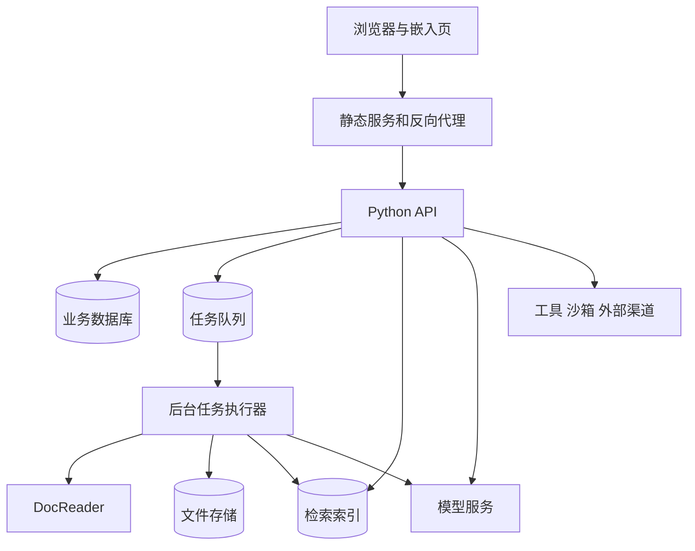

# `S10`：在干净环境部署，并证明功能与样式一致

[返回目录](./00-目录.md) · [上一章：完整功能逐项复刻](./11-S9-完整功能逐项复刻.md) · [下一章：进度与验收记录](./13-进度与验收记录.md)

## 1. 这一章的目标和前置条件

部署就是让另一台机器按照说明，也能运行你已经完成的系统。全量验收则是让每个页面、接口、任务和运行入口都留下可以重复的证据。

**开始前必须有：** `S0` 固定的原版基线、`S1–S8` 的闭环证据、`S9` 的功能与视觉清单，以及新工程的依赖锁定记录。尚未完成的模块可以先做部署演练，但最终不能标记全量通过。

本章不会要求你对原生产服务切流或下线 `Go`。使用独立测试环境与数据；迁移与回退指新项目自身的版本升级和恢复。

下文所有配置文件都是待创建或完善的目标，**不表示当前仓库已经具备一键启动脚本**。源码路径从仓库根目录 `WeKnora/` 计算，执行命令另外标明工作目录。

原版部署参考：[容器编排](../../../docker-compose.yml)、[后端镜像构建](../../../docker/Dockerfile.app)、[解析器镜像](../../../docker/Dockerfile.docreader)、[前端代理](../../../frontend/nginx.conf)。先理解其职责，不直接照搬依赖旧 `Go` 服务的入口。

## 2. 先画清楚要启动哪些东西



前端构建产物是静态文件；`API` 处理请求；后台进程执行长任务；数据库、文件和索引分别保存不同数据。不能只复制数据库，就认为所有用户资料已经备份。

本章按 `S10.1–S10.10` 执行。把实际证据保存在本目录的 `实践记录/S10/`，在[进度表](./13-进度与验收记录.md)登记结果。

## 3. `S10.1`：冻结本次待验收版本

### 3.1 先记录输入，不急着启动

从仓库根目录记录：

```bash
git rev-parse HEAD
git status --short
```

提交号不能代表未提交修改。若工作区有改动，同时保存本次实际差异清单或构建产物标识，说明验证的是哪一份代码；不要把工作区自动清理掉。

接着登记这些信息：

| 项目 | 记录内容 | 为什么需要 |
| --- | --- | --- |
| 原版基线 | 提交、部署模式、功能开关 | 决定要复刻什么 |
| 新版构建 | 提交、未提交差异、产物版本 | 能定位本次测试对象 |
| 运行环境 | 操作系统、架构、浏览器、时区 | 解释平台和视觉差异 |
| 依赖 | `Python`、`Node.js`、锁文件、镜像标识 | 保证重复安装一致 |
| 数据 | 测试语料版本、角色与租户配置 | 保证两版测试条件相同 |
| 外部服务 | 类型、版本、是否测试环境 | 说明哪些是真实验收 |

### 3.2 准备配置清单

创建或完善 `refactor/python/backend/.env.example`，只写配置名、说明和无秘密的示例。实际密钥放在部署环境的秘密配置中，不能放入前端 `VITE_` 变量；前端构建变量会进入浏览器。

逐项说明数据库、队列、存储、模型、解析器、会话安全、允许来源、日志和部署能力。启动时区分必需与可选依赖，缺少必要密钥应拒绝进入可服务状态。

**过关：** 能明确回答“今天测的是哪个版本，用了哪些配置，哪些能力没有开启”，且记录不包含真实凭据。

### 3.3 把版本和配置落实到可检查的文件

先整理已有文件，不立即改部署。依赖锁文件保存实际解析版本，配置示例说明需要填什么，秘密配置保存真实值；三者不能互相替代。

1. 打开 `python/backend/pyproject.toml` 与前端 `package.json`，逐项核对实际启动命令引用的包是否声明；不能依赖电脑上全局恰好安装的包。
2. 找到工程实际采用的后端锁文件和前端 `package-lock.json`，记录文件版本或摘要。若后端尚未选择锁定方式，先完成并验证可重复安装，再继续构建。
3. 从后端配置读取代码反查必填项，在 `.env.example` 中填写无秘密的示意值与用途；没有被代码读取的配置不要假装已经生效。
4. 对每项配置标明使用者：`API`、工作进程、解析器还是前端。工作进程必须获得它实际需要的存储和模型配置，不能只给 `API` 设置。
5. 在独立环境分别缺失一项必需配置、关闭一项可选能力，观察启动或就绪结果；错误应指明配置类别，不打印完整秘密。

**读结果：** 同样代码在另一台机器不工作，先比较锁定依赖、配置是否被读取以及运行模式；不要先修改业务接口。输出一张“配置项 → 使用进程 → 必需条件 → 验证动作”的表，作为后面启动依据。

## 4. `S10.2`：建立真实依赖验证矩阵

假模型能证明编排，不能证明模型质量；本地文件能证明存取，不能证明对象存储签名；`SQLite` 能验证本地流程，不能替代 `PostgreSQL` 的字段和事务行为。

| 能力 | 开发时可能使用 | 本阶段要验证 | 最小实际操作 |
| --- | --- | --- | --- |
| 数据库 | `SQLite` | 目标 `PostgreSQL` 及承诺支持的本地模式 | 初始化、写入、约束、事务回滚 |
| 任务 | 单进程替身 | 持久队列与真实工作进程 | 提交任务、重启、恢复与取消 |
| 文件 | 本地目录 | 目标对象存储或正式本地存储配置 | 上传、预览、授权下载、删除 |
| 检索 | 固定向量或内存计算 | 目标索引与真实向量模型 | 建索引、查询、删除与维度校验 |
| 文档 | 短文本解析 | 实际 `DocReader` 和配置的解析器 | 每种支持格式解析并定位来源 |
| 模型 | 固定回答 | 聊天、向量、重排及启用的视觉/语音能力 | 连通、失败、超时与固定质量样例 |
| 工具 | 确定性替身 | 配置的 `MCP`、沙箱和浏览器环境 | 执行、审批、停止与清理 |
| 渠道 | 本地事件 | 已授权的测试平台与测试账号 | 回调、去重、回复与失败 |

先选择与原版基线一致的一套真实组合跑通，再逐项验证所承诺支持的其他组合。只验证一套组合，报告就只能声明这一套组合通过。

配置里禁用某能力不等于复刻了它。原版基线支持而暂时缺少环境的项目，要保留“待验证”及所缺依赖。

**过关：** 矩阵中的每一行都有实际目标、测试样本、负责人或下一步，不再写笼统的“换成生产服务即可”。

### 4.1 一次只替换一种测试替身

真实依赖接入要能判断问题来自哪一层。先保留固定语料和接口测试，只替换当前要验证的一项依赖。

1. 从数据库开始，给独立目标数据库执行既有迁移，再运行字段、约束、事务和读取测试。检查的是相同业务含义，不要求两种数据库生成完全一样的底层语句。
2. 将文件适配器切换到目标存储，用自制文件完成保存、受保护读取与删除；记录资源引用，不记录永久公开链接来绕过授权。
3. 接真实向量模型与索引，重新处理固定文档后才发查询。不要让旧假向量与真实查询向量混在同一测试结果里。
4. 接真实队列，用一个可控任务检查受理、领取、完成；暂停或重启工作进程后读取同一任务状态，确认不是又创建了一个新任务冒充恢复。
5. 最后接真实解析、生成及工具能力，逐项记录允许的超时和失败结果。若多个依赖同时替换后失败，回到最后一次已通过组合逐项定位。

**读结果：** 连接测试通过只证明一条连接；它不能代替写入权限、事务语义、队列重启和真实模型质量。每行矩阵至少附一个实际写读或执行结果，无法运行就保留待验证。

## 5. `S10.3`：准备构建产物与启动入口

### 5.1 后端产物

完善新后端依赖锁定文件、应用启动入口和工作进程入口。应用与任务执行器可以使用同一份代码，但启动职责不同。不要在每个 `API` 副本启动时自动重复运行全部迁移或调度器。

目标文件可以包括：

| 目标文件 | 应包含的内容 |
| --- | --- |
| `refactor/python/backend/Dockerfile` | 已锁定依赖、应用代码、运行用户及启动方式 |
| `refactor/python/backend/.dockerignore` | 排除密钥、虚拟环境、开发数据库和测试产物 |
| `refactor/python/backend/app/workers/` | 前面阶段已实现的任务入口 |
| `refactor/python/backend/scripts/` | 实际迁移、初始化和健康验证命令 |

文件名应与实际工程一致；创建前先检查前面阶段已有什么，复用已有入口，不再增加第二套任务框架。

### 5.2 前端产物

前提是 `S1–S9` 已创建新工程、锁文件和构建脚本。从 `refactor/` 执行：

```bash
cd python/frontend
npm ci
npm run build
```

检查 `package.json` 中构建是否包含 `vue-tsc`。如果类型检查是独立脚本，应先执行真实存在的该脚本；不能因为打包成功就宣称类型检查通过。

核对产物包含主页面、嵌入入口、图标、字体、预览器资源、工作线程与所需 `WASM`。保留原版 `TDesign` 主题，确认 `Tailwind` 工具类实际生成。

`npm run preview` 适合本地查看产物，不代替正式静态服务器配置。开发时代理正常也不能证明产物部署后的代理正确。

### 5.3 写出真正可执行的部署说明

在新工程准备好以后，再创建部署配置和运行说明，记录：启动目录、需要的环境文件、服务名、挂载目录、端口、迁移命令、启动命令和停止方法。

若选择 `Docker Compose`，先写出新项目实际配置，再执行 `docker compose config --quiet` 检查语法。避免将包含解析后密钥的完整配置输出保存到公共报告。

本章不提供伪造的 `docker compose up` 路径；配置尚未写好时，这条命令没有可执行对象。

**过关：** 后端镜像或安装包可重建；前端构建可重复；部署说明中的每个路径、服务名和命令都有实际文件支撑。

### 5.4 让每个进程使用同一份可重建代码

产物是部署时真正运行的文件或镜像；工作目录、启动参数与环境决定它运行哪一种职责。先复用已有应用和任务入口，不为打包重写业务逻辑。

1. 后端镜像先只安装锁定依赖并复制运行所需代码；确认 `.dockerignore` 排除了 `.env`、`.venv`、本地数据库和私人测试材料。
2. 分别写明 `API` 与工作进程的实际启动命令。只启动 `API` 时应能响应健康检查；提交长任务但未启动工作进程时，应看到真实待处理状态，不是假成功。
3. 把迁移和初始化命令作为明确的一次性动作。应用副本扩大后，不能自动产生多个同时迁移或重复调度的执行者。
4. 前端构建后查看实际输出目录和入口文件；根据项目配置确认主入口、嵌入入口、静态资源路径，再让静态服务读取这个目录。
5. 在干净构建环境重做一次安装和构建，核对不会偷偷读取开发机源码或绝对路径；浏览器读取的脚本应属于本次构建。
6. 若使用编排配置，把服务间地址写成该运行网络能解析的地址。在容器里 `127.0.0.1` 指当前容器，不自动指数据库容器或开发机。

**读结果：** 镜像能构建但启动失败，先查启动入口和运行用户权限；前端空白，先看脚本请求是否返回真实脚本；任务一直排队，检查是否启动正确工作进程和消费同一个队列。

## 6. `S10.4`：按依赖顺序启动与迁移

### 6.1 第一次启动按这个顺序

1. 准备独立数据目录和秘密配置，确认当前环境不是原生产数据库。
2. 启动数据库、队列、存储和索引服务，检查真实连接与权限。
3. 执行新后端实际迁移入口；只允许一个迁移执行者，失败停止后续启动。
4. 启动解析器与必要外部适配服务，验证一个短文本解析或连通检查。
5. 启动 `Python API`，确认健康状态与依赖就绪状态。
6. 启动任务工作进程和唯一或协调后的调度器，提交一个测试任务。
7. 启动前端静态服务和反向代理，检查实际访问地址。
8. 用测试身份完成一轮登录、建库、上传、检索和问答。

容器处于运行状态不代表服务已就绪；等待机制应检查实际依赖，不用固定等待几秒代替检测。

### 6.2 数据库迁移要验证三种情况

| 情况 | 操作 | 通过标准 |
| --- | --- | --- |
| 空库 | 在独立空数据库执行迁移 | 表、索引、约束和版本记录完整 |
| 重复执行 | 对同一版本再次执行 | 不重复建表或修改已完成数据 |
| 失败中断 | 在隔离库注入失败 | 明确停止，保留可诊断状态，不自动清除失败标记 |

升级已有测试数据时，先保存备份与旧版本，再执行迁移和业务回归。兼容原版数据库结构不等于可以直接连接原生产库进行试验。

### 6.3 健康与就绪分开

`/health` 表示应用进程能响应；新增就绪检查时，还要验证必要数据库和依赖是否可用。检查接口不得返回密码、连接密钥或完整内部地址。

开发阶段可用以下命令确认健康，地址要替换为你实际启动的本地实例：

```bash
curl --fail --show-error http://127.0.0.1:8080/health
```

不要把这个本地示例当作正式公网地址或开放端口要求。

**过关：** 停掉必要数据库时应用不会继续宣称可正常服务；恢复依赖后行为可解释，任务不重复执行。

### 6.4 按“依赖可用 → 迁移成功 → 业务可用”推进

每走完一步再启动下一步，保留实际服务名和退出状态。下面说明检查方法，具体命令使用你已经建立的部署文件和入口，不复制不存在的服务名。

1. 数据库启动后，用部署账号做一次真实连接与允许的测试写读，确认地址、账号和库都正确；连接成功但无建表权限时，先修部署授权。
2. 执行实际迁移命令，记录迁移前后版本与返回状态。失败则停止；不要通过清空失败标记或删库让步骤看起来成功。
3. 启动 `API` 后请求 `/health`，再执行一个访问数据库的已实现只读接口。前者通、后者失败，说明进程存活与业务依赖可用是两回事。
4. 启动工作进程，提交自制文本的处理任务，记录文档、任务与轮次身份；观察同一任务从受理到完成，而不是仅看工作进程日志有启动文字。
5. 启动静态服务与代理，直接访问详情路由并刷新；最后从浏览器完整走一次登录到问答。
6. 在独立环境停止数据库，观察必要依赖失效后的就绪状态与业务错误；恢复后重新请求，确认连接能恢复且没有遗留半完成写入。

**读结果：** 健康通过而无法登录，先查数据库和认证配置；上传返回后永远待处理，查队列与消费者；工作进程完成而页面不变，查状态读取和轮询身份。

## 7. `S10.5`：验证静态资源、代理和长连接

### 7.1 普通页面与接口

对照[原版前端构建](../../../frontend/vite.config.ts)和[代理配置](../../../frontend/nginx.conf)，为新项目实现实际需要的规则：

1. 主应用页面地址刷新后仍返回主入口，静态资源不存在则返回正确错误，不能全都回退为 `HTML`。
2. 嵌入地址返回嵌入入口，不返回后台入口。
3. `/api` 与受保护文件请求转到新后端；错误状态码与响应体不被代理改成统一成功页面。
4. 子路径部署时，页面路由、资源基址、嵌入路径和文件链接一致。
5. 跨来源策略与实际宿主一致，不能用全部放开来源掩盖配置错误。

### 7.2 `SSE` 验证

在实际代理后发送聊天请求，观察首段及时出现，而不是生成全部结束后才一次返回。检查响应缓冲、压缩或超时设置是否改变流式行为。

再执行长回答、慢速上游、心跳、用户停止、断网与恢复。连接关闭不等于用户主动停止生成；按 `S8` 已实现的状态和继续流协议恢复，不能重发一次新提问冒充恢复。

外层事件、`response_type`、消息标识和终态处理保持原版契约。错误后流收尾不得把失败改成成功。

### 7.3 `WebSocket` 与沙箱连接

在浏览器网络面板确认握手升级，观察终端实际输入输出、断线和重新连接。验证代理转发、闲置超时及连接凭据过期。

不要为了快速连接而关闭所有身份检查；连接成功后仍要验证租户、会话和沙箱归属。撤权后旧入口不能获得新连接。

**过关：** 主入口、详情刷新、嵌入、下载、聊天流和终端都经过正式配置路径，而不只是开发服务器。

### 7.4 用同一请求比较直连与经过代理的差异

代理负责转交请求，不能替业务更改身份、响应结构或结束语义。先确认直连后端正确，再确认代理没有破坏它。

1. 使用隔离测试身份对同一健康或读取接口分别直连与经代理请求，对比状态码、响应类型和正文。敏感请求只保存脱敏记录，不把令牌写进可公开命令。
2. 请求一个不存在的静态文件，应收到对应错误；请求一个合法页面地址，应进入主应用。两者都返回首页会让浏览器把 `HTML` 当脚本加载。
3. 用可控假流经代理生成分段回答，在服务端记录片段发送时间，在浏览器观察到达时间；若全部结束才显示，优先排查代理缓冲与压缩，而不是改前端追加逻辑。
4. 拉长片段之间的间隔，验证心跳和实际超时；超时后按已有轮次恢复，不重新提交问题。正常完成、主动停止和网络断开分别测试。
5. 打开终端连接，检查真实握手、发送和接收；短期连接凭据到期后再次连接应拒绝。普通接口成功不能替代升级连接测试。
6. 从嵌入宿主页重复访问，并检查允许来源和资源基址；开发代理与生产代理是两份配置，应各有独立证据。

**读结果：** 直连能流、代理不能流，查传输设置；两者都没有首段，沿模型与事件生产查；终端连上没输出，查远端执行和消息方向，不先关闭授权。

## 8. `S10.6`：从干净数据走完功能验收

### 8.1 先准备固定样本

创建两个租户和不同权限的测试账号，准备采购规则、休假规则和设备指南等可区分资料。为各种格式、图谱、`FAQ`、`Wiki` 和产物准备相应样本，模型输出使用固定问题核查来源。

不要把真实业务文档复制进公开测试夹具。真实模型测试显式配置 `RUN_REAL_LLM=1` 与测试凭据，记录供应商、模型与参数，但不记录密钥。

### 8.2 按操作故事验收

| 顺序 | 用户故事 | 检查证据 |
| --- | --- | --- |
| 一 | 注册或邀请加入，再登录和切空间 | 身份、角色、刷新与退出正确 |
| 二 | 配置模型和知识库，上传不同来源资料 | 密钥脱敏、任务进度、失败与重试 |
| 三 | 检索、问答、引用、停止、刷新 | 来源正确、消息持久化、流恢复 |
| 四 | 管标签文件夹、`FAQ`、`Wiki` 和图谱 | 关联、版本、冲突与权限 |
| 五 | 编辑消息、分支回退、附件语音与产物 | 历史和文件关系正确 |
| 六 | 运行智能体、技能、记忆与工具审批 | 真执行、拒绝有效、停止清理 |
| 七 | 使用沙箱、浏览器、自动化和外部渠道 | 真实连接、去重和失败恢复 |
| 八 | 组织共享、系统管理与设置 | 角色权限、撤销、配额与审计 |
| 九 | 嵌入、桌面和其他客户端 | 各入口独立鉴权及真实环境结果 |

实际操作逐项对应 `S0` 功能清单。这里只规定验收顺序，不代替全部子功能用例。

### 8.3 测试命令必须对应实际配置

后端工程与虚拟环境已创建、依赖已安装时，从 `refactor/python/backend/` 执行：

```bash
source .venv/bin/activate
python -m pytest -q
python -m ruff check .
```

前端只有在相应脚本、浏览器依赖、测试服务和独立数据库都已准备时，才执行 `npm run test -- --run`、`npm run test:e2e`。若脚本名称不同，记录实际命令，不创建一个只打印成功的占位脚本。

各阶段可能共享数据库和日志，必须串行执行。失败时保留现场和结果，不用第二次成功覆盖第一次失败记录。

**过关：** 所有声明支持的功能都有成功与关键失败证据；真实依赖测试与假模型编排测试分开记录。

### 8.4 把一次完整故事拆成连续断言

以“采购规则上传后问谁审批”为第一条真实验收，不直接开始批量执行全部脚本。

1. 先创建测试身份、配置和知识库，记录真实标识；测试数据由夹具或实际接口产生，不依赖别人的开发数据库恰好已有记录。
2. 上传自制资料后检查文档身份与处理状态；等到实际可检索条件满足，再读取分块并查目标证据。
3. 新建会话并提问，检查用户消息、助手身份、引用及流事件；回答事实应符合材料，不要求真实模型逐字一致。
4. 刷新后重新加载历史，比较保存内容与引用身份；再用无权用户请求相同资源，确认没有正文泄露。
5. 只有这条故事通过，才逐组增加文件格式、知识增强、工具、渠道与客户端；每组独立记录失败，避免后一组成功掩盖前面未通过。
6. 测试退出成功后仍查看跳过与未运行列表。需要 `RUN_REAL_LLM=1` 的用例未启用时，结果只能说明默认测试范围通过。

**读结果：** 页面出现正确答案但引用错误，回到检索与证据阶段；刷新后丢失，查消息保存与完成事件顺序；仅真实依赖失败，先保留配置版本和最早错误，不删掉该用例。

## 9. `S10.7`：逐页验收样式与交互

### 9.1 固定比较条件

原版与新版使用相同浏览器版本、视口、缩放、字体、语言、主题、数据、角色和功能开关。先等字体与图片加载完成，再保存截图。

每页至少检查正常、空数据、加载、失败、无权限、弹窗与选中状态。需要滚动的页面同时比较顶部、底部和滚动容器；聊天长内容与代码块不能只截首屏。

### 9.2 按层比较，便于定位

1. 先比较整体区域：侧栏、头部、内容区、弹窗位置和宽度。
2. 再比较组件：卡片、表格、按钮、菜单、输入框和加载状态。
3. 再比较细节：字号、行高、图标、圆角、边框、阴影、焦点和悬停。
4. 最后比较行为：键盘、快捷键、返回、刷新、窄屏、主题偏好和减少动画。

有差异时先查原版变量与 `TDesign` 覆盖，再查 `Tailwind` 类名和层叠规则。不要为了通过截图，把功能隐藏或把错误状态写死。

### 9.3 自动截图也需要人工审核

可以用已建立的 `Playwright` 流程保存截图和差异图，但首次基线必须人工审核。时间和模型文本等确实不稳定的局部可以受控屏蔽，不能屏蔽整张聊天卡片或整页。

结果分为“相同”“可解释的环境差异”“需要修复”，每个差异都记录位置和原因。只接受与明确验收条件一致的差异，不能把容差调大后宣称完全一致。

**过关：** 功能清单与视觉清单一一关联，没有“功能通过但界面从未对照”的页面。

### 9.4 一次差异只修一个来源

把原版和新版放在同样视口，选一张具体的失败截图。先问差异来自数据、布局、主题还是控件行为，避免一口气覆盖所有样式。

1. 数据不一致时先让两边展示相同记录和状态；加载中截图不能与已完成截图比较。
2. 区域宽度不同，查看外层容器、侧栏宽度与滚动容器；不在每张卡片上加补偿边距。
3. 控件尺寸不同，核对原版组件版本、尺寸属性和主题覆盖；颜色不同再检查主题变量以及暗色条件。
4. 字体或图标不同，检查生产资源请求是否成功，等待资源加载后重新截图。缺字体造成的换行不能用缩小字号掩盖。
5. 修复后重复原动作，并用键盘打开关闭弹窗、移动焦点；视觉正确但不可操作仍属失败。
6. 共享样式修改会影响其他页面，挑对应组件的不同状态复查，并在记录里写明受影响范围。

**读结果：** 只保存一张“看起来正常”的图无法验收；每项差异必须有原图、新图、实际原因和修复后的结果。没有运行环境的页面不生成虚假对照图。

## 10. `S10.8`：故障与恢复演练

### 10.1 先在独立环境备份，再故意制造失败

| 故障 | 操作 | 必须观察到的结果 |
| --- | --- | --- |
| 工作进程重启 | 处理中停止并重新启动任务进程 | 任务可恢复或明确失败，不长期悬挂 |
| 队列短时不可用 | 提交时或处理中断队列 | 实际受理状态可追查，恢复不重复处理 |
| 索引写入失败 | 文档块保存后让索引失败 | 有补偿或重试，重跑不重复污染 |
| 旧任务迟到 | 重解析或删除后放行旧任务 | 不复活文档，不覆盖新状态 |
| 模型超时 | 首段前与生成中分别注入超时 | 页面明确失败，已有内容按契约保留 |
| 消息保存失败 | 生成结束后阻断持久化 | 不虚假承诺完成，错误可诊断 |
| 存储不可用 | 上传、预览、删除时分别失败 | 不把未保存文件显示为可用 |
| 权限撤销 | 执行、同步或连接期间撤权 | 后续访问按权限规则拒绝 |

每次只注入一个故障，观察请求、任务、文档、消息和页面状态，恢复后重跑相同用例。一次停掉所有服务，很难知道真正是哪一段有问题。

### 10.2 备份必须覆盖关联数据

列出业务数据库、原文件、派生文件、不可重建的运行记录，以及重建索引所需的模型版本和配置。明确备份时如何获得一致的数据视图。

把备份恢复到另一套空环境，验证用户、知识库、文档、引用、会话、文件和产物。仅看到备份文件存在不算恢复成功。

若索引选择重建，实际执行一次重建并核对数据量、来源与检索结果；不能只说“可以重建”。

### 10.3 升级与回退

先记录旧应用版本、数据库版本和备份位置。部署新版本后跑主流程，再按预案演练失败处理。

数据库结构已经升级时，直接换回旧镜像不一定可用。依据迁移兼容性选择兼容旧应用、前向修复或恢复一致备份；不可逆迁移不得用未经验证的降级脚本强行回退。

**过关：** 有一份真实恢复结果，说明恢复到哪个时间点、丢失窗口和恢复耗时；这些值从演练测得，不凭空承诺。

### 10.4 先演练一份资料的完整恢复

恢复目标不是“服务能启动”，而是关联数据能继续使用。先写下允许恢复到的时间点，再证明恢复出的资源互相对应。

1. 在独立环境保存一份文档、块、索引、引用和会话，记录脱敏的关联标识及内容摘要；停止或协调相关写入，按实际存储能力取得一致备份。
2. 把数据库与文件备份恢复到另一套空环境，配置明确指向新位置，防止恢复验证其实仍读取旧存储。
3. 若索引要重建，按保留的模型配置实际执行重建；检查文档与块的数量、索引映射及固定问题的命中，而不是仅检查索引服务已启动。
4. 用恢复出的用户访问历史、打开引用、下载原件；逐项验证资源身份和授权。原件存在但绑定丢失，也属于恢复失败。
5. 再演练一次处理中工作进程重启，观察旧任务怎样被重新领取或标记失败；确认没有生成重复块或把取消状态改回成功。
6. 升级前记录旧应用能否读取新结构。若不兼容，回退预案必须包含一致数据恢复或前向修复，不能只把镜像标签改回去。

**读结果：** 历史能看但引用打不开，先查文件恢复和资源绑定；资料能下载但搜不到，查索引恢复或重建；把实际恢复耗时与数据时间点写入记录，不承诺尚未测出的恢复能力。

## 11. `S10.9`：检查运行质量与可诊断性

1. 用请求、会话、文档和任务标识串起日志，能够找到哪个阶段失败；去掉凭据、完整提示词和不必要正文。
2. 分别记录检索、模型首段、总生成、上传处理和任务排队耗时，不用一个总耗时掩盖瓶颈。
3. 用原版相同环境与固定数据建立比较；容量目标根据实际场景明确，不能用开发机单次请求冒充压力验收。
4. 检查请求限制、上传限制、任务并发与配额；超过限制时返回明确结果，恢复后资源可释放。
5. 检查前端首屏、富文本、预览和长列表；保留必要拆包与懒加载，避免把所有大库塞到嵌入首屏。
6. 核对停止后连接数、任务数、沙箱进程和临时文件是否回落，防止多次使用后越来越慢。
7. 外部测试调用只发送到授权环境；没有权限或凭据时保留待验证，不用真实业务群和生产账户补测。

**过关：** 面对一条失败报告，能从证据找到实际原因；性能与容量结论注明测试条件和适用范围。

### 11.1 用一条失败记录串起所有相关进程

可观测性指系统留下足够证据，让你知道哪个步骤发生了什么。先满足排错，不要求第一天搭完整监控平台。

1. 在已有日志入口贯穿请求、文档、任务轮次、会话与助手消息身份；按步骤开始、结束、失败记录阶段，不记录完整受保护正文。
2. 用可控失败让索引写入出错，拿文档身份找到上传受理、任务领取、块保存、索引失败和最终状态，确认跨进程还能串起来。
3. 用相同固定问题分别记录检索完成、模型首段、生成结束和消息保存时间；总耗时变慢时先找到增长的那一段。
4. 连续执行并停止几轮任务，比较连接、工作任务、临时文件和沙箱资源数量；应按生命周期回落，不把前端停止显示当资源释放证据。
5. 再逐步提高并发，记录环境、数据量、模型及限制配置。达到限制时检查拒绝或排队语义，不能只记录成功请求平均耗时。

**读结果：** 没有对应标识时先补关联，不靠搜索完整文档内容定位；首段慢可能是检索或代理等待，不必先换模型；重跑后越来越慢则先查资源是否释放。

## 12. `S10.10`：汇总最终交付与未完成项

在 `实践记录/S10/` 保存以下证据，并由[进度表](./13-进度与验收记录.md)链接：

| 文件内容 | 应回答的问题 |
| --- | --- |
| 版本与配置摘要 | 原版、新版和依赖到底是哪一版 |
| 启动与部署说明 | 干净环境如何一步步启动 |
| 功能矩阵 | 哪个操作由哪个接口和页面实现 |
| 测试报告 | 实际命令、通过、失败、跳过及原因 |
| 视觉对照 | 原版截图、新版截图、差异与处理结果 |
| 恢复演练 | 备份、恢复、升级与回退的实际结果 |
| 已知限制 | 未验证的格式、平台、渠道和运行条件 |

### 12.1 逐项签收，不用总测试结果替代功能清单

1. 在功能矩阵给每项连接实际页面、接口、目标文件与测试证据；无法说明代码位置的功能先标待核实，不凭截图猜已完成。
2. 对每条测试结果记录执行版本、环境、命令及输出；失败和跳过保留原原因，不能从汇总中删除。
3. 把视觉、恢复和真实依赖结果分别关联回同一功能。某功能只有模拟测试通过时，实际能力仍保持待验收。
4. 按已知限制逐条写“缺什么、下一步做什么、影响哪些入口”，例如某格式缺解析环境，不能笼统写“基本完成”。
5. 最后让另一人在干净环境按实际部署说明操作；遇到需要口头补充的目录、配置或命令，把缺项写回说明，再复验相应步骤。

签收对象是固定版本的完整范围；以后更改模型、代理或存储配置时，重新执行受影响的检查，不把这一轮结果永久套用到所有部署。

最终状态按照证据填写：

- **本地闭环完成：** `S8` 主故事通过，不能代表 `S9` 全功能。
- **浏览器端复刻完成：** 固定范围内全部浏览器功能与视觉通过，其他入口单列。
- **完整范围验收通过：** 固定版本的所有约定功能、部署模式、入口、真实依赖和恢复要求均有结果。
- **待验收：** 仍有缺环境、失败、未完成或未比较项目，写清下一步。

没有全量证据时不使用“全部一样”“所有功能完成”这类结论。验收记录中的跳过项，也不会因测试命令退出成功而自动变成通过。

今天可以先完成 `S10.1`：整理版本、锁文件和依赖矩阵，尝试在干净环境构建。只有这些信息清楚，后续运行结果才可复现。

本章仅规定未来部署与验证步骤，本次文档整理没有执行真实部署、故障注入或全量产品验收。
