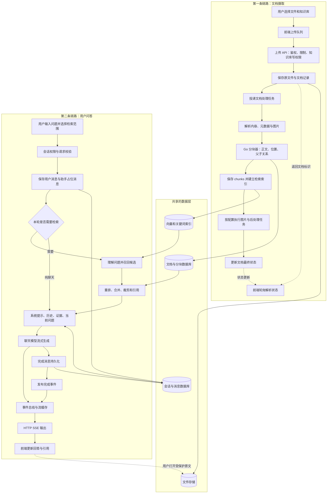

# 文档上传到用户问答：总览与核心链路

> 先建立整体认识，再看数据如何从上传进入知识库并最终支撑用户问答。

## 1. 先建立正确的整体认识

这个功能不是一个“上传文件后直接让大模型回答”的接口，而是两条通过知识库数据衔接的链路：

1. **摄取链路：** 文件 → 存储 → 文档记录 → 异步解析 → 分块 → 索引 → 配置要求的后处理 → 可用知识。
2. **问答链路：** 问题和检索范围 → 鉴权 → 会话与消息 → 问题理解 → 检索 → 整理证据 → 模型生成 → 流式展示 → 持久化。

文档通常在上传时处理一次，用户每次提问时处理的是问题和检索候选；普通问答不会重新解析全部原始文件。重新解析是另一项显式操作。

### 1.1 四种“完成”必须分开

| 看到的信号 | 实际含义 | 不能据此推断 |
| --- | --- | --- |
| 上传进度到 `100%` | 浏览器完成请求体传输 | 后端已经解析完、索引可用 |
| 上传接口返回 `success=true` | 接口返回了文档创建结果 | 异步任务一定成功，甚至不能忽略返回的 `parse_status` |
| 文档进入 `completed` | 当前文档处理流程达到终态 | 所有租户均可读、每个问题都能召回它 |
| 问答收到 `complete` | 当前流的结束处理已发布 | 内容必然正确；现有错误路径也可能完成清理后发布此事件 |

`Embedding` 把文本或图像映射为检索用的向量；`Rerank` 对已召回的候选再打分；聊天模型根据上下文生成答案。它们是三种不同职责，不应共用一个没有明确类型的“调用大模型”函数。

### 1.2 从哪些地方开始阅读

| 你正在解决的问题 | 对应章节 |
| --- | --- |
| 想先看全貌 | 第 `2` 节 |
| 上传为什么立即返回、后台又在做什么 | 第 `3`～`6` 节 |
| 文件、分块、索引、消息分别存在哪里 | 第 `7` 节 |
| 问题如何找到文档，如何变成模型输入 | 第 `8`～`11` 节 |
| 页面如何逐字显示，停止和刷新如何处理 | 第 `12`～`13` 节 |
| 用 `Python` 从零实现时如何划分模块 | 第 `16` 节 |
| 如何验收、如何排错、去哪里读源码 | 第 `17`～`19` 节 |

所有图均使用 `Mermaid`；支持它的 `Markdown` 阅读器会直接渲染，不支持时可阅读对应的阶段表和箭头文本。图中的虚线用于表示可选或旁路工作，条件分支表示配置或权限决定，不是每次都会执行。

## 2. 全局总览：数据先入库，问题再检索

**图的边界：** 它展示主路径，不表示文件系统、数据库、索引和队列之间存在一个共同事务。任何跨系统写入都可能部分成功，具体失败和重试边界见第 `14` 节。引用打开原文仍须经过受保护资源接口，不是让浏览器直接读取磁盘路径。

> 说明文件上传、后台摄取、状态机、重试重解析、取消删除和核心数据模型。
