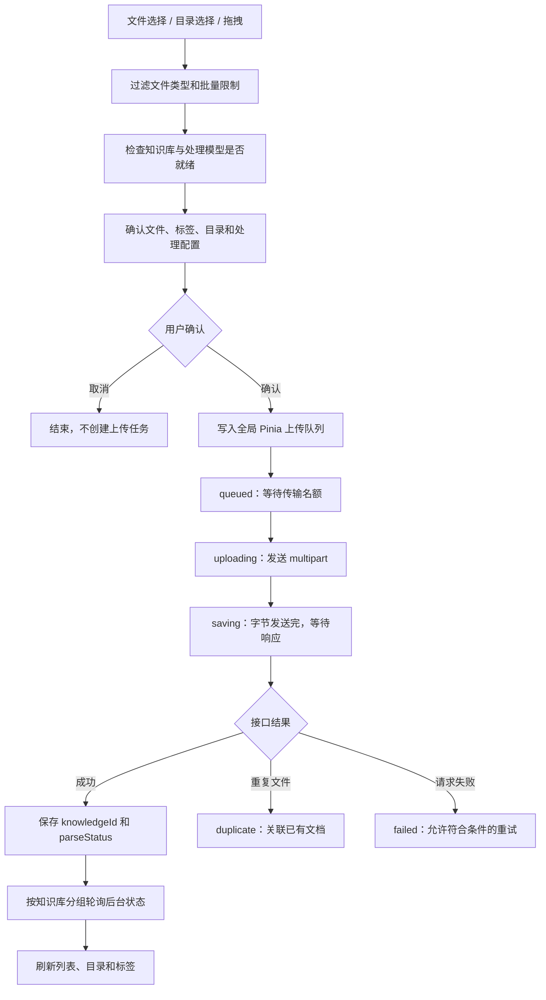
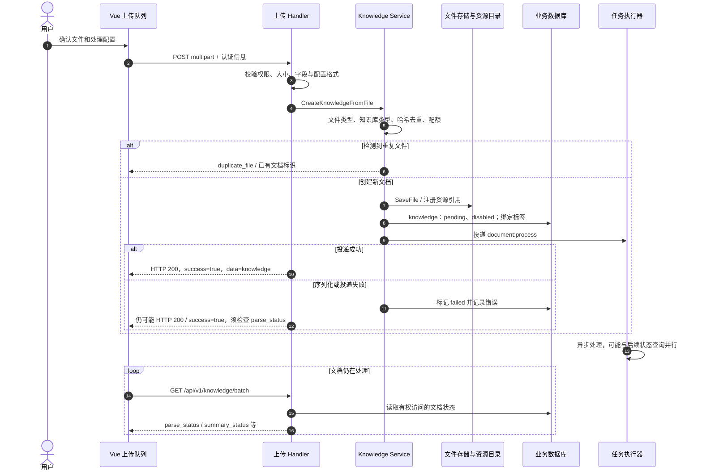

# 文档上传到用户问答：上传入口

> 说明文件如何从用户选择进入系统，并取得文档标识。

## 1. 上传入口：从选择文件到拿到文档标识

### 1.1 前端实际做了哪些事

这里有两种不同的“队列”：前端队列控制浏览器同时传输多少文件；后端队列控制服务器异步处理多少文档。前端显示正在排队，不一定表示服务器里已有任务。

| 前端环节 | 当前行为 | 自己实现时应理解的原因 |
| --- | --- | --- |
| 文件/目录选择 | 普通文件支持多选，目录入口使用 `webkitdirectory` | 目录选择最终仍拆成多个文件上传 |
| 确认弹窗 | 收集 `tagIds`、`processConfig`、`targetFolder` 等 | 解析规则属于这一批上传的输入，不应在任务执行时随意丢失 |
| 文件名 | `buildUploadFileName` 包含用户选择的目录信息 | 页面目录组织与底层安全存储路径不是同一件事 |
| 全局队列 | 传输并发为 `3`；同知识库、同大小的文件避免同时在途 | 减少竞争，并配合后端内容哈希去重；文件大小本身不是去重结论 |
| 账号/租户切换 | 上传队列绑定当前用户和有效租户 | 上一个空间的响应不能污染新空间的页面 |
| `saving` | 请求体已发完但响应未返回，此时拒绝普通取消 | 服务器可能已在创建文档，不能假装已经撤销 |
| 传输重试 | 只重试仍保留 `File` 的 `failed/cancelled` 项 | 这是重新发送文件，不是重新执行服务器解析 |
| 旧请求隔离 | 使用 `generation` 和控制器身份识别旧任务 | 取消后重试、清空后重传，都不能被迟到响应覆盖 |

`URL` 导入、手工文本、`FAQ` 和会话临时附件有独立入口。本文主路径是“永久知识库文件上传”；不能把这些入口都套成同一个 `multipart` 请求。

### 1.2 上传接口与时序

接口为 `POST /api/v1/knowledge-bases/{kb_id}/knowledge/file`，请求体是 `multipart/form-data`。认证和有效租户信息由请求层携带；服务端再检查当前用户对目标知识库的写权限。

| 字段 | 传输形式 | 用途 |
| --- | --- | --- |
| `file` | 文件二进制 | 原始文档 |
| `fileName` | 字符串 | 文件名或目录限定的展示名称 |
| `tag_ids` | 逗号分隔字符串，可选 | 文档所属标签 |
| `process_config` | `JSON` 字符串，可选 | 本次解析、图片、音频等处理配置 |

**以代码执行为准：** 上传处理器当前实际返回 `HTTP 200`，不能把注释里的 `201` 当作契约。默认文件大小上限为 `50 MB`，部署可调整；本文不是宣称所有环境都固定使用这个值。源文件保存成功、数据库写入失败时存在回滚文件逻辑，但回滚也可能失败。

### 1.3 页面为什么有两套状态轮询

| 轮询方 | 当前节奏 | 查询与收敛行为 |
| --- | --- | --- |
| 全局上传面板 | `3000 ms`；每批最多 `40` 个文档标识，查询并发 `4` | 按知识库分组查询；`pending/processing/finalizing` 持续轮询；连续 `3` 次成功响应缺失同一文档才判断已删除 |
| 知识库列表页 | 通常 `1500 ms`；每批最多 `100` 个标识，子请求串行 | 查询进行中文档，以及摘要仍在进行的已完成文档；成功查询缺失的行可直接移除 |
| 疑似停滞的列表 | 全部在途项均疑似停滞时降低到 `15000 ms` | 根据 `last_activity_at` 等信息判断；`20` 分钟无活动是前端提示依据，不是服务器自动删除期限 |

上传面板把 `finalizing` 展示为 `ready`，但继续轮询到 `completed`；这是“核心内容已经具备检索条件，但增强任务仍在执行”的表现。页面轮询使用请求身份、代际和重解析版本，避免切知识库或重解析后被旧响应回写。

> 说明解析、分块、索引、状态汇合，以及重试、重解析、取消和删除的语义。
