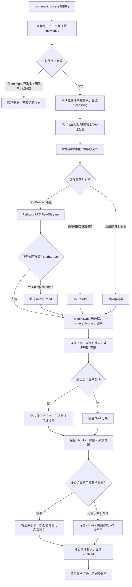
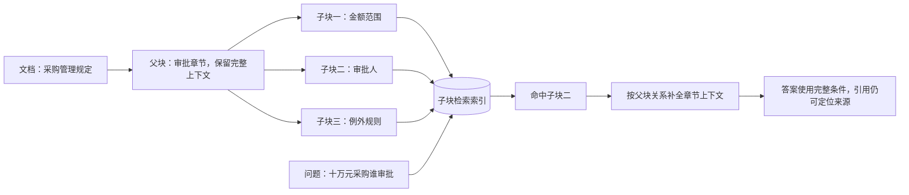
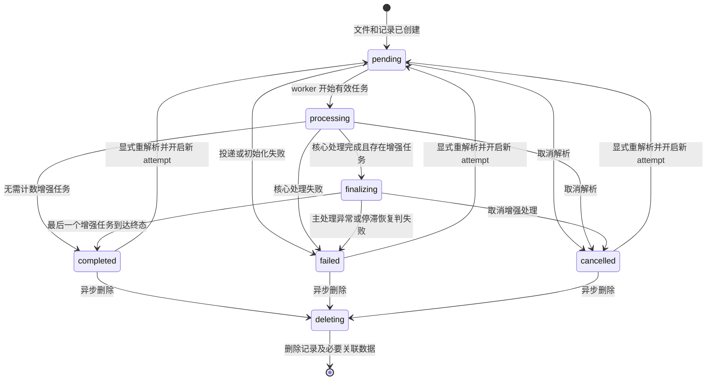
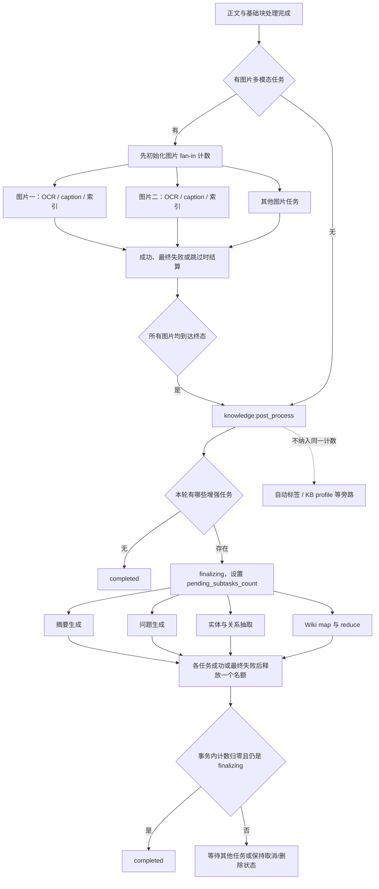
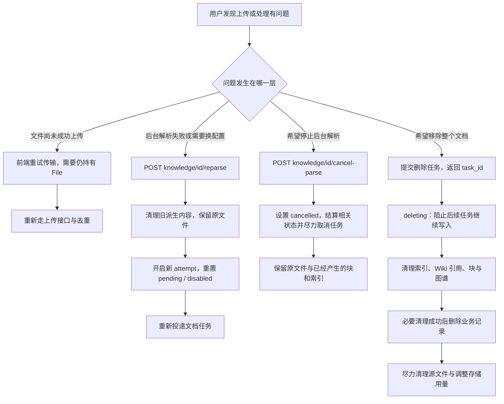
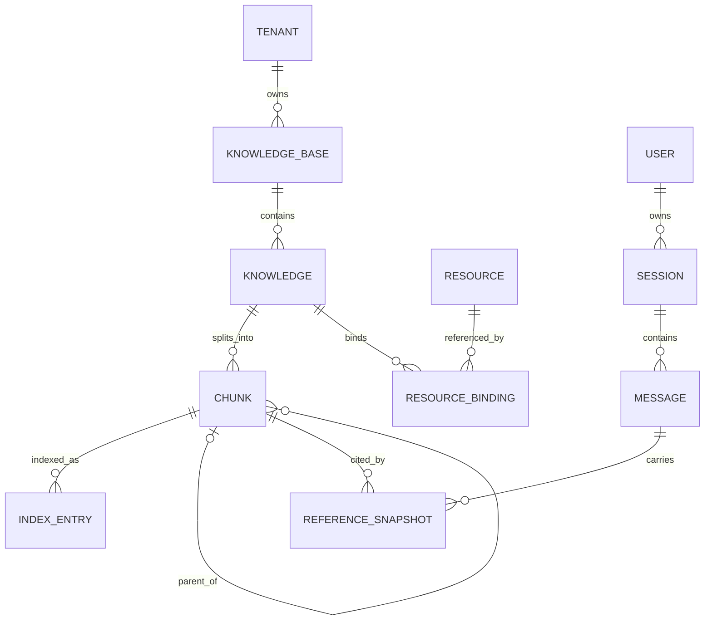

# 文档上传到用户问答：后台摄取、状态与数据模型

> 说明解析、分块、索引、状态汇合、操作语义和业务数据关系。

## 1. 后台摄取：解析器、分块器与索引如何衔接

### 1.1 任务执行的完整主干

当前主编排、分块、数据库写入和索引由 `Go` 完成；`docreader/` 的 `Python` 服务只承担其中部分解析工作。未来全 `Python` 后端需要接管这些职责，不能仅把现有 `DocReader` 部署起来就视为重构完成。

### 1.2 每一步消费什么、产出什么

| 步骤 | 输入 | 输出 | 必须保留的信息 |
| --- | --- | --- | --- |
| 任务加载 | 文档标识、租户、处理配置、执行轮次 | 经校验的文档处理上下文 | `tenant_id`、`knowledge_base_id`、`knowledge_id`、当前 `attempt` |
| 读取文件 | `resource://`、`local://` 或兼容存储引用 | 原文件字节 | 来源引用；不能把展示文件名直接当磁盘路径 |
| 解析 | 字节、格式、解析器配置 | 正文、元数据、图片、来源块 | 页码、段落、文本或图片定位信息 |
| 规范化 | 解析输出 | 可分块文本、已保存图片引用 | 规范化不能丢掉对应的来源关系 |
| 分块 | 正文、块大小/重叠/父子配置 | 有顺序的 `chunks` | 分块标识、文档归属、类型、前后与父子关系、位置 |
| 保存块 | `chunks` | 数据库中的可追溯正文 | 不能只写向量而不保留可展示原文 |
| 建索引 | 标题、上下文头、分块正文、各级标识 | 向量或关键词索引 | 结果必须可回查文档、块和租户范围 |
| 后处理 | 已保存正文及 `OCR/caption` 块 | 摘要、问题、图谱、`Wiki` 等 | 子任务属于哪个文档和哪一轮处理 |

解析过程有明确超时；当前 `DocReader` 调用默认约 `30` 分钟，并受上层任务上下文约束。`ReadStream` 不等于“原文件始终不进内存”：当前转换路径仍会把源文件读为字节。图片分帧返回主要改善解析结果传递，不能据此推断任意大文件都没有内存限制。

### 1.3 父子分块为什么不能省略关系

这是讲解用的文档内容，不是仓库中的真实业务数据。父块保存完整上下文，通常不作为普通子块重复建立同样的向量索引。否则容易出现父子重复召回、上下文重复以及引用定位混乱。

### 1.4 向量和关键词索引不是同一种存储

`BatchIndex` 会按配置决定是否调用 `Embedding`，再把索引项保存到对应后端。支持的实际组合由知识库和部署配置决定；不是每个文档都必须同时经过向量数据库、全文检索引擎和图数据库。

1. 文本向量用于语义相近的问题匹配；写入时的模型与查询模型必须处于同一向量空间。
2. 关键词索引用于原词、编号、专有名词等命中；是否可以作为向量失败后的回退，取决于该知识库是否真的建了关键词索引。
3. 块正文仍保存在业务存储中；索引命中只给出候选，后续还要补充内容和来源。
4. 当前向量索引器有批量调用和退避重试，单批最多尝试 `5` 次；这与文档队列的 `MaxRetry(3)` 是两层机制，不能理解为全流程只调用模型 `3` 次。

## 2. 状态机：何时可用，何时真正结束

### 2.1 文档的主要处理状态

为保持可读性，图未画出每个状态到删除或重新解析的全部管理分支；正在处理的文档也可能被删除或被新处理轮次取代。`deleted` 常是前端根据文档缺失推导出的显示状态，不是这里列出的持久化 `parse_status` 常量。

| 字段/信号 | 解释 | 不应混同的内容 |
| --- | --- | --- |
| `parse_status` | 主文档处理状态 | 浏览器上传百分比 |
| `enable_status` | 文档的启用状态 | 主处理是否全部结束 |
| `summary_status` | 摘要单独的 `none/pending/processing/completed/failed` | 文档所有增强任务状态 |
| `pending_subtasks_count` | `finalizing` 阶段尚未结算的计数任务 | 所有后台工作的全局数量 |
| `attempt` | 本文档当前有效处理轮次 | 队列内部某一次重试次数 |
| `last_activity_at`、处理 `spans` | 活动和阶段观测依据 | 保证任务一定仍存活的锁 |

**三个时间点分开判断：**核心索引完成 → 文档达到检索可用条件 → 被计数的增强任务全部终结。`finalizing` 被设计成可检索但仍在消耗处理资源；具体问题能否命中，还取决于索引、启用状态、权限和查询范围，不能只看一个状态字符串。

### 2.2 图片任务与增强任务是两次不同的汇合

图中四类增强任务是“按配置择需执行”，不是全部必开：问题生成要求相应索引能力；图谱还受 `NEO4J_ENABLE` 等开关限制；`Wiki` 有独立待办和批处理机制。图片任务的中间重试不减计数，只有终态才结算。单张图片或某项增强失败，不一定把整篇文档标成 `failed`。

因此，`completed` 表示主流程及计数增强任务已经收敛，不等于每项增强成功，更不等于所有旁路、知识库级 `Wiki` 收敛任务都停止。需要查看独立状态、错误与处理记录。

### 2.3 普通部署与轻量模式

| 执行方式 | 当前实现 | 边界 |
| --- | --- | --- |
| 常规任务队列 | `Redis + Asynq`，文档、后处理等有不同队列与策略 | 有队列重试和任务检查；仍须处理重复执行、取消与过期轮次 |
| `Lite` | 进程内异步执行器，使用 `goroutine` | 仍然异步，但不能视为具备同等的跨进程持久性、队列检查与取消能力 |
| 图片汇合 | 常规模式使用带过期时间的 `Redis` 计数，轻量模式使用内存计数 | 重启和过期会影响恢复，不能把计数当永久业务事实 |

## 3. 重试、重解析、取消、删除：四种操作四种语义

正式接口路径使用 `/api/v1/knowledge/{id}/reparse`、`/api/v1/knowledge/{id}/cancel-parse`；图中省略前缀仅为缩短节点。删除是异步操作，拿到 `task_id` 不等于文件已从全部存储消失。

| 操作 | 是否新上传原文件 | 是否重新解析 | 是否保留已产生内容 | 关键边界 |
| --- | --- | --- | --- | --- |
| 前端重传 | 是 | 由新的上传受理结果决定 | 已存在文件会参与去重 | 需要原 `File`，不能代替后台重解析 |
| 队列重试 | 否 | 重跑对应任务 | 依任务的幂等和清理逻辑处理 | 有次数限制；有些失败直接标失败，不重试 |
| `reparse` | 否 | 是 | 原文件保留，旧派生内容清理 | 旧 `attempt` 不得回写新处理结果；不能保证重建期间旧索引始终可用 |
| `cancel-parse` | 否 | 否 | 保留源文件和已经产生的块/索引 | 当前并非统一禁用文档，也不能保证远端模型瞬间中止 |
| 删除文档 | 否 | 否 | 目标是清理，但跨存储需分步完成 | 关键清理失败时保留记录以供重试；不要直接删除共享 `Wiki` 页面 |

首次上传的投递失败可能包装在成功响应里；`reparse` 的投递失败会返回错误。这是现有代码的差异，接入时必须逐接口处理，不能用统一的“只看 `success`”逻辑覆盖一切。

> 说明会话创建、问答编排和检索内部如何从问题找到正确片段。

## 4. 数据模型：原文、知识、索引、消息分别是什么

### 4.1 用业务关系理解数据，不把概念图当建表脚本

这是概念关系图：`REFERENCE_SNAPSHOT`、`INDEX_ENTRY` 表示逻辑对象，并非宣称数据库里一定有这两个同名表；历史引用也可能指向后来被删除的来源。共享知识库还涉及授权关系，不能由单一的租户归属关系替代。实施前按现有实体和迁移文件核对真实表结构。

| 数据 | 作用 | 何时产生 | 后续谁使用 |
| --- | --- | --- | --- |
| 原文件与资源引用 | 保留上传原件、图片及资源绑定 | 上传和解析阶段 | 重解析、预览、下载、引用定位 |
| `knowledge` | 文档级元数据、配置、状态、归属 | 上传受理时 | 文档列表、处理任务、授权和引用标题 |
| `chunk` | 可追溯的正文片段与结构 | 解析分块后 | 检索补文、上下文组装、引用预览 |
| 向量/关键词索引 | 加速寻找相关片段 | 核心索引和部分增强任务 | 提问时检索 |
| 图谱 | 实体、关系及证据关联 | 图谱增强开启时 | 图谱相关检索分支 |
| `Wiki` 页面与待办 | 跨文档整理知识及持续合并 | `Wiki` 处理开启时 | 页面阅读、相关检索、后续收敛 |
| `session` | 用户的一组对话及配置状态 | 新建会话 | 历史、会话权限、续接 |
| `message` | 用户问题、助手答案、引用和执行数据 | 提问前先建记录，完成后更新 | 页面刷新、历史加载、可选消息索引 |
| 流事件缓存 | 暂存回答增量和控制事件 | 回答生成期间 | 活跃连接、恢复连接、停止信号 |

消息数据库是历史读取依据；流缓存是实时传输和有限恢复工具。二者不能互相替代。源文件存储、关系数据库、检索存储及事件缓存也不能混为一个“数据库”。

> 说明会话创建、问答编排、检索召回、证据组织以及引用如何进入模型上下文。
