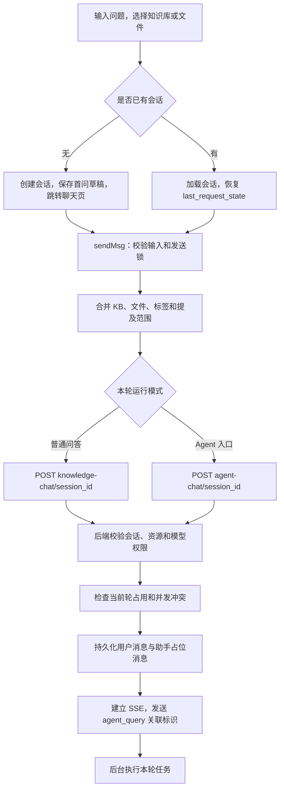
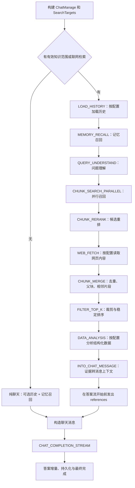
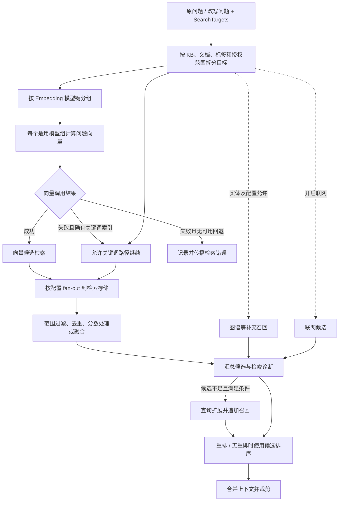
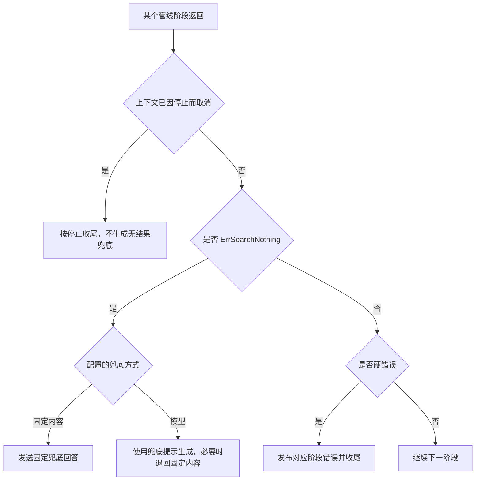

# 文档上传到用户问答：用户提问与检索

> 说明会话创建、问答编排和检索内部如何从问题找到正确片段。

## 1. 用户提问：从输入框到有权限的一轮对话

### 1.1 创建会话不是已经发起生成

新会话先调用 `POST /api/v1/sessions`，取得 `session.id`。当前前端把首问、提及项、模型、图片和附件草稿放进菜单状态，再跳转到 `/platform/chat/{id}`；聊天页接着执行 `sendMsg`，不是把完整问题塞进地址栏。

已有会话会读取 `session.last_request_state`，恢复本会话的输入配置。全局默认配置、会话恢复配置、尚未发送的草稿是不同层；异步加载只能在会话标识仍一致时生效，否则会把甲会话的选择覆盖到乙会话。



图中接口均位于 `/api/v1` 下。当前创建会话页面还发送部分 `agent_config`，但后端是否采纳要看请求结构和实际配置解析；可靠的检索范围仍要查看本轮问答请求及后端归一化结果，不能假设“会话永久绑定一个知识库”。

### 1.2 普通知识库问答请求示例

下面是说明字段关系的最小示例，标识为占位值，需换成自己有权访问的真实资源：

```http
POST /api/v1/knowledge-chat/session-example
Authorization: Bearer <access_token>
Content-Type: application/json
X-Request-ID: request-example

{
  "query": "采购金额超过十万元时需要谁审批？",
  "knowledge_base_ids": ["kb-example"],
  "knowledge_ids": ["knowledge-example"],
  "agent_enabled": false,
  "channel": "web"
}
```

同时给出知识库和文件是允许出现的请求形式，但不能自行理解为两个独立条件的简单交集。后端会把知识库范围、指定文档、标签、共享来源和提及信息归一化为 `SearchTargets`。要只查一个文件时，优先明确发送该文件范围，并核对最终目标集合，避免同时额外选择整个知识库而扩大搜索。

| 输入来源 | 前端如何汇入请求 | 后端必须确认什么 |
| --- | --- | --- |
| 知识库选择器 | `knowledge_base_ids` | 是否可读、属于本租户还是被授权共享、可用的检索配置 |
| 指定文件和 `@file` | `knowledge_ids`、`mentioned_items` | 文件真实所属知识库与权限，不能信任客户端提供的归属 |
| `@kb`、标签 | 知识库范围、`tag_ids`、提及项 | 标签所属知识库及解析后的文档集合 |
| 模型选择 | `summary_model_id` 等 | 类型、执行租户和使用权限 |
| 助手选择 | `agent_id`、可能的来源租户 | 助手权限与真实配置；不是仅信任 `agent_enabled` |
| 临时附件 | `attachment_ids` 或内联附件内容 | 当前会话归属、解析就绪、大小及使用范围 |
| 联网、工具和技能 | `web_search_enabled`、`mcp_service_ids`、`skill_names` 等 | 是否被配置允许、是否真的可用 |

只有标签的有效范围也可能需要检索，不能只判断 `knowledge_base_ids.length > 0`。共享知识库要携带并校验来源租户信息；“当前执行租户”和“知识库归属租户”在合法共享场景下可能不同。

### 1.3 用户消息与助手占位的创建顺序

后端先保存用户消息，再创建 `is_completed=false` 的助手消息。助手占位创建失败时有回滚用户消息的路径。前端本地也会先显示输入内容，但本地临时消息不等于服务端已经接受。收到 `agent_query` 中的 `assistant_message_id` 后，才可把本次生成与服务器消息、停止接口和恢复接口关联起来。

请求头的 `X-Request-ID` 用于关联日志和本轮事件；不要把它未经验证就当作“重复 `POST` 必然幂等”的保证。并发占用、轮次租约和消息归属由服务端检查，前端的发送按钮锁只改善交互。

## 2. 问答编排：普通检索、纯聊天与 `Agent`

### 2.1 普通知识库问答的实际管线



图是当前事件编排的可读展开，不表示每个节点都会实际调用模型。`LOAD_HISTORY` 受历史轮数控制；联网抓取、数据分析等按配置插入或自行跳过；问题理解得到“不需要检索”的意图时，后续检索插件也可跳过。纯聊天仍可能包含临时附件、图片说明或引用文本，不能把“未选择知识库”等同于“没有任何额外上下文”。

### 2.2 问题理解阶段的产出

1. 保留原始 `query`，初始化用于召回的 `RewriteQuery`。原问题用于展示、历史和最终作答，改写问题主要帮助检索。
2. 有历史时，把“那它的审批人呢”这类省略表达补全为可独立检索的问题。
3. 根据配置识别检索意图、处理图片说明或相关信息。
4. 改写关闭、无适用模型或改写失败时，可以保留原问题继续；不能因此丢失用户输入。
5. 问题理解、向量检索、重排、聊天生成是不同阶段，分别记录耗时和失败位置。

### 2.3 三类入口的不同职责

| 入口/模式 | 工作目标 | 是否一定生成回答 |
| --- | --- | --- |
| `POST /api/v1/knowledge-search` | 不依赖会话的知识检索 | 否，主要返回检索结果 |
| 知识库级 `hybrid-search` | 对目标知识库执行检索，配置可包含重排 | 否，不等于完整会话生成 |
| `POST /api/v1/knowledge-chat/{session_id}` | 普通管线问答 | 是，含流式回答与消息生命周期 |
| `POST /api/v1/agent-chat/{session_id}` | 根据助手配置运行对应模式 | 有效配置可能进入工具循环，也可能走普通快速回答 |

真正的 `Agent` 模式可在工具调用、结果观察和继续生成之间循环；知识检索只是可用能力的一部分，不能把普通管线图硬套成每个 `Agent` 的固定执行顺序。当前 `Agent` 请求还要有可解析的助手标识；自定义助手配置优先于请求布尔值。第一次亲手实现建议先完成普通知识库问答，再扩展工具循环和审批等能力。

## 3. 检索内部：问题怎样找到正确的片段

### 3.1 从范围到候选结果



上图的存储扇出表示后端适配与并行搜索层；向量、关键词并不是先查完再把相同工作重复提交一次。代码中这些层次互相协作，图把职责分开以便学习。图谱、`Wiki` 相关能力以及联网召回取决于知识库类型、目标和配置，不是任何一次普通文档检索都触发。

### 3.2 为什么按 `Embedding` 模型分组

同一问题对使用不同向量模型的知识库，需要各自对应的问题向量。不同模型即使向量维数相同，也不能据此认定语义空间相同。当前搜索会按模型键分组，组内复用问题向量，减少重复调用；不能把所有知识库的向量无条件混到一个索引空间。

同时区分几种“数量”：召回候选数、重排候选数、最终上下文数量和模型输入令牌预算。增大召回候选数并不意味着要把全部候选交给聊天模型。

### 3.3 分数融合不是直接相加

当前融合代码针对不同路径采用不同处理：向量单路保留相应分数；关键词单路会做列表内归一化；混合路径使用加权倒数排名融合，并做归一化。以下是理解公式，不是需要硬编码进新项目的固定参数：

```text
raw_score = vector_weight / (k + vector_rank)
          + keyword_weight / (k + keyword_rank)

normalized_score = raw_score / ((vector_weight + keyword_weight) / (k + 1))
```

没有出现在某路结果中的候选不应虚构一个真实命中排名。`BM25` 分数与向量相似度的量纲不同，不能直接按 `0.7 × cosine + 0.3 × BM25` 猜测当前实现。跨引擎分数处理也有条件，不是所有引擎结果都统一重标定。

显式选中文档或标签范围可能调整召回阈值，避免已明确指定的范围在重排前全被筛掉。这并不等于绕过权限，也不意味着答案一定来自该范围的每份文件。

### 3.4 重排、合并、裁剪的先后关系

| 阶段 | 主要职责 | 为什么需要 |
| --- | --- | --- |
| 召回 | 快速找到可能相关的块 | 重在覆盖，允许有噪声 |
| 重排 | 使用适用的重排配置重新比较问题与候选 | 从候选中选出更能回答问题的证据 |
| 初次去重 | 按标识与内容签名去重 | 同一段可能被多条召回路径命中 |
| 历史引用补入 | 按管线条件补充相关历史证据 | 追问可能依赖上一轮已找到的内容 |
| 父块还原 | 从子块回到更完整上下文 | 防止只命中结论，却漏掉限定条件 |
| 同来源合并 | 同文档、同块类型的连续或重叠范围合并 | 减少重复文本 |
| `FAQ` 回答补全 | 对适用条目恢复问题对应的回答 | 检索文本与最终可用答案不一定是同一字段 |
| 相邻块扩展 | 为过短的证据补上下文，再次合并与去重 | 避免句子或表格被截断 |
| 最终裁剪 | 按稳定顺序保留适用数量，记录被截断信息 | 控制输入规模，避免随机抖动 |

未配置重排、模型不可用或调用失败时存在候选回退路径，不能写成“重排永远成功”。最终 `TopK` 还存在保留项等规则，不应机械断言所有输出数组长度始终严格等于配置值。模型上下文预算还需独立控制。

### 3.5 没有结果、系统失败、用户停止要分开



这一顺序很重要：停止导致检索调用取消时，结果可能表现为空；必须先检查取消，否则刷新后会把“用户停止”错误地保存成“未找到答案”。数据库、模型或检索服务不可用也不能统一伪装成业务上的无结果。
