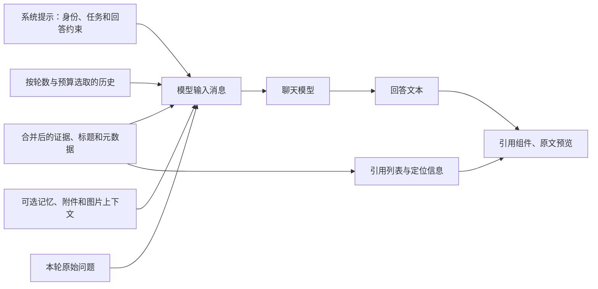
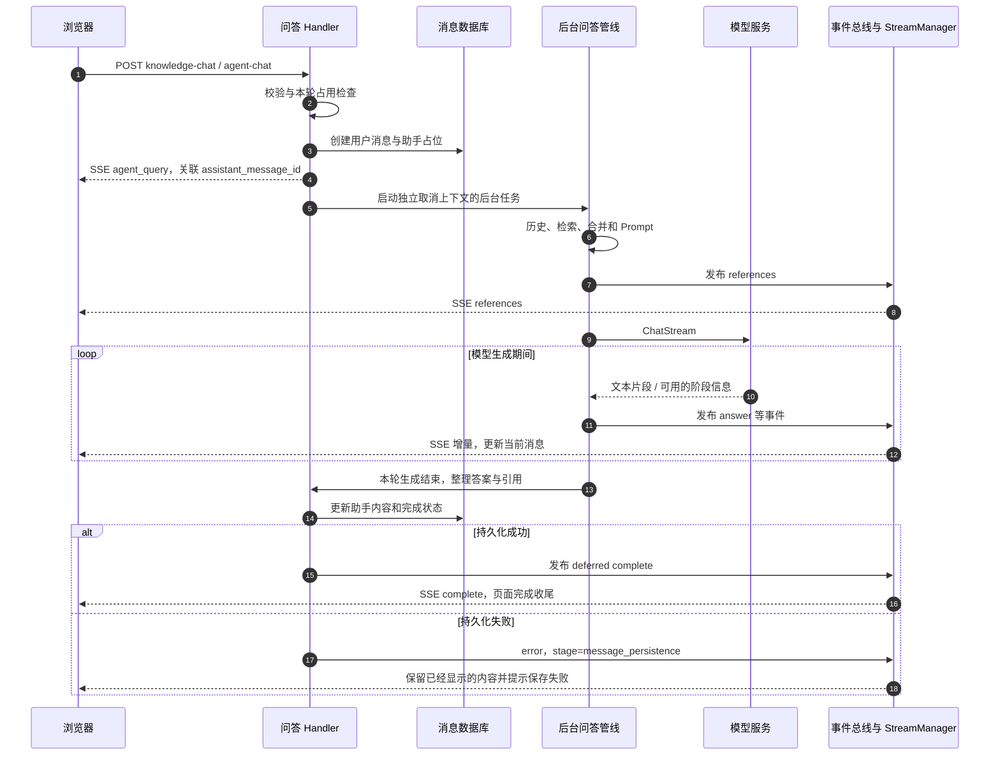

# 文档上传到用户问答：证据、Prompt与流式回答

> 说明检索证据如何进入模型上下文，以及回答如何通过事件和 `SSE` 返回。

## 1. 证据到 `Prompt`：模型看到什么，用户能追溯什么

### 1.1 输入消息的组成



现有 `INTO_CHAT_MESSAGE` 会把合并结果放入上下文模板，并可附加文档标题、说明、自定义元数据以及图片。开启 `FAQ` 优先时，对高置信度 `FAQ` 和普通文档上下文做区分；判断置信度不能只看人为加权后的分数。

以下仅解释结构，**不是仓库模板的逐字复制**：

```text
系统要求：按照允许的任务和输出规则作答。
历史：上一轮用户问题和已经结束的助手回答。

<context id="source-example">
文档：采购管理规定
章节：审批权限
证据：金额超过十万元的采购，应由指定负责人审批。
</context>

当前问题：采购金额超过十万元时需要谁审批？
```

对亲手实现的新版本，要把文档内容作为证据数据处理：文档里的“忽略系统要求”等文字不能获得执行工具或扩大权限的能力。没有证据就应按约定说明不足，不能用模型生成的文字伪造来源。

### 1.2 引用不是只存一个 `chunk_id`

当前引用以 `SearchResult` 为主要结构，包含结果标识、正文、知识标识、标题、块顺序、位置、匹配类型、分数、父子块关系等；可选字段还包括 `source_locators`、图片、匹配片段、知识库标识及元数据。`VectorScore` 在对应结构中不直接作为对外 `JSON` 字段输出，不能凭想象要求每条引用都有 `vector_score`。

| 用户动作 | 前端所需数据 | 相关读取入口 |
| --- | --- | --- |
| 展示“来源文档” | 文档标题、知识标识、命中片段 | 问答流返回的引用 |
| 查看精确块 | 块标识、父子或子块信息 | `GET /api/v1/chunks/by-id/{chunk_id}` |
| 查看文档详情 | `knowledge_id` | `GET /api/v1/knowledge/{id}` |
| 打开原文预览 | 原文类型、权限、定位信息 | `GET /api/v1/knowledge/{id}/preview` |
| 定位页码/文本/图片 | `source_locators` 等 | 预览组件在拿到内容后执行定位 |

引用加载也有异步竞争：切换会话要隔离引用缓存；连续打开两篇文档时，第一篇的迟到响应不能覆盖第二篇。现有前端使用带范围的缓存键、加载版本和定位令牌处理这些问题。

### 1.3 用一个贯穿案例验收理解

假设你自己创建测试文档 `采购规则.md`，写明“超过十万元需要财务负责人复核”，再问“采购十二万元找谁复核”：

1. 上传返回文档标识，但此时不直接断言答案可用。
2. 处理任务读取文件，保存包含该句的块，并建立对应索引。
3. 问题理解可以保留原问题；检索问题与“十二万元”相关语义或关键词。
4. 候选中找到“超过十万元”的规则，父块或邻居补入适用条件。
5. 模型输入包含规则、问题和必要历史，不是重新读完整磁盘文件。
6. 流中先后出现关联标识、引用和答案；前端逐段显示。
7. 最终答案与引用写入消息记录；刷新后仍可查看。
8. 点击引用应回到这份测试文档的相关内容；如果模型答对但引用指向另一租户的文件，仍然是验收失败。

此案例是建议自己制作的测试夹具，不是对当前环境真实模型效果的测试结果。

> 说明事件、缓存、`SSE`、停止生成、刷新恢复、异常和一致性边界。

## 2. 流式输出：事件、缓存、浏览器和数据库的时序

### 2.1 为什么要分事件总线、流缓存和 `SSE`



图展示正常成功路径及保存失败分支。内部 `EventAgentComplete` 会先准备完成数据，但对外 `complete` 延后到消息持久化成功之后发布。不能因为内部事件名字含完成，就把它画成早于保存的对外成功承诺。

事件总线让生成逻辑不直接依赖某一个浏览器连接；`StreamManager` 暂存事件；`SSE` 负责把事件写入当前 `HTTP` 响应。当前支持内存和 `Redis` 等配置路径，内存不跨进程持久；`Redis` 事件也有过期时间，当前工厂默认缓存时长为 `1` 小时。恢复能力不是无限期保留全部生成记录。

### 2.2 当前真实的 `SSE` 外层格式

前端使用 `@microsoft/fetch-event-source` 发送带认证信息的 `POST`，解析每个 `data:` 中的 `JSON`，按其 `response_type` 分发。不是简单用原生 `EventSource` 向生成接口发 `GET`。

下面仅示意最关键字段；真实事件还可携带 `data`、用量、结束原因和更多引用信息：

```text
data: {"id":"request-example","response_type":"agent_query","content":"","done":false,"session_id":"session-example","assistant_message_id":"assistant-example"}

data: {"id":"request-example","response_type":"references","content":"","done":false,"knowledge_references":[{"id":"chunk-example","knowledge_id":"knowledge-example","knowledge_title":"采购规则","content":"超过十万元需要财务负责人复核。"}]}

data: {"id":"request-example","response_type":"answer","content":"需要财务负责人","done":false}

data: {"id":"request-example","response_type":"answer","content":"复核。","done":true}

data: {"id":"request-example","response_type":"complete","content":"","done":true}

```

**答案增量在顶层 `content`，不是固定在 `data.content`。**引用通常读取顶层 `knowledge_references`，现有处理器还兼容 `data.references` 等形态。`id` 是外层关联字段；不同事件还可能有自己的 `data.event_id`，二者不要混用。

| `response_type` | 主要作用 | 前端应如何处理 |
| --- | --- | --- |
| `agent_query` | 握手，给出会话和助手消息标识 | 关联服务端消息、停止与续流目标；普通问答也使用此名字 |
| `references` | 提供知识引用 | 更新来源列表，与答案正文分开维护 |
| `thinking` | 适用模型和流程输出的过程片段 | 按产品规则展示过程区，不拼进最终答案 |
| `progress` | 阶段进度，可能是累计快照 | 根据事件标识更新，不把每次快照重复追加 |
| `answer` | 回答片段 | 追加或按 `data.replace` 替换；保留截断、兜底等标记 |
| `tool_call` / `tool_result` | 工具输入、结果与执行状态 | 按 `tool_call_id` 配对，保留结果完整数据 |
| `session_title` | 异步会话标题 | 更新对应会话菜单，不混入答案 |
| `error` | 生成或保存失败 | 展示错误；`message_persistence` 单独提示保存问题 |
| `complete` | 整轮结束数据 | 更新完成状态、用量、最终内容，解除发送锁 |
| `stop` | 服务端停止信号 | 结束当前展示，保留允许保留的已有内容 |
| `heartbeat` | 连接活性 | 重置空闲计时，不进入聊天正文 |

还有审批、挂起/恢复、后台工作等高级事件，不属于第一版文档问答的必要实现范围。前端派生展示项 `agent_complete` 不是外层协议里的完成类型，真实外层名称是 `complete`。

### 2.3 三种容易误读的结束信号

1. `answer.done=true` 只结束该答案段，不能证明整轮已持久化成功。
2. 正常路径的 `complete` 在保存后发布；错误路径也可能保存失败说明或部分答案，再进行完成清理。因此消费者仍要保留错误状态，不要收到后续 `complete` 就擦掉错误。
3. `HTTP` 连接关闭可能来自正常结束、网络波动、切页或用户本地中止，不能一律当成功，也不能一律当后端已取消。

当前普通问答错误处理会尽力保存已有内容及错误说明，`is_completed` 表示该消息处理结束，不等于回答业务成功。建议新 `Python` 协议明确区分成功、失败、停止；兼容现有协议时要为上述组合保留测试。
