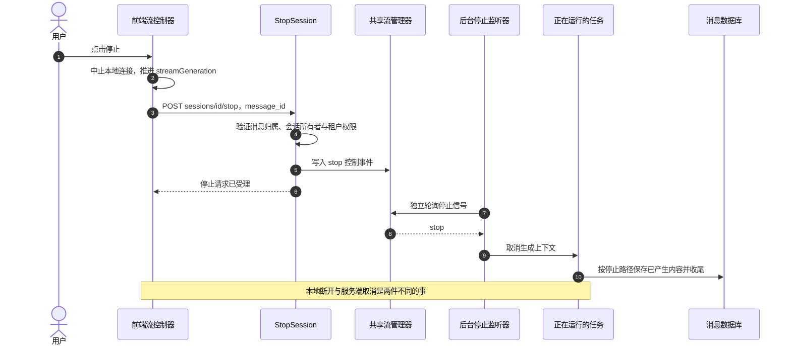
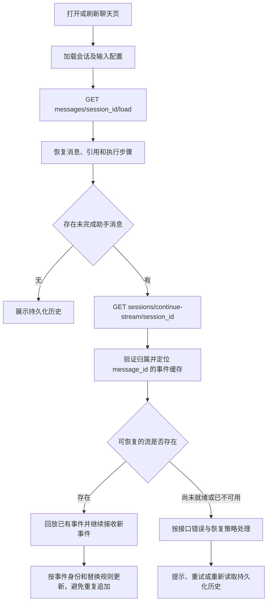

# 文档上传到用户问答：停止恢复与异常一致性

> 说明停止、刷新、断线恢复、历史加载，以及失败和一致性边界。

## 1. 停止、刷新、断线恢复和历史加载

### 1.1 停止生成必须有服务器动作

后台任务的取消上下文与浏览器连接分离，所以页面刷新时后台可以继续生成；停止监听也能在原连接断开后工作。停止接口返回成功代表信号被接受，不能承诺远端模型立刻停止计费或所有调用立即退出。已完成消息的停止请求有幂等处理。

### 1.2 刷新后先恢复消息，再决定是否续流

历史接口为 `GET /api/v1/messages/{session_id}/load?limit=20`；向上翻页携带 `before_time`。续流接口为 `GET /api/v1/sessions/continue-stream/{session_id}?message_id={assistant_id}`。恢复使用已存在的助手消息，不应重新发送已经接受的提问 `POST`，否则可能创建第二轮生成。

### 1.3 当前前端自动恢复的真实边界

| 场景 | 当前行为 | 注意 |
| --- | --- | --- |
| 新流开始或旧流停止 | 更新 `streamGeneration` | 旧回调不能继续改当前消息 |
| 握手遇到 `401` | 允许刷新凭据后重放一次 | 是认证恢复路径，不等于任意失败都可重发生成请求 |
| 活跃 `Agent` 流断线 | 非内嵌、已有助手标识、未终止等条件下可恢复 | 入口需满足 `agent-chat` 或 `continue-stream` 条件 |
| 普通 `knowledge-chat` 原连接断线 | 不满足同一套自动重连条件 | 不能在文档里承诺全部聊天流自动恢复 |
| 恢复连接的空闲检查 | `30` 秒无心跳触发；退避 `1/2/4/5` 秒 | 最多 `8` 次连续失败；事件到达会重置连续失败计数 |
| 页面重新加载发现未完成消息 | 页面可主动请求 `continue-stream` | 与原始连接的自动重连条件是两层逻辑 |
| 正常 `complete` | 原位更新当前消息和后续推荐等 | 并非每次都无条件全量重载历史 |
| 内存流管理器重启或缓存过期 | 可能失去回放事件 | 仍须依赖消息记录判断可展示的持久内容 |

会话临时附件、语音输入、内嵌渠道和即时通信来源有各自补充路径。学习时先掌握当前网页普通知识库问答，再分别补这些差异，不要用一个没有条件的“全部自动恢复”箭头概括。

## 2. 异常与一致性：失败后留下了什么

### 2.1 把失败落到具体阶段

| 失败位置 | 用户可能看到什么 | 当前链路中要核对的状态或行为 | `Python` 重构的最低验收 |
| --- | --- | --- | --- |
| 上传鉴权/大小/格式校验 | 立即报错 | 是否尚未创建文档和任务 | 拒绝请求时不遗留可被其他人读取的文件 |
| 文件保存后数据库失败 | 上传失败 | 是否尝试删除刚保存的文件；补偿是否失败 | 可追踪孤立文件，不假设跨存储事务 |
| 文档创建后入队失败 | 甚至可能收到成功外层 | `data.parse_status=failed` 与错误原因 | 界面能识别“记录存在但任务没启动” |
| 解析器超时/内容非法 | 文档长期处理或失败 | 任务、处理轮次、阶段记录、最终失败状态 | 超时后有明确终态或可恢复记录 |
| 部分图片失败 | 正文可用，但图片理解不完整 | 图片终态与汇合是否释放；正文是否仍保留 | 不把可选图片失败误报为全篇完美处理 |
| 块保存成功、索引失败 | 文档有块却搜不到 | 索引回滚、块清理与清理失败日志 | 重跑不能制造不可控重复索引 |
| 增强任务失败 | 文档可能仍到 `completed` | `summary_status`、任务错误、计数收敛 | 主状态与增强状态能分别说明结果 |
| 检索无结果 | 兜底回答 | 是否真的零结果，而非权限/模型/服务错误 | 无结果测试与服务异常测试分开 |
| 模型流意外中断 | 已有半段答案后报错 | 不完整结束与长度截断的区分 | 保存部分内容及失败结果，不假装成功 |
| 答案生成完但保存失败 | 页面有答案，刷新可能丢失 | `error.stage=message_persistence`，没有成功完成承诺 | 明确提示保存失败，保留屏幕上的答案 |
| 浏览器断线 | 页面不再增长 | 后台是否仍在运行、缓存是否能恢复 | 不重复提交已接受的提问 |
| 删除中某个关键步骤失败 | 文档仍处于删除过程 | 保留记录和源文件以供重试 | 重复删除可收敛，且不误删共享来源 |

### 2.2 幂等、轮次与重试不是同一个概念

1. **上传去重**识别同一知识库下已经存在的文件内容。文件名相同不代表内容相同，大小相同也不够。
2. **任务重试**可能执行相同任务多次。保存块、索引和结算计数时，需要避免一次业务动作被重复计入。
3. **处理轮次 `attempt`**区分“旧任务还没停”和“用户已经要求重新处理”。旧轮次晚到不得将新文档标为完成或写回旧内容。
4. **问答恢复**是继续读取已存在的一轮事件；不是重新执行问题。
5. **最终完成标记**必须与关键数据写入有正确先后关系，不能让界面已经宣告完成，数据库却只有占位消息。

现有 `FinalizeSubtask` 把减计数和有条件的状态提升放在同一数据库事务中，并检查仍为 `finalizing` 且计数为零。这个局部事务解决并发结算问题，并不把文件、索引、队列和消息流都变成一个事务。

### 2.3 停滞巡检是补偿机制，不是即时保证

当前有最终失败钩子和 `housekeeping`，结合处理 `spans`、活动时间、队列任务以及 `Wiki` 持久待办判断异常。`Wiki` 还使用 `task_pending_ops`、失败次数和死信等机制。不同任务覆盖范围不同，不能概括为“所有错误都会自动重试直到成功”。

调试停滞时先确认任务是否真的孤立：排队拥堵、模型慢、尚有合法的 `Wiki` 待办，都可能与完全失联不同。新版本至少要让失败可见、可人工重试，再按生产需求补巡检，不能只给页面加一个更长的轮询定时器。

> 说明主链路之外的分支、全 `Python` 重构步骤、验收清单、排错路线和源码索引。
