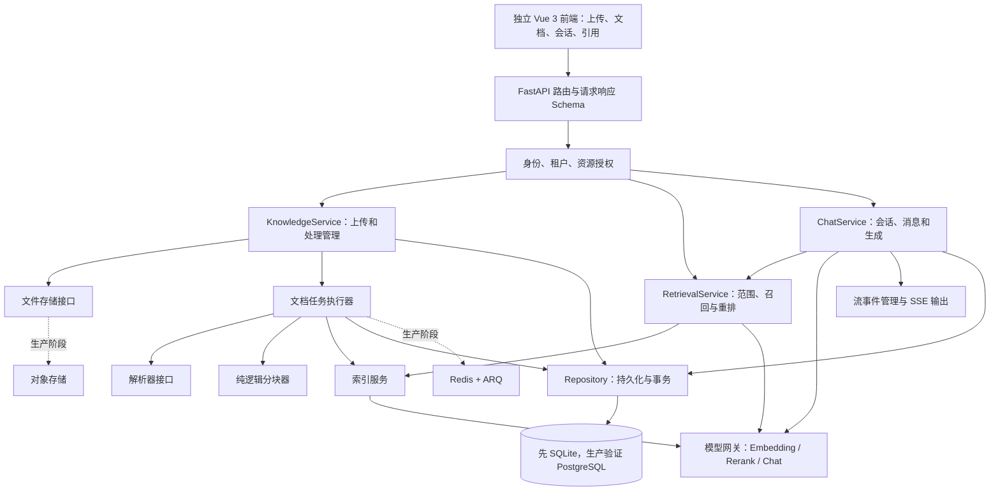
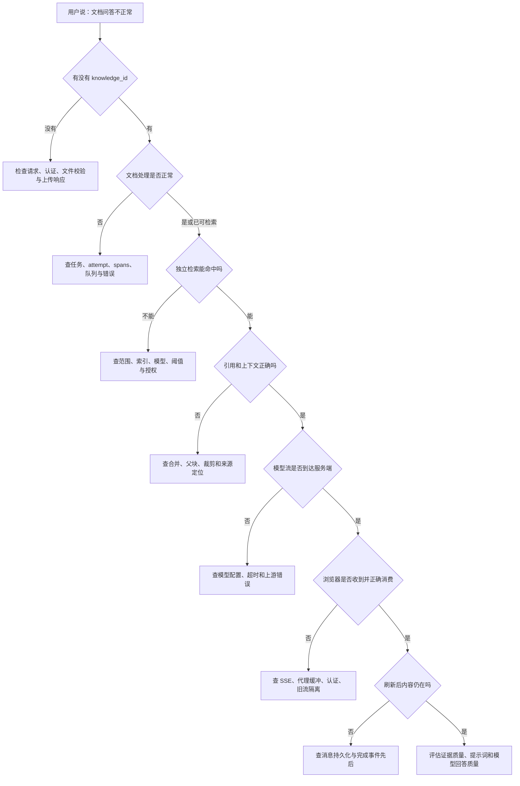

# 文档上传到用户问答：重构实施与验收

> 说明主链路之外的分支、全 `Python` 重构、验收、排错和源码索引。

## 1. 主链路之外的分支：现在理解，按阶段实现

| 能力 | 插入位置 | 与普通文件问答的差异 | 学习优先级 |
| --- | --- | --- | --- |
| 扫描件与 `OCR` | 解析及图片处理 | 没有文本层时必须识别文字，并保留来源定位 | 文本闭环之后 |
| 图片说明与多模态检索 | 图片任务、查询图片、消息上下文 | 涉及视觉模型、图片索引和图片资源权限 | 按实际材料需要增加 |
| 音频/视频 | 解析入口与任务配置 | 需要转写或分段等专用处理，不能套普通文本解析 | 明确需要时增加 |
| 摘要与问题生成 | 核心处理后的增强任务 | 会新增模型费用和等待阶段；摘要不是全文检索的替代品 | 基础摄取稳定之后 |
| 图谱 | 入库抽取和查询补充召回 | 实体关系需要保留原块证据和知识库范围 | 单独阶段 |
| `Wiki` | 文档入库后的跨文档整理 | 有持久待办、`map/reduce`、来源撤回及知识库级收敛 | 单独阶段 |
| `FAQ` | 专用知识条目与检索/上下文 | 问题命中和回答正文分离，高置信度有特殊优先策略 | 检索基础完成之后 |
| 联网检索 | 查询管线 | 外部页面是额外来源，不等于用户已上传的私有文档 | 作为可关闭扩展 |
| 会话临时附件 | 提问前上传及上下文准备 | 会话级生命周期，不自动变成永久知识库资料 | 基础聊天之后 |
| `Agent/MCP` | 助手运行与工具循环 | 工具选择、审批、挂起、权限和错误面更多 | 按实施计划的扩展阶段 |
| 会话消息索引、记忆和推荐问题 | 回答保存后的可选旁路 | 失败不应覆盖已经保存的主答案 | 最小问答闭环之后 |

贯穿所有分支的权限边界包括：上传写权限、检索读权限、共享来源授权、会话所有权、模型与工具可用范围、引用原文访问。前端隐藏按钮只能改善体验，服务端必须独立检查；不能因为已经拿到某个 `knowledge_id` 或 `chunk_id` 就直接返回内容。

## 2. 全 `Python` 重构：把现有链路转换成可实现的步骤

> 本节是目标实现建议。当前目录没有 `python/backend/` 和 `python/frontend/`，以下路径、函数边界、测试均是待建立的产物，不是已经存在的实现。与[逐步实施计划](../Python全栈重构逐步实施计划.md)配合使用；保留已约定的数据库结构及 `/api/v1` 契约，不把 `integration-web` 当新前端基础。

### 2.1 先拆职责，再选择基础设施



不要第一天就把所有适配器和任务平台建齐。最小闭环按现有计划使用 `SQLAlchemy 2 async + SQLite`、本地文件和确定性假模型；生产阶段再验证 `PostgreSQL`、`Redis + ARQ` 和对象存储。假模型只用于验证流程，不代表真实语义检索或回答质量已验收。

建议文件归属如下，具体文件名可以随真实工程约定调整：

```text
python/backend/
  app/
    main.py
    api/v1/                 # 路由、参数与协议适配
    schemas/                # 上传、检索、聊天和流事件结构
    core/                   # 配置、数据库、认证及日志基础
    domain/entities/        # 与既定数据结构一致的实体
    services/               # knowledge、retrieval、chat 的业务编排
    repositories/           # 数据访问与事务
    integrations/           # 文件、解析器、模型、索引适配
    workers/                # 文档任务入口和生产队列接入
  tests/
    unit/                   # 分块、状态、范围、事件归约
    contract/               # API、状态、SSE 和数据结构契约
    e2e/                    # 上传 → 检索 → 提问 → 历史

python/frontend/src/
  api/                      # 请求、上传与 SSE transport
  stores/                   # 当前用户、上传队列、会话状态
  composables/              # 可复用的上传/聊天状态管理
  views/                    # 知识库与聊天页面
  components/               # 上传进度、消息、引用和预览
```

`services/` 负责业务顺序；`repositories/` 负责持久化；模型调用放在网关适配层。不要把磁盘操作、分块、模型调用和流输出全部塞进一个路由函数。另一方面，也不需要把每个简单步骤再包装成一套通用工作流平台。

### 2.2 按这个顺序实现并打通每一段

| 顺序 | 亲手实现的最小内容 | 当步必须看见的结果 | 对照章节 |
| --- | --- | --- | --- |
| `01` | 记录接口、字段、文档状态与流事件契约 | 明确哪些保留现有行为，哪些属于后续扩展 | `3/5/8/12` |
| `02` | 后端启动、配置、数据库迁移、前端空壳 | 健康检查和数据库创建可重复执行 | 实施计划阶段 `1/2` |
| `03` | 用户、租户、会话/知识库资源授权 | 同租户合法访问通过，越权访问被拒绝 | `8/15` |
| `04` | 知识库管理与假模型网关 | 能创建库，三种模型职责明确 | `4/10` |
| `05` | 文件保存与 `knowledge` 创建 | 返回真实文档标识，原件可受控读取 | `3` |
| `06` | 任务记录与最小异步执行 | 上传快速返回，后台状态可查询 | `3/5` |
| `07` | 先支持文本和 `Markdown` 解析 | 能检查规范化正文及来源信息 | `4` |
| `08` | 确定性分块与块持久化 | 同一输入得出稳定的块顺序和边界 | `4/7` |
| `09` | 单一检索存储与假 `Embedding` | 指定文档的测试句能被稳定查到 | `10` |
| `10` | 查询范围与过滤，先做独立检索接口 | 无需聊天模型就能检查候选及权限 | `8/10` |
| `11` | 合并证据、引用结构和输入预算 | 能打印受控的上下文结构并追到原文 | `11` |
| `12` | 会话、用户消息、助手占位 | 每一轮生成有可查询的真实标识 | `8` |
| `13` | 假聊天流与 `answer/references/complete/error` | 页面连续显示文本，引用独立更新 | `12` |
| `14` | 保存后完成、刷新历史、保存失败处理 | 刷新不丢已完成答案，失败不会误报成功 | `12/13` |
| `15` | 停止、旧请求隔离、基础恢复策略 | 停止与断线语义分开，旧流不能串消息 | `13` |
| `16` | 上传/解析失败、重试、取消与重解析 | 重跑不会被旧任务覆盖或重复入索引 | `6/14` |
| `17` | 用真实解析器与模型替换假适配器 | 固定材料中能真实命中并正确引用 | `17` |
| `18` | 按需求加入混合检索、重排、父子块 | 与基础版本比较命中质量和延迟 | `4/10` |
| `19` | 按计划加入 `FAQ/Wiki/Agent/MCP` 等 | 每个扩展有独立的可关闭边界与验收 | `15` |
| `20` | 生产数据库、持久队列、对象存储、观测 | 进程重启、并发、故障和部署均能验证 | `14/18` |

完成每一步，都先用接口或小测试确认这一段，再接页面。不要等整套系统全部写完，才第一次验证文件是否真的能分块并检索。

### 2.3 两处必须明确处理的协议差异

**任务状态与文档状态：**实施计划给任务设计了 `queued → running → succeeded/failed`；这适合内部任务生命周期，但不能直接替换已有 `knowledge.parse_status` 的取值。兼容现有文档接口时，应分别维护任务状态和文档状态：任务开始可推动文档进入 `processing`，核心任务结束也可能只是进入 `finalizing`。如果当前版本没有增强任务，才可在核心成功后直接完成文档。取消、重解析与删除还要有各自明确的业务语义。

**业务终态与流的结束：**实施计划要求成功和失败互斥，而当前普通问答错误路径可能先发 `error`，随后保存并发布 `complete` 做收尾。兼容实现应保留已约定的外层行为，并在内部区分成功、失败、停止；后续的流收尾不能把失败改成成功。若未来要把外层协议改成严格只有一个终止事件，需要同步定义协议版本、前端消费和契约测试，不能在同一个兼容接口中悄悄变更。

另外，`ARQ` 是目标生产队列；现有 `Go` 队列使用 `Asynq`。二者不能共享一句“重试三次”就当行为完全等价；任务标识、超时、取消、失败钩子和重启恢复都需要重新验收。

### 2.4 第一版就要留下的可观测数据

每个处理记录至少能关联租户、知识库、文档、任务与轮次，说明开始时间、结束时间、当前阶段和失败原因。每轮对话至少能关联 `request_id`、`session_id`、用户消息与助手消息，并分别观察检索、模型首段输出、总生成和保存耗时。

这些数据用于回答“卡在哪里”，不要求把完整文档、完整提示词或密钥都写入日志。能复现问题的最小信息，比无边界记录所有内容更有用。

## 3. 验收清单：如何证明整条链路真的通了

> 以下是建议执行的测试清单，不是本次文档工作已运行的测试报告。先用确定性假模型验证编排，再单独验证真实解析、检索和生成质量。

### 3.1 最小闭环

- [ ] 创建测试用户、租户、模型配置和知识库，记录对应标识。
- [ ] 上传自己制作的 `采购规则.md`，其中包含至少两条容易区分的规则。
- [ ] 断言接口返回真实文档标识；即使传输已完成，页面仍能表示后台处理中。
- [ ] 等待文档达到本版本的可检索条件，并读取块列表或检查索引记录。
- [ ] 先通过检索接口提问，确认命中正确文档和片段。
- [ ] 创建会话，发送同一问题，确认用户消息和助手占位已经保存。
- [ ] 消费完整 `SSE`：拿到消息关联、引用、答案和明确的结束结果。
- [ ] 刷新页面，从消息接口重新取得答案和引用。
- [ ] 点击引用，预览能定位到对应的原文内容。
- [ ] 切换到没有权限的用户/租户，确认不能通过猜测标识读取这些内容。

### 3.2 风险优先的测试矩阵

| 场景 | 测试操作 | 通过标准 |
| --- | --- | --- |
| 同内容重复上传 | 重复提交同一文件 | 按明确去重契约返回，不生成无意义重复文档 |
| 同名不同内容 | 修改正文后再次上传同名文件 | 不因同名错误合并成旧内容 |
| 上传受理后队列失败 | 注入任务投递错误 | 用户能看见实际失败状态，记录可追查 |
| 解析失败 | 提供损坏文件或令解析器报错 | 文档有失败原因，不无限显示处理中 |
| 块与索引边界 | 让索引写入在块保存后失败 | 记录可重试/清理，重跑不会重复污染 |
| 旧轮次迟到 | 阻塞旧任务，再执行重解析 | 旧任务无法覆盖新正文、状态或计数 |
| 图片部分失败 | 一张图片任务失败，其他成功 | 汇合能结束，图片失败有证据，不无限等待 |
| 无检索结果 | 问文档完全不涉及的问题 | 使用约定兜底，不能伪造引用 |
| 检索服务失败 | 模拟向量或关键词后端异常 | 与真正无结果可区分 |
| 纯聊天 | 不给有效检索范围且不开联网 | 不强制调用知识库检索 |
| 仅标签范围 | 只通过合法标签指定范围 | 不被误判为纯聊天，不扩大到全部知识库 |
| 保存失败 | 模型正常结束后令消息更新失败 | 没有成功完成承诺，已显示答案仍可见 |
| 中途停止 | 检索中、首段前、生成中分别停止 | 不生成错误的无结果兜底，部分内容按约定保存 |
| 断网和刷新 | 收到助手标识后断开连接 | 不重复创建一轮；按支持范围续流或恢复历史 |
| 快速切会话 | 旧流未结束时打开另一会话 | 旧事件不能串入新会话，引用缓存隔离 |
| 跨租户资源标识 | 替换文档、块、会话或助手标识 | 每个入口独立执行授权 |
| 删除后旧任务回写 | 处理期间删除，再放行旧任务 | 不复活文档，不重建已禁止写入的内容 |
| 进程重启 | 上传/生成期间重启对应进程 | 行为与所选内存/持久模式的承诺一致 |

### 3.3 真实能力测试单独建立基线

使用你有权处理的样例：普通文本、带文本层的 `PDF`、扫描件、含表格文档、含图片文档。每类记录解析正文、块数、检索命中、引用定位、首段延迟和总耗时。真实模型测试需要显式开启并配置凭据；一次答案看起来正确，不代表权限、恢复、成本和引用都正确。

建议保存测试问题、预期来源及可接受的答案要点，不要求真实模型逐字输出同一句话。对确定性逻辑采用严格断言，对生成质量采用来源与事实约束，避免把整个答案字符串当作唯一标准。

## 4. 排错路线：沿着标识与阶段逐层定位



| 标识或证据 | 用于串起什么 | 常见排查问题 |
| --- | --- | --- |
| `tenant_id`、当前用户 | 权限与数据归属 | 是否选错空间；共享来源是否正确解析 |
| `knowledge_base_id` | 配置、模型、索引与搜索范围 | 入库和检索是否使用同一个知识库配置 |
| `knowledge_id` | 上传记录、源文件、处理任务与块 | 文档是否还存在；是否被取消、删除或重解析 |
| `attempt`、任务标识 | 当前有效处理与旧任务 | 是否有旧轮次覆盖或子任务没有结算 |
| `chunk_id`、来源定位 | 命中内容与原文 | 为什么答对了却引用错位置 |
| `request_id` | 一次请求及相关日志、事件 | 耗时发生在检索、生成还是保存 |
| `session_id`、`assistant_message_id` | 本轮消息、停止和恢复 | 是否停止了错误的消息；是否重复创建了轮次 |
| `response_type`、`data.stage` | 流协议与失败阶段 | 是网络断线、模型失败还是消息保存失败 |

先定位最早发生偏差的阶段，再看其下游。上传解析失败时先调整提示词没有意义；独立检索正确而答案错误时，也不应先重新上传全部文档。

## 5. 源码阅读索引与核对边界

下面的链接相对本文位置指向主仓库源码。函数名与符号是主要定位依据，行号只对应本文顶部的基线，后续更新可能移动。阅读顺序建议沿一份文档和一次问题走完主路径，再阅读可选分支。

### 5.1 上传与处理

| 顺序 | 源码入口 | 重点定位 |
| --- | --- | --- |
| `U01` | [上传选择器](../../../frontend/src/views/knowledge/components/KbUploadSourceDropdown.vue) | `handleFilesChange`，文件/目录输入 |
| `U02` | [知识库页面](../../../frontend/src/views/knowledge/KnowledgeBase.vue) | `enqueueUploads`、`handleUploadSourceFiles`、列表轮询与重解析 |
| `U03` | [上传确认](../../../frontend/src/views/knowledge/components/UploadConfirmDialog.vue) | 处理配置、模型要求与确认输出 |
| `U04` | [知识库 `API` 客户端](../../../frontend/src/api/knowledge-base/index.ts) | `uploadKnowledgeFile`、`batchQueryKnowledge`、`reparseKnowledge` |
| `U05` | [上传队列](../../../frontend/src/stores/uploadQueue.ts) / [状态映射](../../../frontend/src/stores/uploadTasksState.ts) / [参数与归属](../../../frontend/src/stores/uploadTasksCore.ts) | 传输取消、轮询、`generation`、`saving`、`finalizing` |
| `U06` | [知识路由](../../../internal/router/routes_knowledge.go) | 文件上传、权限守卫、管理和检索入口 |
| `U07` | [`Knowledge Handler`](../../../internal/handler/knowledge.go) | `CreateKnowledgeFromFile` 约第 `313` 行；实际响应约第 `457` 行 |
| `U08` | [文档创建服务](../../../internal/application/service/knowledge_create.go) | `createKnowledgeFromFile`，去重、保存、入队失败 |
| `U09` | [存储选择](../../../internal/application/service/knowledge_util.go) / [本地存储](../../../internal/application/service/file/local.go) / [资源目录](../../../internal/application/service/file/resource_catalog.go) | `resolveFileService`、`SaveFile`、资源绑定 |
| `U10` | [任务注册](../../../internal/router/task.go) / [轻量执行器](../../../internal/router/sync_task.go) / [任务参数](../../../internal/application/service/knowledge_task_options.go) | 任务分发、最终失败钩子、队列和超时 |
| `U11` | [文档处理](../../../internal/application/service/knowledge_process.go) | `processChunks` 约第 `404` 行；`ProcessDocument` 约第 `3816` 行；`convert` 约第 `4375` 行 |
| `U12` | [解析引擎注册](../../../internal/infrastructure/docparser/engine_registry.go) / [`gRPC` 解析器](../../../internal/infrastructure/docparser/grpc_parser.go) | 引擎分流、`ReadStream` 与条件回退 |
| `U13` | [`Python DocReader` 服务](../../../docreader/main.py) / [解析器选择](../../../docreader/parser/parser.py) | `ReadStream`、解析器注册和输出 |
| `U14` | [混合索引器](../../../internal/application/service/retriever/keywords_vector_hybrid_indexer.go) | `BatchIndex`、向量退避与索引保存 |
| `U15` | [图片任务](../../../internal/application/service/image_multimodal.go) | `Handle`、`checkAndFinalizeAllImages` |
| `U16` | [后处理](../../../internal/application/service/knowledge_post_process.go) / [状态仓储](../../../internal/application/repository/knowledge.go) | 子任务分发、`FinalizeSubtask`、事务内归零提升 |
| `U17` | [状态定义](../../../internal/types/knowledge.go) | `ParseStatus*`、`SummaryStatus*`、`pending_subtasks_count` |
| `U18` | [删除服务](../../../internal/application/service/knowledge_delete.go) / [停滞巡检](../../../internal/application/service/knowledge_housekeeping.go) | `executeKnowledgeDelete`、派生资源清理和恢复 |
| `U19` | [图谱抽取](../../../internal/application/service/extract.go) / [`Wiki` 调度](../../../internal/application/service/wiki_ingest.go) / [`Wiki` 批处理](../../../internal/application/service/wiki_ingest_batch.go) | 证据关联、持久待办、`map/reduce` 与结算 |

### 5.2 提问、检索与流式回答

| 顺序 | 源码入口 | 重点定位 |
| --- | --- | --- |
| `Q01` | [新建聊天页面](../../../frontend/src/views/creatChat/creatChat.vue) / [聊天页面](../../../frontend/src/views/chat/index.vue) | `createNewSession`、`loadSessionAndHydrate`、`sendMsg` |
| `Q02` | [前端流传输](../../../frontend/src/api/chat/streame.ts) | 请求字段、`streamGeneration`、重连条件、认证重试 |
| `Q03` | [前端流事件处理](../../../frontend/src/composables/useChatStreamHandler.ts) | `agent_query`、`answer`、`complete`、保存失败 |
| `Q04` | [聊天 `API`](../../../frontend/src/api/chat/index.ts) / [引用原文视图](../../../frontend/src/components/ChatReferenceSourceView.vue) | 历史、停止、文档预览和位置恢复 |
| `Q05` | [引用缓存](../../../frontend/src/utils/citationChunkCache.ts) / [引用侧栏](../../../frontend/src/composables/useChatReferencesDrawer.ts) | 范围隔离、块加载与引用选择 |
| `Q06` | [问答路由](../../../internal/router/routes_chat.go) / [请求类型](../../../internal/handler/session/types.go) | 会话、问答、独立检索、停止与续流 |
| `Q07` | [问答 `Handler`](../../../internal/handler/session/qa.go) | `parseQARequest`、`executeQA`、`setupSSEStream`、`completeStreamAssistantMessage` |
| `Q08` | [`Handler` 辅助函数](../../../internal/handler/session/helpers.go) / [流与停止处理](../../../internal/handler/session/stream.go) | `buildStreamResponse`、`startStopWatcher`、`StopSession`、`ContinueStream` |
| `Q09` | [事件到流的桥接](../../../internal/handler/session/agent_stream_handler.go) / [流管理器工厂](../../../internal/stream/factory.go) | `handleFinalAnswer`、`handleError`、延后 `publishCompletion`、存储模式 |
| `Q10` | [问答主服务](../../../internal/application/service/session_knowledge_qa.go) | `KnowledgeQA`、`KnowledgeQAByEvent`、无结果兜底及引用发布 |
| `Q11` | [问题理解](../../../internal/application/service/chat_pipeline/query_understand.go) / [并行召回](../../../internal/application/service/chat_pipeline/search_parallel.go) / [搜索实现](../../../internal/application/service/chat_pipeline/search.go) | 改写、意图、模型分组、各范围检索 |
| `Q12` | [知识库搜索](../../../internal/application/service/knowledgebase_search.go) / [搜索扇出](../../../internal/application/service/knowledgebase_search_fanout.go) / [融合](../../../internal/application/service/knowledgebase_search_fusion.go) | 候选来源、分数处理、加权 `RRF` |
| `Q13` | [检索重排](../../../internal/application/service/knowledgebase_search_rerank.go) / [管线重排](../../../internal/application/service/chat_pipeline/rerank.go) | 配置、阈值、候选数和回退边界 |
| `Q14` | [块合并](../../../internal/application/service/chat_pipeline/merge.go) / [最终裁剪](../../../internal/application/service/chat_pipeline/filter_top_k.go) | 去重、历史引用、父块、相邻块与保留项 |
| `Q15` | [上下文转消息](../../../internal/application/service/chat_pipeline/into_chat_message.go) / [模型消息准备](../../../internal/application/service/chat_pipeline/common.go) / [流式模型生成](../../../internal/application/service/chat_pipeline/chat_completion_stream.go) | `FAQ`、模板、历史、输入预算和流输出 |
| `Q16` | [搜索类型](../../../internal/types/search.go) / [聊天类型](../../../internal/types/chat.go) | `SearchTarget`、`SearchResult`、`StreamResponse` 与结束类型 |

### 5.3 如何维护这份图

1. 上传响应、任务状态、管线事件或 `SSE` 字段变化时，先更新对应流程图和表格，再更新测试契约。
2. 某个新 `Python` 模块真正完成后，用真实源码与测试证据替换本节的目标描述；不要只因为目录创建了就写“已实现”。
3. 图里注明的数值是当前代码值或默认值，部署覆盖与版本更新后应重新核对。
4. 本文以静态源码为依据；真实启用的模型、解析器、存储、队列和索引组合，仍需在具体部署环境验证。

### 5.4 本次文档校验

`19` 张流程图、时序图、状态图和关系图均通过 `Mermaid 11.15.0` 语法解析；正文的 `64` 个本地文档/源码链接均检查了目标存在，主章节编号为连续的 `1`～`19`。这里只验证了图表语法和文档结构，没有完成各阅读器中的视觉排版检查，也没有运行真实上传、数据库、模型调用或浏览器端到端测试。
