# 文档上传到用户问答：全链路流程图与实现说明

> 核对日期：`2026-11-05`；源码基线：`5e65ef7`。本文用于理解当前系统，并配合[`Python` 全栈从零实施计划](./Python全栈重构逐步实施计划.md)亲手实现新版本。
> **阅读边界：**“现有实现”依据仓库根目录的 `frontend/`、`internal/`、`docreader/`；“`Python` 目标”是设计建议，不表示已经实现。当前工作树没有 `refactor/python/`。新前端按计划独立建立在 `python/frontend/`，不依赖 `integration-web/`。

## 1. 先建立正确的整体认识

这个功能不是一个“上传文件后直接让大模型回答”的接口，而是两条通过知识库数据衔接的链路：

1. **摄取链路：**文件 → 存储 → 文档记录 → 异步解析 → 分块 → 索引 → 配置要求的后处理 → 可用知识。
2. **问答链路：**问题和检索范围 → 鉴权 → 会话与消息 → 问题理解 → 检索 → 整理证据 → 模型生成 → 流式展示 → 持久化。

文档通常在上传时处理一次，用户每次提问时处理的是问题和检索候选；普通问答不会重新解析全部原始文件。重新解析是另一项显式操作。

### 1.1 四种“完成”必须分开

| 看到的信号 | 实际含义 | 不能据此推断 |
| --- | --- | --- |
| 上传进度到 `100%` | 浏览器完成请求体传输 | 后端已经解析完、索引可用 |
| 上传接口返回 `success=true` | 接口返回了文档创建结果 | 异步任务一定成功，甚至不能忽略返回的 `parse_status` |
| 文档进入 `completed` | 当前文档处理流程达到终态 | 所有租户均可读、每个问题都能召回它 |
| 问答收到 `complete` | 当前流的结束处理已发布 | 内容必然正确；现有错误路径也可能完成清理后发布此事件 |

`Embedding` 把文本或图像映射为检索用的向量；`Rerank` 对已召回的候选再打分；聊天模型根据上下文生成答案。它们是三种不同职责，不应共用一个没有明确类型的“调用大模型”函数。

### 1.2 从哪些地方开始阅读

| 你正在解决的问题 | 对应章节 |
| --- | --- |
| 想先看全貌 | 第 `2` 节 |
| 上传为什么立即返回、后台又在做什么 | 第 `3`～`6` 节 |
| 文件、分块、索引、消息分别存在哪里 | 第 `7` 节 |
| 问题如何找到文档，如何变成模型输入 | 第 `8`～`11` 节 |
| 页面如何逐字显示，停止和刷新如何处理 | 第 `12`～`13` 节 |
| 用 `Python` 从零实现时如何划分模块 | 第 `16` 节 |
| 如何验收、如何排错、去哪里读源码 | 第 `17`～`19` 节 |

所有图均使用 `Mermaid`；支持它的 `Markdown` 阅读器会直接渲染，不支持时可阅读对应的阶段表和箭头文本。图中的虚线用于表示可选或旁路工作，条件分支表示配置或权限决定，不是每次都会执行。

## 2. 全局总览：数据先入库，问题再检索

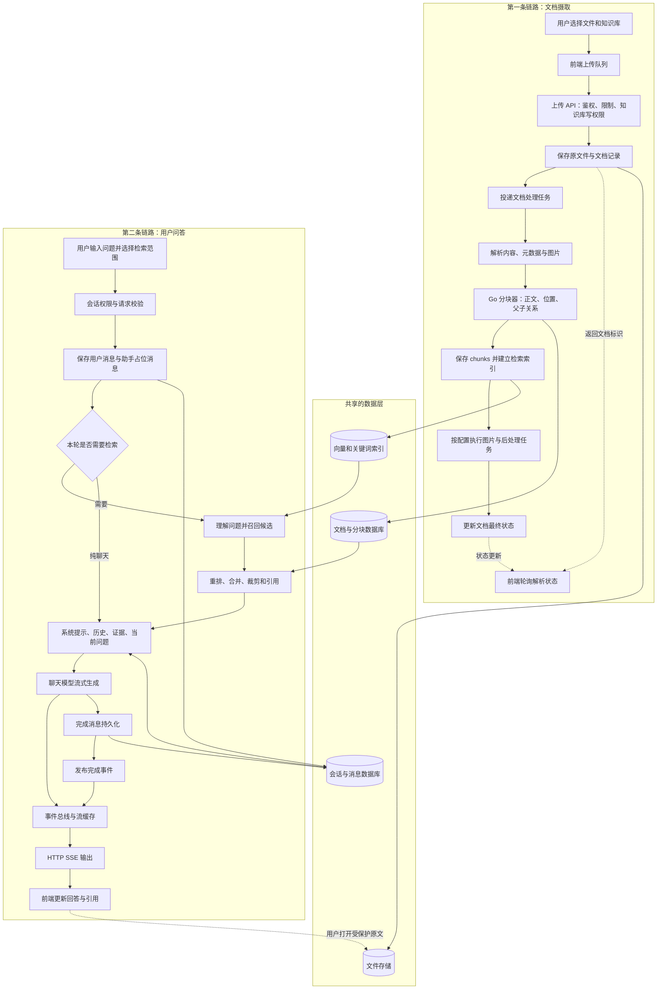

**图的边界：**它展示主路径，不表示文件系统、数据库、索引和队列之间存在一个共同事务。任何跨系统写入都可能部分成功，具体失败和重试边界见第 `14` 节。引用打开原文仍须经过受保护资源接口，不是让浏览器直接读取磁盘路径。

## 3. 上传入口：从选择文件到拿到文档标识

### 3.1 前端实际做了哪些事

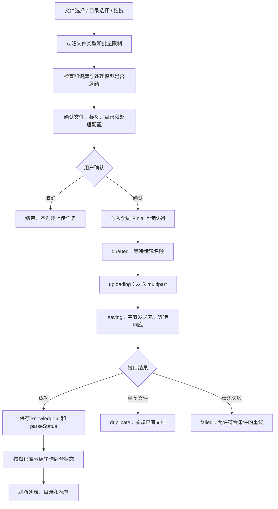

这里有两种不同的“队列”：前端队列控制浏览器同时传输多少文件；后端队列控制服务器异步处理多少文档。前端显示正在排队，不一定表示服务器里已有任务。

| 前端环节 | 当前行为 | 自己实现时应理解的原因 |
| --- | --- | --- |
| 文件/目录选择 | 普通文件支持多选，目录入口使用 `webkitdirectory` | 目录选择最终仍拆成多个文件上传 |
| 确认弹窗 | 收集 `tagIds`、`processConfig`、`targetFolder` 等 | 解析规则属于这一批上传的输入，不应在任务执行时随意丢失 |
| 文件名 | `buildUploadFileName` 包含用户选择的目录信息 | 页面目录组织与底层安全存储路径不是同一件事 |
| 全局队列 | 传输并发为 `3`；同知识库、同大小的文件避免同时在途 | 减少竞争，并配合后端内容哈希去重；文件大小本身不是去重结论 |
| 账号/租户切换 | 上传队列绑定当前用户和有效租户 | 上一个空间的响应不能污染新空间的页面 |
| `saving` | 请求体已发完但响应未返回，此时拒绝普通取消 | 服务器可能已在创建文档，不能假装已经撤销 |
| 传输重试 | 只重试仍保留 `File` 的 `failed/cancelled` 项 | 这是重新发送文件，不是重新执行服务器解析 |
| 旧请求隔离 | 使用 `generation` 和控制器身份识别旧任务 | 取消后重试、清空后重传，都不能被迟到响应覆盖 |

`URL` 导入、手工文本、`FAQ` 和会话临时附件有独立入口。本文主路径是“永久知识库文件上传”；不能把这些入口都套成同一个 `multipart` 请求。

### 3.2 上传接口与时序

接口为 `POST /api/v1/knowledge-bases/{kb_id}/knowledge/file`，请求体是 `multipart/form-data`。认证和有效租户信息由请求层携带；服务端再检查当前用户对目标知识库的写权限。

| 字段 | 传输形式 | 用途 |
| --- | --- | --- |
| `file` | 文件二进制 | 原始文档 |
| `fileName` | 字符串 | 文件名或目录限定的展示名称 |
| `tag_ids` | 逗号分隔字符串，可选 | 文档所属标签 |
| `process_config` | `JSON` 字符串，可选 | 本次解析、图片、音频等处理配置 |

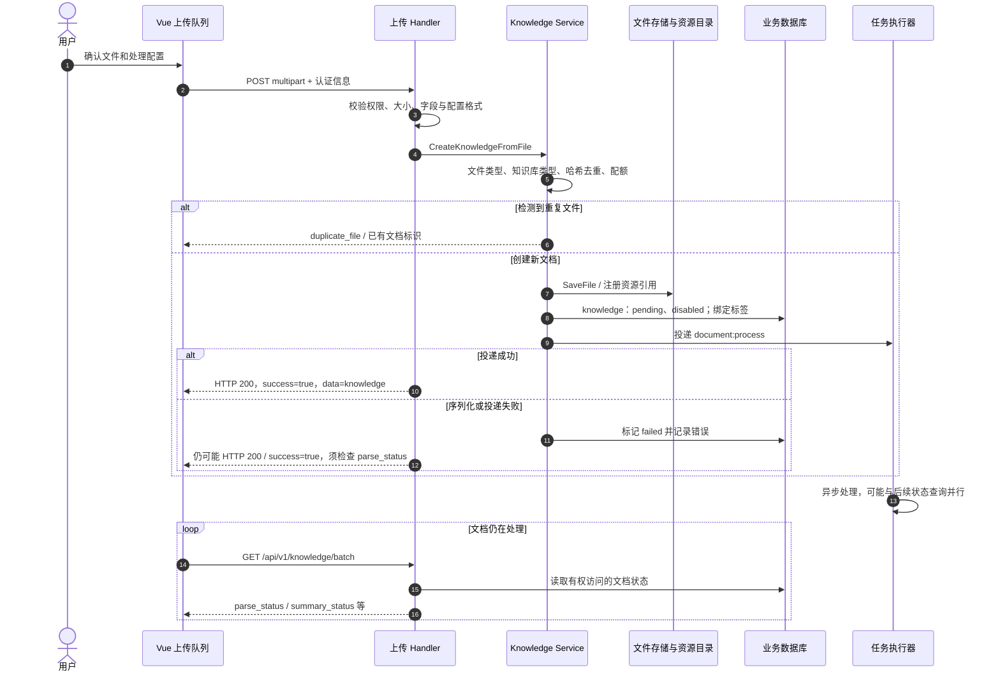

**以代码执行为准：**上传处理器当前实际返回 `HTTP 200`，不能把注释里的 `201` 当作契约。默认文件大小上限为 `50 MB`，部署可调整；本文不是宣称所有环境都固定使用这个值。源文件保存成功、数据库写入失败时存在回滚文件逻辑，但回滚也可能失败。

### 3.3 页面为什么有两套状态轮询

| 轮询方 | 当前节奏 | 查询与收敛行为 |
| --- | --- | --- |
| 全局上传面板 | `3000 ms`；每批最多 `40` 个文档标识，查询并发 `4` | 按知识库分组查询；`pending/processing/finalizing` 持续轮询；连续 `3` 次成功响应缺失同一文档才判断已删除 |
| 知识库列表页 | 通常 `1500 ms`；每批最多 `100` 个标识，子请求串行 | 查询进行中文档，以及摘要仍在进行的已完成文档；成功查询缺失的行可直接移除 |
| 疑似停滞的列表 | 全部在途项均疑似停滞时降低到 `15000 ms` | 根据 `last_activity_at` 等信息判断；`20` 分钟无活动是前端提示依据，不是服务器自动删除期限 |

上传面板把 `finalizing` 展示为 `ready`，但继续轮询到 `completed`；这是“核心内容已经具备检索条件，但增强任务仍在执行”的表现。页面轮询使用请求身份、代际和重解析版本，避免切知识库或重解析后被旧响应回写。

## 4. 后台摄取：解析器、分块器与索引如何衔接

### 4.1 任务执行的完整主干

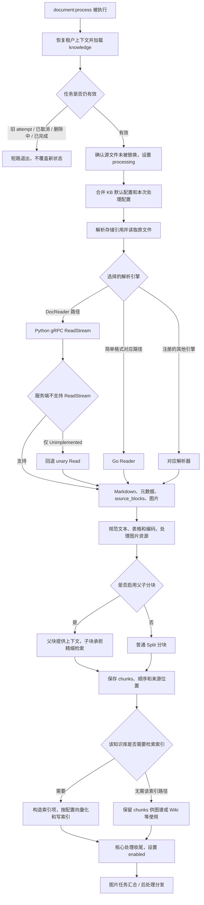

当前主编排、分块、数据库写入和索引由 `Go` 完成；`docreader/` 的 `Python` 服务只承担其中部分解析工作。未来全 `Python` 后端需要接管这些职责，不能仅把现有 `DocReader` 部署起来就视为重构完成。

### 4.2 每一步消费什么、产出什么

| 步骤 | 输入 | 输出 | 必须保留的信息 |
| --- | --- | --- | --- |
| 任务加载 | 文档标识、租户、处理配置、执行轮次 | 经校验的文档处理上下文 | `tenant_id`、`knowledge_base_id`、`knowledge_id`、当前 `attempt` |
| 读取文件 | `resource://`、`local://` 或兼容存储引用 | 原文件字节 | 来源引用；不能把展示文件名直接当磁盘路径 |
| 解析 | 字节、格式、解析器配置 | 正文、元数据、图片、来源块 | 页码、段落、文本或图片定位信息 |
| 规范化 | 解析输出 | 可分块文本、已保存图片引用 | 规范化不能丢掉对应的来源关系 |
| 分块 | 正文、块大小/重叠/父子配置 | 有顺序的 `chunks` | 分块标识、文档归属、类型、前后与父子关系、位置 |
| 保存块 | `chunks` | 数据库中的可追溯正文 | 不能只写向量而不保留可展示原文 |
| 建索引 | 标题、上下文头、分块正文、各级标识 | 向量或关键词索引 | 结果必须可回查文档、块和租户范围 |
| 后处理 | 已保存正文及 `OCR/caption` 块 | 摘要、问题、图谱、`Wiki` 等 | 子任务属于哪个文档和哪一轮处理 |

解析过程有明确超时；当前 `DocReader` 调用默认约 `30` 分钟，并受上层任务上下文约束。`ReadStream` 不等于“原文件始终不进内存”：当前转换路径仍会把源文件读为字节。图片分帧返回主要改善解析结果传递，不能据此推断任意大文件都没有内存限制。

### 4.3 父子分块为什么不能省略关系

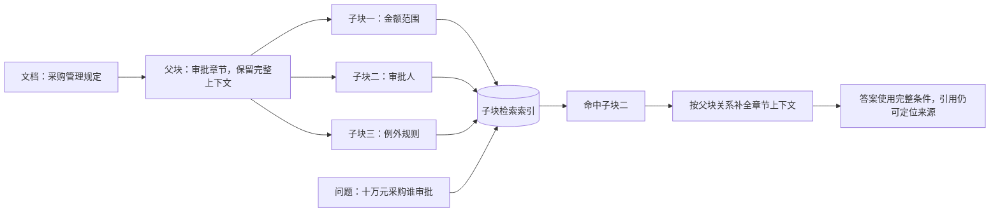

这是讲解用的文档内容，不是仓库中的真实业务数据。父块保存完整上下文，通常不作为普通子块重复建立同样的向量索引。否则容易出现父子重复召回、上下文重复以及引用定位混乱。

### 4.4 向量和关键词索引不是同一种存储

`BatchIndex` 会按配置决定是否调用 `Embedding`，再把索引项保存到对应后端。支持的实际组合由知识库和部署配置决定；不是每个文档都必须同时经过向量数据库、全文检索引擎和图数据库。

1. 文本向量用于语义相近的问题匹配；写入时的模型与查询模型必须处于同一向量空间。
2. 关键词索引用于原词、编号、专有名词等命中；是否可以作为向量失败后的回退，取决于该知识库是否真的建了关键词索引。
3. 块正文仍保存在业务存储中；索引命中只给出候选，后续还要补充内容和来源。
4. 当前向量索引器有批量调用和退避重试，单批最多尝试 `5` 次；这与文档队列的 `MaxRetry(3)` 是两层机制，不能理解为全流程只调用模型 `3` 次。

## 5. 状态机：何时可用，何时真正结束

### 5.1 文档的主要处理状态

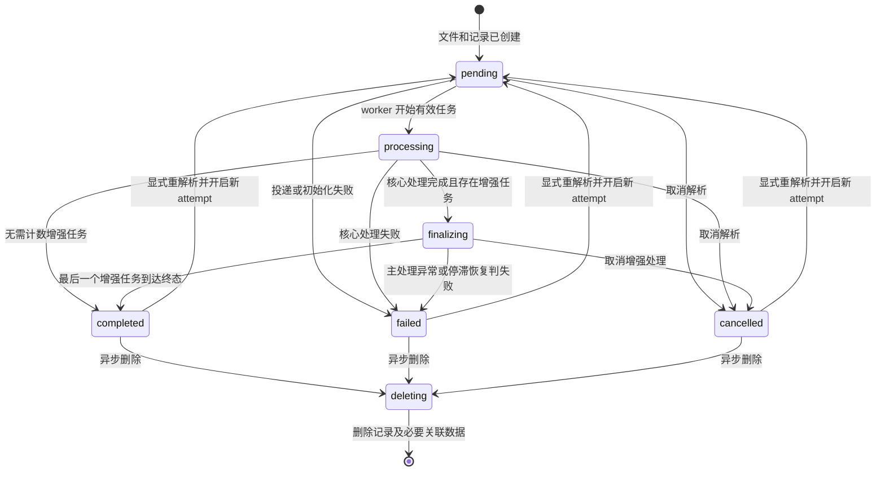

为保持可读性，图未画出每个状态到删除或重新解析的全部管理分支；正在处理的文档也可能被删除或被新处理轮次取代。`deleted` 常是前端根据文档缺失推导出的显示状态，不是这里列出的持久化 `parse_status` 常量。

| 字段/信号 | 解释 | 不应混同的内容 |
| --- | --- | --- |
| `parse_status` | 主文档处理状态 | 浏览器上传百分比 |
| `enable_status` | 文档的启用状态 | 主处理是否全部结束 |
| `summary_status` | 摘要单独的 `none/pending/processing/completed/failed` | 文档所有增强任务状态 |
| `pending_subtasks_count` | `finalizing` 阶段尚未结算的计数任务 | 所有后台工作的全局数量 |
| `attempt` | 本文档当前有效处理轮次 | 队列内部某一次重试次数 |
| `last_activity_at`、处理 `spans` | 活动和阶段观测依据 | 保证任务一定仍存活的锁 |

**三个时间点分开判断：**核心索引完成 → 文档达到检索可用条件 → 被计数的增强任务全部终结。`finalizing` 被设计成可检索但仍在消耗处理资源；具体问题能否命中，还取决于索引、启用状态、权限和查询范围，不能只看一个状态字符串。

### 5.2 图片任务与增强任务是两次不同的汇合

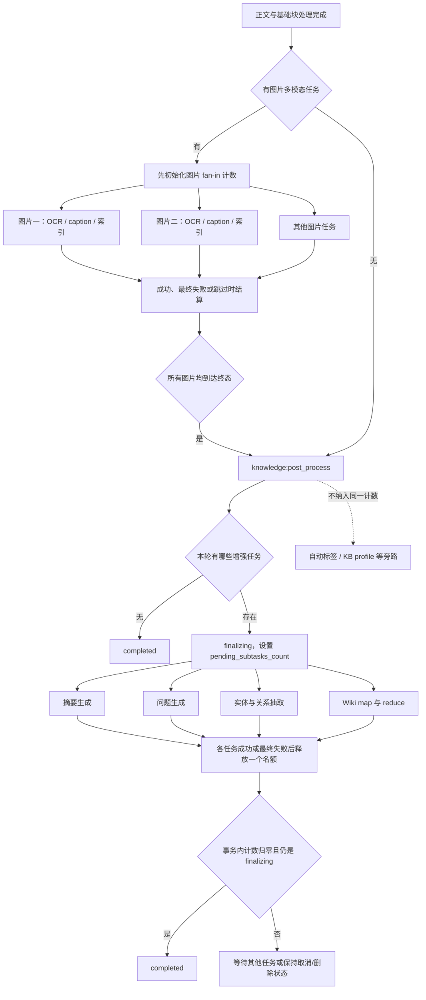

图中四类增强任务是“按配置择需执行”，不是全部必开：问题生成要求相应索引能力；图谱还受 `NEO4J_ENABLE` 等开关限制；`Wiki` 有独立待办和批处理机制。图片任务的中间重试不减计数，只有终态才结算。单张图片或某项增强失败，不一定把整篇文档标成 `failed`。

因此，`completed` 表示主流程及计数增强任务已经收敛，不等于每项增强成功，更不等于所有旁路、知识库级 `Wiki` 收敛任务都停止。需要查看独立状态、错误与处理记录。

### 5.3 普通部署与轻量模式

| 执行方式 | 当前实现 | 边界 |
| --- | --- | --- |
| 常规任务队列 | `Redis + Asynq`，文档、后处理等有不同队列与策略 | 有队列重试和任务检查；仍须处理重复执行、取消与过期轮次 |
| `Lite` | 进程内异步执行器，使用 `goroutine` | 仍然异步，但不能视为具备同等的跨进程持久性、队列检查与取消能力 |
| 图片汇合 | 常规模式使用带过期时间的 `Redis` 计数，轻量模式使用内存计数 | 重启和过期会影响恢复，不能把计数当永久业务事实 |

## 6. 重试、重解析、取消、删除：四种操作四种语义

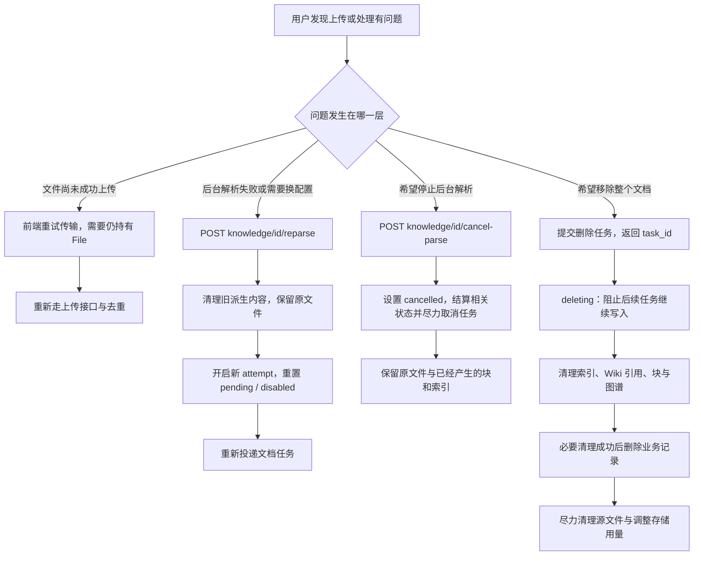

正式接口路径使用 `/api/v1/knowledge/{id}/reparse`、`/api/v1/knowledge/{id}/cancel-parse`；图中省略前缀仅为缩短节点。删除是异步操作，拿到 `task_id` 不等于文件已从全部存储消失。

| 操作 | 是否新上传原文件 | 是否重新解析 | 是否保留已产生内容 | 关键边界 |
| --- | --- | --- | --- | --- |
| 前端重传 | 是 | 由新的上传受理结果决定 | 已存在文件会参与去重 | 需要原 `File`，不能代替后台重解析 |
| 队列重试 | 否 | 重跑对应任务 | 依任务的幂等和清理逻辑处理 | 有次数限制；有些失败直接标失败，不重试 |
| `reparse` | 否 | 是 | 原文件保留，旧派生内容清理 | 旧 `attempt` 不得回写新处理结果；不能保证重建期间旧索引始终可用 |
| `cancel-parse` | 否 | 否 | 保留源文件和已经产生的块/索引 | 当前并非统一禁用文档，也不能保证远端模型瞬间中止 |
| 删除文档 | 否 | 否 | 目标是清理，但跨存储需分步完成 | 关键清理失败时保留记录以供重试；不要直接删除共享 `Wiki` 页面 |

首次上传的投递失败可能包装在成功响应里；`reparse` 的投递失败会返回错误。这是现有代码的差异，接入时必须逐接口处理，不能用统一的“只看 `success`”逻辑覆盖一切。

## 7. 数据模型：原文、知识、索引、消息分别是什么

### 7.1 用业务关系理解数据，不把概念图当建表脚本

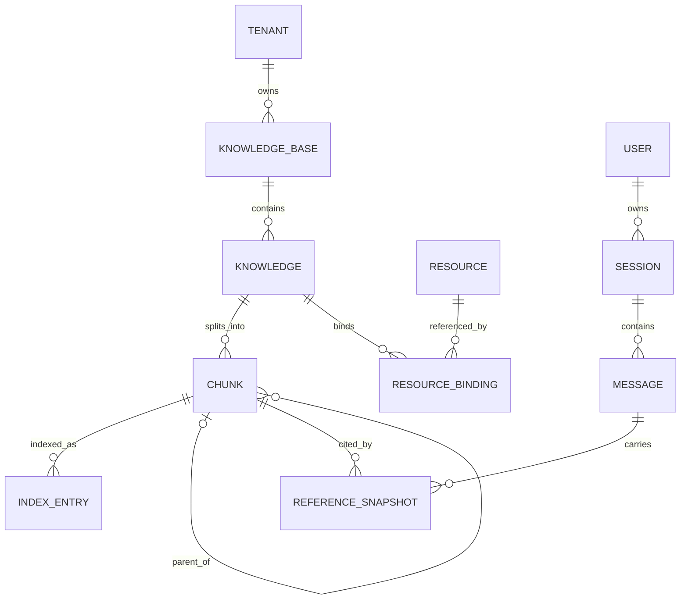

这是概念关系图：`REFERENCE_SNAPSHOT`、`INDEX_ENTRY` 表示逻辑对象，并非宣称数据库里一定有这两个同名表；历史引用也可能指向后来被删除的来源。共享知识库还涉及授权关系，不能由单一的租户归属关系替代。实施前按现有实体和迁移文件核对真实表结构。

| 数据 | 作用 | 何时产生 | 后续谁使用 |
| --- | --- | --- | --- |
| 原文件与资源引用 | 保留上传原件、图片及资源绑定 | 上传和解析阶段 | 重解析、预览、下载、引用定位 |
| `knowledge` | 文档级元数据、配置、状态、归属 | 上传受理时 | 文档列表、处理任务、授权和引用标题 |
| `chunk` | 可追溯的正文片段与结构 | 解析分块后 | 检索补文、上下文组装、引用预览 |
| 向量/关键词索引 | 加速寻找相关片段 | 核心索引和部分增强任务 | 提问时检索 |
| 图谱 | 实体、关系及证据关联 | 图谱增强开启时 | 图谱相关检索分支 |
| `Wiki` 页面与待办 | 跨文档整理知识及持续合并 | `Wiki` 处理开启时 | 页面阅读、相关检索、后续收敛 |
| `session` | 用户的一组对话及配置状态 | 新建会话 | 历史、会话权限、续接 |
| `message` | 用户问题、助手答案、引用和执行数据 | 提问前先建记录，完成后更新 | 页面刷新、历史加载、可选消息索引 |
| 流事件缓存 | 暂存回答增量和控制事件 | 回答生成期间 | 活跃连接、恢复连接、停止信号 |

消息数据库是历史读取依据；流缓存是实时传输和有限恢复工具。二者不能互相替代。源文件存储、关系数据库、检索存储及事件缓存也不能混为一个“数据库”。

## 8. 用户提问：从输入框到有权限的一轮对话

### 8.1 创建会话不是已经发起生成

新会话先调用 `POST /api/v1/sessions`，取得 `session.id`。当前前端把首问、提及项、模型、图片和附件草稿放进菜单状态，再跳转到 `/platform/chat/{id}`；聊天页接着执行 `sendMsg`，不是把完整问题塞进地址栏。

已有会话会读取 `session.last_request_state`，恢复本会话的输入配置。全局默认配置、会话恢复配置、尚未发送的草稿是不同层；异步加载只能在会话标识仍一致时生效，否则会把甲会话的选择覆盖到乙会话。

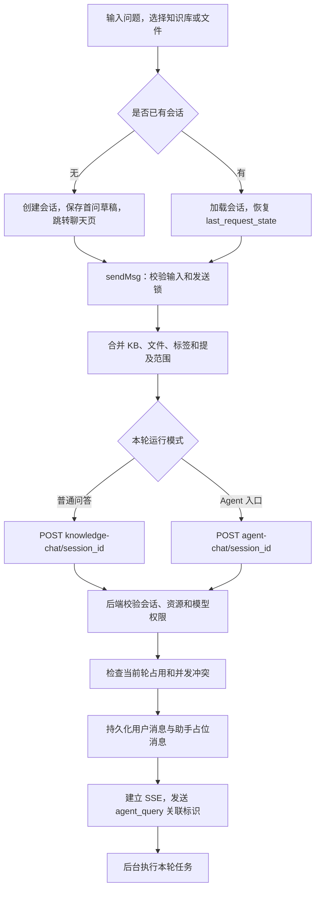

图中接口均位于 `/api/v1` 下。当前创建会话页面还发送部分 `agent_config`，但后端是否采纳要看请求结构和实际配置解析；可靠的检索范围仍要查看本轮问答请求及后端归一化结果，不能假设“会话永久绑定一个知识库”。

### 8.2 普通知识库问答请求示例

下面是说明字段关系的最小示例，标识为占位值，需换成自己有权访问的真实资源：

```http
POST /api/v1/knowledge-chat/session-example
Authorization: Bearer <access_token>
Content-Type: application/json
X-Request-ID: request-example

{
  "query": "采购金额超过十万元时需要谁审批？",
  "knowledge_base_ids": ["kb-example"],
  "knowledge_ids": ["knowledge-example"],
  "agent_enabled": false,
  "channel": "web"
}
```

同时给出知识库和文件是允许出现的请求形式，但不能自行理解为两个独立条件的简单交集。后端会把知识库范围、指定文档、标签、共享来源和提及信息归一化为 `SearchTargets`。要只查一个文件时，优先明确发送该文件范围，并核对最终目标集合，避免同时额外选择整个知识库而扩大搜索。

| 输入来源 | 前端如何汇入请求 | 后端必须确认什么 |
| --- | --- | --- |
| 知识库选择器 | `knowledge_base_ids` | 是否可读、属于本租户还是被授权共享、可用的检索配置 |
| 指定文件和 `@file` | `knowledge_ids`、`mentioned_items` | 文件真实所属知识库与权限，不能信任客户端提供的归属 |
| `@kb`、标签 | 知识库范围、`tag_ids`、提及项 | 标签所属知识库及解析后的文档集合 |
| 模型选择 | `summary_model_id` 等 | 类型、执行租户和使用权限 |
| 助手选择 | `agent_id`、可能的来源租户 | 助手权限与真实配置；不是仅信任 `agent_enabled` |
| 临时附件 | `attachment_ids` 或内联附件内容 | 当前会话归属、解析就绪、大小及使用范围 |
| 联网、工具和技能 | `web_search_enabled`、`mcp_service_ids`、`skill_names` 等 | 是否被配置允许、是否真的可用 |

只有标签的有效范围也可能需要检索，不能只判断 `knowledge_base_ids.length > 0`。共享知识库要携带并校验来源租户信息；“当前执行租户”和“知识库归属租户”在合法共享场景下可能不同。

### 8.3 用户消息与助手占位的创建顺序

后端先保存用户消息，再创建 `is_completed=false` 的助手消息。助手占位创建失败时有回滚用户消息的路径。前端本地也会先显示输入内容，但本地临时消息不等于服务端已经接受。收到 `agent_query` 中的 `assistant_message_id` 后，才可把本次生成与服务器消息、停止接口和恢复接口关联起来。

请求头的 `X-Request-ID` 用于关联日志和本轮事件；不要把它未经验证就当作“重复 `POST` 必然幂等”的保证。并发占用、轮次租约和消息归属由服务端检查，前端的发送按钮锁只改善交互。

## 9. 问答编排：普通检索、纯聊天与 `Agent`

### 9.1 普通知识库问答的实际管线

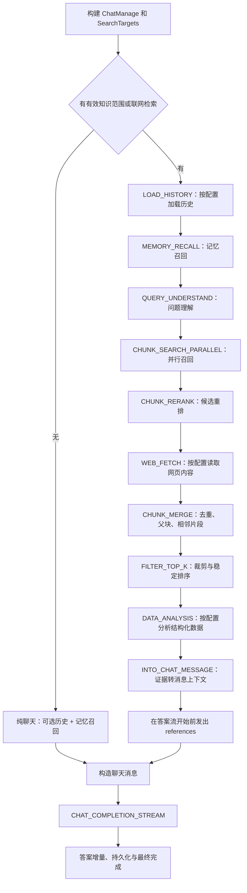

图是当前事件编排的可读展开，不表示每个节点都会实际调用模型。`LOAD_HISTORY` 受历史轮数控制；联网抓取、数据分析等按配置插入或自行跳过；问题理解得到“不需要检索”的意图时，后续检索插件也可跳过。纯聊天仍可能包含临时附件、图片说明或引用文本，不能把“未选择知识库”等同于“没有任何额外上下文”。

### 9.2 问题理解阶段的产出

1. 保留原始 `query`，初始化用于召回的 `RewriteQuery`。原问题用于展示、历史和最终作答，改写问题主要帮助检索。
2. 有历史时，把“那它的审批人呢”这类省略表达补全为可独立检索的问题。
3. 根据配置识别检索意图、处理图片说明或相关信息。
4. 改写关闭、无适用模型或改写失败时，可以保留原问题继续；不能因此丢失用户输入。
5. 问题理解、向量检索、重排、聊天生成是不同阶段，分别记录耗时和失败位置。

### 9.3 三类入口的不同职责

| 入口/模式 | 工作目标 | 是否一定生成回答 |
| --- | --- | --- |
| `POST /api/v1/knowledge-search` | 不依赖会话的知识检索 | 否，主要返回检索结果 |
| 知识库级 `hybrid-search` | 对目标知识库执行检索，配置可包含重排 | 否，不等于完整会话生成 |
| `POST /api/v1/knowledge-chat/{session_id}` | 普通管线问答 | 是，含流式回答与消息生命周期 |
| `POST /api/v1/agent-chat/{session_id}` | 根据助手配置运行对应模式 | 有效配置可能进入工具循环，也可能走普通快速回答 |

真正的 `Agent` 模式可在工具调用、结果观察和继续生成之间循环；知识检索只是可用能力的一部分，不能把普通管线图硬套成每个 `Agent` 的固定执行顺序。当前 `Agent` 请求还要有可解析的助手标识；自定义助手配置优先于请求布尔值。第一次亲手实现建议先完成普通知识库问答，再扩展工具循环和审批等能力。

## 10. 检索内部：问题怎样找到正确的片段

### 10.1 从范围到候选结果

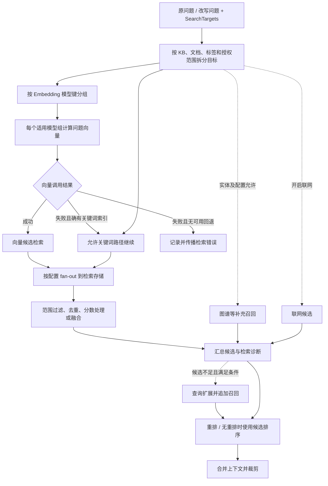

上图的存储扇出表示后端适配与并行搜索层；向量、关键词并不是先查完再把相同工作重复提交一次。代码中这些层次互相协作，图把职责分开以便学习。图谱、`Wiki` 相关能力以及联网召回取决于知识库类型、目标和配置，不是任何一次普通文档检索都触发。

### 10.2 为什么按 `Embedding` 模型分组

同一问题对使用不同向量模型的知识库，需要各自对应的问题向量。不同模型即使向量维数相同，也不能据此认定语义空间相同。当前搜索会按模型键分组，组内复用问题向量，减少重复调用；不能把所有知识库的向量无条件混到一个索引空间。

同时区分几种“数量”：召回候选数、重排候选数、最终上下文数量和模型输入令牌预算。增大召回候选数并不意味着要把全部候选交给聊天模型。

### 10.3 分数融合不是直接相加

当前融合代码针对不同路径采用不同处理：向量单路保留相应分数；关键词单路会做列表内归一化；混合路径使用加权倒数排名融合，并做归一化。以下是理解公式，不是需要硬编码进新项目的固定参数：

```text
raw_score = vector_weight / (k + vector_rank)
          + keyword_weight / (k + keyword_rank)

normalized_score = raw_score / ((vector_weight + keyword_weight) / (k + 1))
```

没有出现在某路结果中的候选不应虚构一个真实命中排名。`BM25` 分数与向量相似度的量纲不同，不能直接按 `0.7 × cosine + 0.3 × BM25` 猜测当前实现。跨引擎分数处理也有条件，不是所有引擎结果都统一重标定。

显式选中文档或标签范围可能调整召回阈值，避免已明确指定的范围在重排前全被筛掉。这并不等于绕过权限，也不意味着答案一定来自该范围的每份文件。

### 10.4 重排、合并、裁剪的先后关系

| 阶段 | 主要职责 | 为什么需要 |
| --- | --- | --- |
| 召回 | 快速找到可能相关的块 | 重在覆盖，允许有噪声 |
| 重排 | 使用适用的重排配置重新比较问题与候选 | 从候选中选出更能回答问题的证据 |
| 初次去重 | 按标识与内容签名去重 | 同一段可能被多条召回路径命中 |
| 历史引用补入 | 按管线条件补充相关历史证据 | 追问可能依赖上一轮已找到的内容 |
| 父块还原 | 从子块回到更完整上下文 | 防止只命中结论，却漏掉限定条件 |
| 同来源合并 | 同文档、同块类型的连续或重叠范围合并 | 减少重复文本 |
| `FAQ` 回答补全 | 对适用条目恢复问题对应的回答 | 检索文本与最终可用答案不一定是同一字段 |
| 相邻块扩展 | 为过短的证据补上下文，再次合并与去重 | 避免句子或表格被截断 |
| 最终裁剪 | 按稳定顺序保留适用数量，记录被截断信息 | 控制输入规模，避免随机抖动 |

未配置重排、模型不可用或调用失败时存在候选回退路径，不能写成“重排永远成功”。最终 `TopK` 还存在保留项等规则，不应机械断言所有输出数组长度始终严格等于配置值。模型上下文预算还需独立控制。

### 10.5 没有结果、系统失败、用户停止要分开

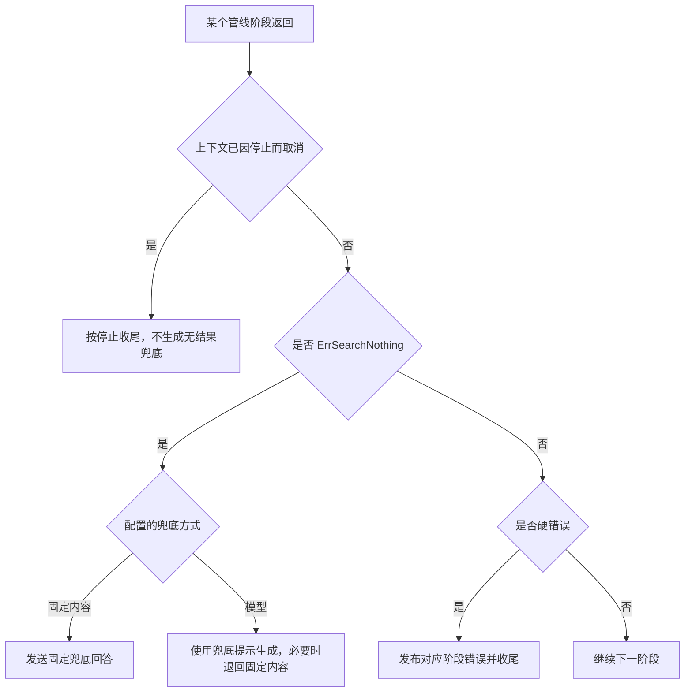

这一顺序很重要：停止导致检索调用取消时，结果可能表现为空；必须先检查取消，否则刷新后会把“用户停止”错误地保存成“未找到答案”。数据库、模型或检索服务不可用也不能统一伪装成业务上的无结果。

## 11. 证据到 `Prompt`：模型看到什么，用户能追溯什么

### 11.1 输入消息的组成

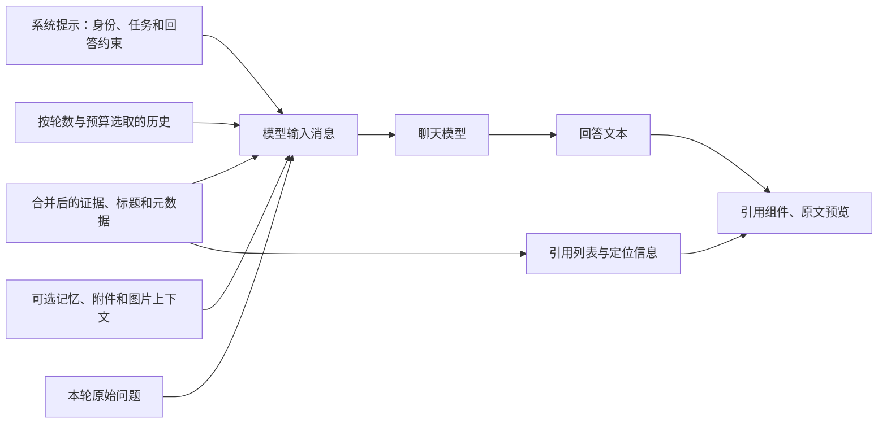

现有 `INTO_CHAT_MESSAGE` 会把合并结果放入上下文模板，并可附加文档标题、说明、自定义元数据以及图片。开启 `FAQ` 优先时，对高置信度 `FAQ` 和普通文档上下文做区分；判断置信度不能只看人为加权后的分数。

以下仅解释结构，**不是仓库模板的逐字复制**：

```text
系统要求：按照允许的任务和输出规则作答。
历史：上一轮用户问题和已经结束的助手回答。

<context id="source-example">
文档：采购管理规定
章节：审批权限
证据：金额超过十万元的采购，应由指定负责人审批。
</context>

当前问题：采购金额超过十万元时需要谁审批？
```

对亲手实现的新版本，要把文档内容作为证据数据处理：文档里的“忽略系统要求”等文字不能获得执行工具或扩大权限的能力。没有证据就应按约定说明不足，不能用模型生成的文字伪造来源。

### 11.2 引用不是只存一个 `chunk_id`

当前引用以 `SearchResult` 为主要结构，包含结果标识、正文、知识标识、标题、块顺序、位置、匹配类型、分数、父子块关系等；可选字段还包括 `source_locators`、图片、匹配片段、知识库标识及元数据。`VectorScore` 在对应结构中不直接作为对外 `JSON` 字段输出，不能凭想象要求每条引用都有 `vector_score`。

| 用户动作 | 前端所需数据 | 相关读取入口 |
| --- | --- | --- |
| 展示“来源文档” | 文档标题、知识标识、命中片段 | 问答流返回的引用 |
| 查看精确块 | 块标识、父子或子块信息 | `GET /api/v1/chunks/by-id/{chunk_id}` |
| 查看文档详情 | `knowledge_id` | `GET /api/v1/knowledge/{id}` |
| 打开原文预览 | 原文类型、权限、定位信息 | `GET /api/v1/knowledge/{id}/preview` |
| 定位页码/文本/图片 | `source_locators` 等 | 预览组件在拿到内容后执行定位 |

引用加载也有异步竞争：切换会话要隔离引用缓存；连续打开两篇文档时，第一篇的迟到响应不能覆盖第二篇。现有前端使用带范围的缓存键、加载版本和定位令牌处理这些问题。

### 11.3 用一个贯穿案例验收理解

假设你自己创建测试文档 `采购规则.md`，写明“超过十万元需要财务负责人复核”，再问“采购十二万元找谁复核”：

1. 上传返回文档标识，但此时不直接断言答案可用。
2. 处理任务读取文件，保存包含该句的块，并建立对应索引。
3. 问题理解可以保留原问题；检索问题与“十二万元”相关语义或关键词。
4. 候选中找到“超过十万元”的规则，父块或邻居补入适用条件。
5. 模型输入包含规则、问题和必要历史，不是重新读完整磁盘文件。
6. 流中先后出现关联标识、引用和答案；前端逐段显示。
7. 最终答案与引用写入消息记录；刷新后仍可查看。
8. 点击引用应回到这份测试文档的相关内容；如果模型答对但引用指向另一租户的文件，仍然是验收失败。

此案例是建议自己制作的测试夹具，不是对当前环境真实模型效果的测试结果。

## 12. 流式输出：事件、缓存、浏览器和数据库的时序

### 12.1 为什么要分事件总线、流缓存和 `SSE`

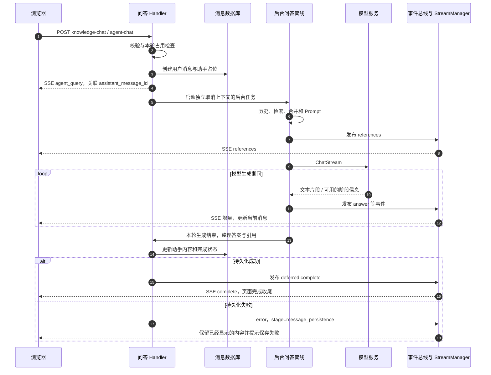

图展示正常成功路径及保存失败分支。内部 `EventAgentComplete` 会先准备完成数据，但对外 `complete` 延后到消息持久化成功之后发布。不能因为内部事件名字含完成，就把它画成早于保存的对外成功承诺。

事件总线让生成逻辑不直接依赖某一个浏览器连接；`StreamManager` 暂存事件；`SSE` 负责把事件写入当前 `HTTP` 响应。当前支持内存和 `Redis` 等配置路径，内存不跨进程持久；`Redis` 事件也有过期时间，当前工厂默认缓存时长为 `1` 小时。恢复能力不是无限期保留全部生成记录。

### 12.2 当前真实的 `SSE` 外层格式

前端使用 `@microsoft/fetch-event-source` 发送带认证信息的 `POST`，解析每个 `data:` 中的 `JSON`，按其 `response_type` 分发。不是简单用原生 `EventSource` 向生成接口发 `GET`。

下面仅示意最关键字段；真实事件还可携带 `data`、用量、结束原因和更多引用信息：

```text
data: {"id":"request-example","response_type":"agent_query","content":"","done":false,"session_id":"session-example","assistant_message_id":"assistant-example"}

data: {"id":"request-example","response_type":"references","content":"","done":false,"knowledge_references":[{"id":"chunk-example","knowledge_id":"knowledge-example","knowledge_title":"采购规则","content":"超过十万元需要财务负责人复核。"}]}

data: {"id":"request-example","response_type":"answer","content":"需要财务负责人","done":false}

data: {"id":"request-example","response_type":"answer","content":"复核。","done":true}

data: {"id":"request-example","response_type":"complete","content":"","done":true}

```

**答案增量在顶层 `content`，不是固定在 `data.content`。**引用通常读取顶层 `knowledge_references`，现有处理器还兼容 `data.references` 等形态。`id` 是外层关联字段；不同事件还可能有自己的 `data.event_id`，二者不要混用。

| `response_type` | 主要作用 | 前端应如何处理 |
| --- | --- | --- |
| `agent_query` | 握手，给出会话和助手消息标识 | 关联服务端消息、停止与续流目标；普通问答也使用此名字 |
| `references` | 提供知识引用 | 更新来源列表，与答案正文分开维护 |
| `thinking` | 适用模型和流程输出的过程片段 | 按产品规则展示过程区，不拼进最终答案 |
| `progress` | 阶段进度，可能是累计快照 | 根据事件标识更新，不把每次快照重复追加 |
| `answer` | 回答片段 | 追加或按 `data.replace` 替换；保留截断、兜底等标记 |
| `tool_call` / `tool_result` | 工具输入、结果与执行状态 | 按 `tool_call_id` 配对，保留结果完整数据 |
| `session_title` | 异步会话标题 | 更新对应会话菜单，不混入答案 |
| `error` | 生成或保存失败 | 展示错误；`message_persistence` 单独提示保存问题 |
| `complete` | 整轮结束数据 | 更新完成状态、用量、最终内容，解除发送锁 |
| `stop` | 服务端停止信号 | 结束当前展示，保留允许保留的已有内容 |
| `heartbeat` | 连接活性 | 重置空闲计时，不进入聊天正文 |

还有审批、挂起/恢复、后台工作等高级事件，不属于第一版文档问答的必要实现范围。前端派生展示项 `agent_complete` 不是外层协议里的完成类型，真实外层名称是 `complete`。

### 12.3 三种容易误读的结束信号

1. `answer.done=true` 只结束该答案段，不能证明整轮已持久化成功。
2. 正常路径的 `complete` 在保存后发布；错误路径也可能保存失败说明或部分答案，再进行完成清理。因此消费者仍要保留错误状态，不要收到后续 `complete` 就擦掉错误。
3. `HTTP` 连接关闭可能来自正常结束、网络波动、切页或用户本地中止，不能一律当成功，也不能一律当后端已取消。

当前普通问答错误处理会尽力保存已有内容及错误说明，`is_completed` 表示该消息处理结束，不等于回答业务成功。建议新 `Python` 协议明确区分成功、失败、停止；兼容现有协议时要为上述组合保留测试。

## 13. 停止、刷新、断线恢复和历史加载

### 13.1 停止生成必须有服务器动作

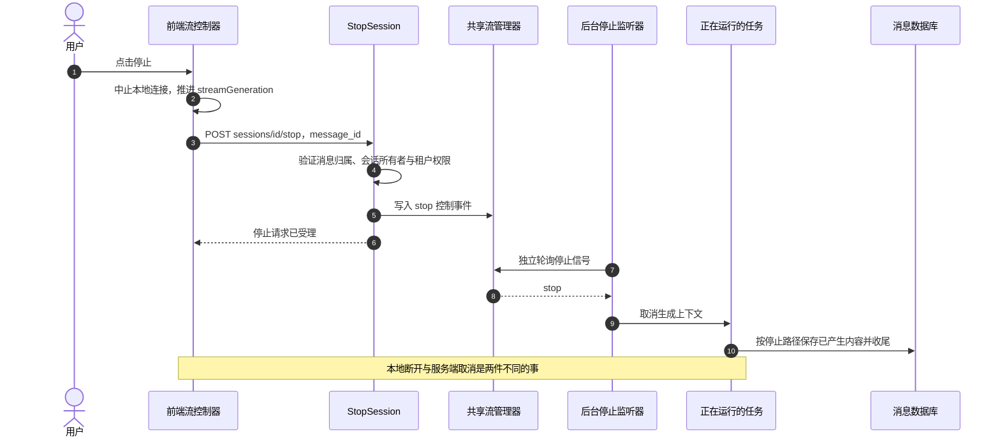

后台任务的取消上下文与浏览器连接分离，所以页面刷新时后台可以继续生成；停止监听也能在原连接断开后工作。停止接口返回成功代表信号被接受，不能承诺远端模型立刻停止计费或所有调用立即退出。已完成消息的停止请求有幂等处理。

### 13.2 刷新后先恢复消息，再决定是否续流

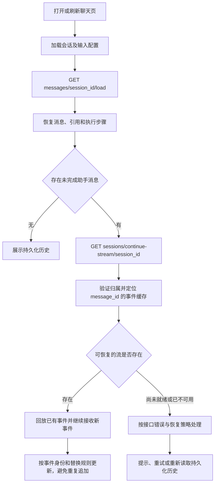

历史接口为 `GET /api/v1/messages/{session_id}/load?limit=20`；向上翻页携带 `before_time`。续流接口为 `GET /api/v1/sessions/continue-stream/{session_id}?message_id={assistant_id}`。恢复使用已存在的助手消息，不应重新发送已经接受的提问 `POST`，否则可能创建第二轮生成。

### 13.3 当前前端自动恢复的真实边界

| 场景 | 当前行为 | 注意 |
| --- | --- | --- |
| 新流开始或旧流停止 | 更新 `streamGeneration` | 旧回调不能继续改当前消息 |
| 握手遇到 `401` | 允许刷新凭据后重放一次 | 是认证恢复路径，不等于任意失败都可重发生成请求 |
| 活跃 `Agent` 流断线 | 非内嵌、已有助手标识、未终止等条件下可恢复 | 入口需满足 `agent-chat` 或 `continue-stream` 条件 |
| 普通 `knowledge-chat` 原连接断线 | 不满足同一套自动重连条件 | 不能在文档里承诺全部聊天流自动恢复 |
| 恢复连接的空闲检查 | `30` 秒无心跳触发；退避 `1/2/4/5` 秒 | 最多 `8` 次连续失败；事件到达会重置连续失败计数 |
| 页面重新加载发现未完成消息 | 页面可主动请求 `continue-stream` | 与原始连接的自动重连条件是两层逻辑 |
| 正常 `complete` | 原位更新当前消息和后续推荐等 | 并非每次都无条件全量重载历史 |
| 内存流管理器重启或缓存过期 | 可能失去回放事件 | 仍须依赖消息记录判断可展示的持久内容 |

会话临时附件、语音输入、内嵌渠道和即时通信来源有各自补充路径。学习时先掌握当前网页普通知识库问答，再分别补这些差异，不要用一个没有条件的“全部自动恢复”箭头概括。

## 14. 异常与一致性：失败后留下了什么

### 14.1 把失败落到具体阶段

| 失败位置 | 用户可能看到什么 | 当前链路中要核对的状态或行为 | `Python` 重构的最低验收 |
| --- | --- | --- | --- |
| 上传鉴权/大小/格式校验 | 立即报错 | 是否尚未创建文档和任务 | 拒绝请求时不遗留可被其他人读取的文件 |
| 文件保存后数据库失败 | 上传失败 | 是否尝试删除刚保存的文件；补偿是否失败 | 可追踪孤立文件，不假设跨存储事务 |
| 文档创建后入队失败 | 甚至可能收到成功外层 | `data.parse_status=failed` 与错误原因 | 界面能识别“记录存在但任务没启动” |
| 解析器超时/内容非法 | 文档长期处理或失败 | 任务、处理轮次、阶段记录、最终失败状态 | 超时后有明确终态或可恢复记录 |
| 部分图片失败 | 正文可用，但图片理解不完整 | 图片终态与汇合是否释放；正文是否仍保留 | 不把可选图片失败误报为全篇完美处理 |
| 块保存成功、索引失败 | 文档有块却搜不到 | 索引回滚、块清理与清理失败日志 | 重跑不能制造不可控重复索引 |
| 增强任务失败 | 文档可能仍到 `completed` | `summary_status`、任务错误、计数收敛 | 主状态与增强状态能分别说明结果 |
| 检索无结果 | 兜底回答 | 是否真的零结果，而非权限/模型/服务错误 | 无结果测试与服务异常测试分开 |
| 模型流意外中断 | 已有半段答案后报错 | 不完整结束与长度截断的区分 | 保存部分内容及失败结果，不假装成功 |
| 答案生成完但保存失败 | 页面有答案，刷新可能丢失 | `error.stage=message_persistence`，没有成功完成承诺 | 明确提示保存失败，保留屏幕上的答案 |
| 浏览器断线 | 页面不再增长 | 后台是否仍在运行、缓存是否能恢复 | 不重复提交已接受的提问 |
| 删除中某个关键步骤失败 | 文档仍处于删除过程 | 保留记录和源文件以供重试 | 重复删除可收敛，且不误删共享来源 |

### 14.2 幂等、轮次与重试不是同一个概念

1. **上传去重**识别同一知识库下已经存在的文件内容。文件名相同不代表内容相同，大小相同也不够。
2. **任务重试**可能执行相同任务多次。保存块、索引和结算计数时，需要避免一次业务动作被重复计入。
3. **处理轮次 `attempt`**区分“旧任务还没停”和“用户已经要求重新处理”。旧轮次晚到不得将新文档标为完成或写回旧内容。
4. **问答恢复**是继续读取已存在的一轮事件；不是重新执行问题。
5. **最终完成标记**必须与关键数据写入有正确先后关系，不能让界面已经宣告完成，数据库却只有占位消息。

现有 `FinalizeSubtask` 把减计数和有条件的状态提升放在同一数据库事务中，并检查仍为 `finalizing` 且计数为零。这个局部事务解决并发结算问题，并不把文件、索引、队列和消息流都变成一个事务。

### 14.3 停滞巡检是补偿机制，不是即时保证

当前有最终失败钩子和 `housekeeping`，结合处理 `spans`、活动时间、队列任务以及 `Wiki` 持久待办判断异常。`Wiki` 还使用 `task_pending_ops`、失败次数和死信等机制。不同任务覆盖范围不同，不能概括为“所有错误都会自动重试直到成功”。

调试停滞时先确认任务是否真的孤立：排队拥堵、模型慢、尚有合法的 `Wiki` 待办，都可能与完全失联不同。新版本至少要让失败可见、可人工重试，再按生产需求补巡检，不能只给页面加一个更长的轮询定时器。

## 15. 主链路之外的分支：现在理解，按阶段实现

| 能力 | 插入位置 | 与普通文件问答的差异 | 学习优先级 |
| --- | --- | --- | --- |
| 扫描件与 `OCR` | 解析及图片处理 | 没有文本层时必须识别文字，并保留来源定位 | 文本闭环之后 |
| 图片说明与多模态检索 | 图片任务、查询图片、消息上下文 | 涉及视觉模型、图片索引和图片资源权限 | 按实际材料需要增加 |
| 音频/视频 | 解析入口与任务配置 | 需要转写或分段等专用处理，不能套普通文本解析 | 明确需要时增加 |
| 摘要与问题生成 | 核心处理后的增强任务 | 会新增模型费用和等待阶段；摘要不是全文检索的替代品 | 基础摄取稳定之后 |
| 图谱 | 入库抽取和查询补充召回 | 实体关系需要保留原块证据和知识库范围 | 单独阶段 |
| `Wiki` | 文档入库后的跨文档整理 | 有持久待办、`map/reduce`、来源撤回及知识库级收敛 | 单独阶段 |
| `FAQ` | 专用知识条目与检索/上下文 | 问题命中和回答正文分离，高置信度有特殊优先策略 | 检索基础完成之后 |
| 联网检索 | 查询管线 | 外部页面是额外来源，不等于用户已上传的私有文档 | 作为可关闭扩展 |
| 会话临时附件 | 提问前上传及上下文准备 | 会话级生命周期，不自动变成永久知识库资料 | 基础聊天之后 |
| `Agent/MCP` | 助手运行与工具循环 | 工具选择、审批、挂起、权限和错误面更多 | 按实施计划的扩展阶段 |
| 会话消息索引、记忆和推荐问题 | 回答保存后的可选旁路 | 失败不应覆盖已经保存的主答案 | 最小问答闭环之后 |

贯穿所有分支的权限边界包括：上传写权限、检索读权限、共享来源授权、会话所有权、模型与工具可用范围、引用原文访问。前端隐藏按钮只能改善体验，服务端必须独立检查；不能因为已经拿到某个 `knowledge_id` 或 `chunk_id` 就直接返回内容。

## 16. 全 `Python` 重构：把现有链路转换成可实现的步骤

> 本节是目标实现建议。当前目录没有 `python/backend/` 和 `python/frontend/`，以下路径、函数边界、测试均是待建立的产物，不是已经存在的实现。与[逐步实施计划](./Python全栈重构逐步实施计划.md)配合使用；保留已约定的数据库结构及 `/api/v1` 契约，不把 `integration-web` 当新前端基础。

### 16.1 先拆职责，再选择基础设施

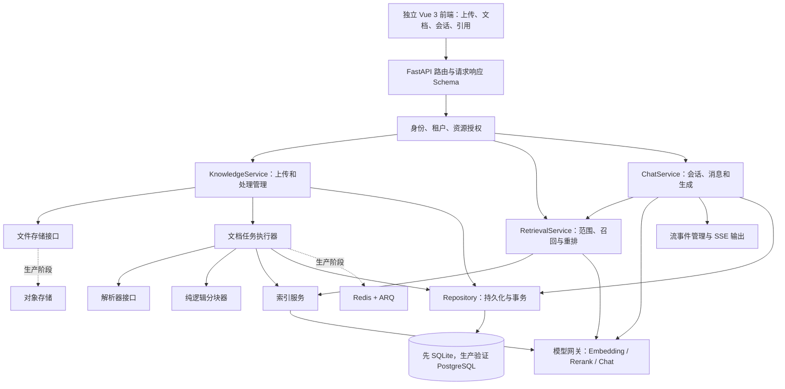

不要第一天就把所有适配器和任务平台建齐。最小闭环按现有计划使用 `SQLAlchemy 2 async + SQLite`、本地文件和确定性假模型；生产阶段再验证 `PostgreSQL`、`Redis + ARQ` 和对象存储。假模型只用于验证流程，不代表真实语义检索或回答质量已验收。

建议文件归属如下，具体文件名可以随真实工程约定调整：

```text
python/backend/
  app/
    main.py
    api/v1/                 # 路由、参数与协议适配
    schemas/                # 上传、检索、聊天和流事件结构
    core/                   # 配置、数据库、认证及日志基础
    domain/entities/        # 与既定数据结构一致的实体
    services/               # knowledge、retrieval、chat 的业务编排
    repositories/           # 数据访问与事务
    integrations/           # 文件、解析器、模型、索引适配
    workers/                # 文档任务入口和生产队列接入
  tests/
    unit/                   # 分块、状态、范围、事件归约
    contract/               # API、状态、SSE 和数据结构契约
    e2e/                    # 上传 → 检索 → 提问 → 历史

python/frontend/src/
  api/                      # 请求、上传与 SSE transport
  stores/                   # 当前用户、上传队列、会话状态
  composables/              # 可复用的上传/聊天状态管理
  views/                    # 知识库与聊天页面
  components/               # 上传进度、消息、引用和预览
```

`services/` 负责业务顺序；`repositories/` 负责持久化；模型调用放在网关适配层。不要把磁盘操作、分块、模型调用和流输出全部塞进一个路由函数。另一方面，也不需要把每个简单步骤再包装成一套通用工作流平台。

### 16.2 按这个顺序实现并打通每一段

| 顺序 | 亲手实现的最小内容 | 当步必须看见的结果 | 对照章节 |
| --- | --- | --- | --- |
| `01` | 记录接口、字段、文档状态与流事件契约 | 明确哪些保留现有行为，哪些属于后续扩展 | `3/5/8/12` |
| `02` | 后端启动、配置、数据库迁移、前端空壳 | 健康检查和数据库创建可重复执行 | 实施计划阶段 `1/2` |
| `03` | 用户、租户、会话/知识库资源授权 | 同租户合法访问通过，越权访问被拒绝 | `8/15` |
| `04` | 知识库管理与假模型网关 | 能创建库，三种模型职责明确 | `4/10` |
| `05` | 文件保存与 `knowledge` 创建 | 返回真实文档标识，原件可受控读取 | `3` |
| `06` | 任务记录与最小异步执行 | 上传快速返回，后台状态可查询 | `3/5` |
| `07` | 先支持文本和 `Markdown` 解析 | 能检查规范化正文及来源信息 | `4` |
| `08` | 确定性分块与块持久化 | 同一输入得出稳定的块顺序和边界 | `4/7` |
| `09` | 单一检索存储与假 `Embedding` | 指定文档的测试句能被稳定查到 | `10` |
| `10` | 查询范围与过滤，先做独立检索接口 | 无需聊天模型就能检查候选及权限 | `8/10` |
| `11` | 合并证据、引用结构和输入预算 | 能打印受控的上下文结构并追到原文 | `11` |
| `12` | 会话、用户消息、助手占位 | 每一轮生成有可查询的真实标识 | `8` |
| `13` | 假聊天流与 `answer/references/complete/error` | 页面连续显示文本，引用独立更新 | `12` |
| `14` | 保存后完成、刷新历史、保存失败处理 | 刷新不丢已完成答案，失败不会误报成功 | `12/13` |
| `15` | 停止、旧请求隔离、基础恢复策略 | 停止与断线语义分开，旧流不能串消息 | `13` |
| `16` | 上传/解析失败、重试、取消与重解析 | 重跑不会被旧任务覆盖或重复入索引 | `6/14` |
| `17` | 用真实解析器与模型替换假适配器 | 固定材料中能真实命中并正确引用 | `17` |
| `18` | 按需求加入混合检索、重排、父子块 | 与基础版本比较命中质量和延迟 | `4/10` |
| `19` | 按计划加入 `FAQ/Wiki/Agent/MCP` 等 | 每个扩展有独立的可关闭边界与验收 | `15` |
| `20` | 生产数据库、持久队列、对象存储、观测 | 进程重启、并发、故障和部署均能验证 | `14/18` |

完成每一步，都先用接口或小测试确认这一段，再接页面。不要等整套系统全部写完，才第一次验证文件是否真的能分块并检索。

### 16.3 两处必须明确处理的协议差异

**任务状态与文档状态：**实施计划给任务设计了 `queued → running → succeeded/failed`；这适合内部任务生命周期，但不能直接替换已有 `knowledge.parse_status` 的取值。兼容现有文档接口时，应分别维护任务状态和文档状态：任务开始可推动文档进入 `processing`，核心任务结束也可能只是进入 `finalizing`。如果当前版本没有增强任务，才可在核心成功后直接完成文档。取消、重解析与删除还要有各自明确的业务语义。

**业务终态与流的结束：**实施计划要求成功和失败互斥，而当前普通问答错误路径可能先发 `error`，随后保存并发布 `complete` 做收尾。兼容实现应保留已约定的外层行为，并在内部区分成功、失败、停止；后续的流收尾不能把失败改成成功。若未来要把外层协议改成严格只有一个终止事件，需要同步定义协议版本、前端消费和契约测试，不能在同一个兼容接口中悄悄变更。

另外，`ARQ` 是目标生产队列；现有 `Go` 队列使用 `Asynq`。二者不能共享一句“重试三次”就当行为完全等价；任务标识、超时、取消、失败钩子和重启恢复都需要重新验收。

### 16.4 第一版就要留下的可观测数据

每个处理记录至少能关联租户、知识库、文档、任务与轮次，说明开始时间、结束时间、当前阶段和失败原因。每轮对话至少能关联 `request_id`、`session_id`、用户消息与助手消息，并分别观察检索、模型首段输出、总生成和保存耗时。

这些数据用于回答“卡在哪里”，不要求把完整文档、完整提示词或密钥都写入日志。能复现问题的最小信息，比无边界记录所有内容更有用。

## 17. 验收清单：如何证明整条链路真的通了

> 以下是建议执行的测试清单，不是本次文档工作已运行的测试报告。先用确定性假模型验证编排，再单独验证真实解析、检索和生成质量。

### 17.1 最小闭环

- [ ] 创建测试用户、租户、模型配置和知识库，记录对应标识。
- [ ] 上传自己制作的 `采购规则.md`，其中包含至少两条容易区分的规则。
- [ ] 断言接口返回真实文档标识；即使传输已完成，页面仍能表示后台处理中。
- [ ] 等待文档达到本版本的可检索条件，并读取块列表或检查索引记录。
- [ ] 先通过检索接口提问，确认命中正确文档和片段。
- [ ] 创建会话，发送同一问题，确认用户消息和助手占位已经保存。
- [ ] 消费完整 `SSE`：拿到消息关联、引用、答案和明确的结束结果。
- [ ] 刷新页面，从消息接口重新取得答案和引用。
- [ ] 点击引用，预览能定位到对应的原文内容。
- [ ] 切换到没有权限的用户/租户，确认不能通过猜测标识读取这些内容。

### 17.2 风险优先的测试矩阵

| 场景 | 测试操作 | 通过标准 |
| --- | --- | --- |
| 同内容重复上传 | 重复提交同一文件 | 按明确去重契约返回，不生成无意义重复文档 |
| 同名不同内容 | 修改正文后再次上传同名文件 | 不因同名错误合并成旧内容 |
| 上传受理后队列失败 | 注入任务投递错误 | 用户能看见实际失败状态，记录可追查 |
| 解析失败 | 提供损坏文件或令解析器报错 | 文档有失败原因，不无限显示处理中 |
| 块与索引边界 | 让索引写入在块保存后失败 | 记录可重试/清理，重跑不会重复污染 |
| 旧轮次迟到 | 阻塞旧任务，再执行重解析 | 旧任务无法覆盖新正文、状态或计数 |
| 图片部分失败 | 一张图片任务失败，其他成功 | 汇合能结束，图片失败有证据，不无限等待 |
| 无检索结果 | 问文档完全不涉及的问题 | 使用约定兜底，不能伪造引用 |
| 检索服务失败 | 模拟向量或关键词后端异常 | 与真正无结果可区分 |
| 纯聊天 | 不给有效检索范围且不开联网 | 不强制调用知识库检索 |
| 仅标签范围 | 只通过合法标签指定范围 | 不被误判为纯聊天，不扩大到全部知识库 |
| 保存失败 | 模型正常结束后令消息更新失败 | 没有成功完成承诺，已显示答案仍可见 |
| 中途停止 | 检索中、首段前、生成中分别停止 | 不生成错误的无结果兜底，部分内容按约定保存 |
| 断网和刷新 | 收到助手标识后断开连接 | 不重复创建一轮；按支持范围续流或恢复历史 |
| 快速切会话 | 旧流未结束时打开另一会话 | 旧事件不能串入新会话，引用缓存隔离 |
| 跨租户资源标识 | 替换文档、块、会话或助手标识 | 每个入口独立执行授权 |
| 删除后旧任务回写 | 处理期间删除，再放行旧任务 | 不复活文档，不重建已禁止写入的内容 |
| 进程重启 | 上传/生成期间重启对应进程 | 行为与所选内存/持久模式的承诺一致 |

### 17.3 真实能力测试单独建立基线

使用你有权处理的样例：普通文本、带文本层的 `PDF`、扫描件、含表格文档、含图片文档。每类记录解析正文、块数、检索命中、引用定位、首段延迟和总耗时。真实模型测试需要显式开启并配置凭据；一次答案看起来正确，不代表权限、恢复、成本和引用都正确。

建议保存测试问题、预期来源及可接受的答案要点，不要求真实模型逐字输出同一句话。对确定性逻辑采用严格断言，对生成质量采用来源与事实约束，避免把整个答案字符串当作唯一标准。

## 18. 排错路线：沿着标识与阶段逐层定位

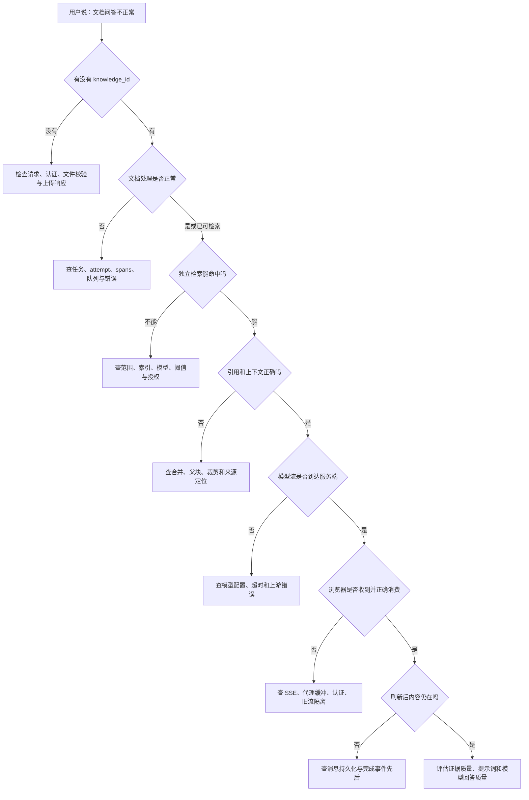

| 标识或证据 | 用于串起什么 | 常见排查问题 |
| --- | --- | --- |
| `tenant_id`、当前用户 | 权限与数据归属 | 是否选错空间；共享来源是否正确解析 |
| `knowledge_base_id` | 配置、模型、索引与搜索范围 | 入库和检索是否使用同一个知识库配置 |
| `knowledge_id` | 上传记录、源文件、处理任务与块 | 文档是否还存在；是否被取消、删除或重解析 |
| `attempt`、任务标识 | 当前有效处理与旧任务 | 是否有旧轮次覆盖或子任务没有结算 |
| `chunk_id`、来源定位 | 命中内容与原文 | 为什么答对了却引用错位置 |
| `request_id` | 一次请求及相关日志、事件 | 耗时发生在检索、生成还是保存 |
| `session_id`、`assistant_message_id` | 本轮消息、停止和恢复 | 是否停止了错误的消息；是否重复创建了轮次 |
| `response_type`、`data.stage` | 流协议与失败阶段 | 是网络断线、模型失败还是消息保存失败 |

先定位最早发生偏差的阶段，再看其下游。上传解析失败时先调整提示词没有意义；独立检索正确而答案错误时，也不应先重新上传全部文档。

## 19. 源码阅读索引与核对边界

下面的链接相对本文位置指向主仓库源码。函数名与符号是主要定位依据，行号只对应本文顶部的基线，后续更新可能移动。阅读顺序建议沿一份文档和一次问题走完主路径，再阅读可选分支。

### 19.1 上传与处理

| 顺序 | 源码入口 | 重点定位 |
| --- | --- | --- |
| `U01` | [上传选择器](../../frontend/src/views/knowledge/components/KbUploadSourceDropdown.vue) | `handleFilesChange`，文件/目录输入 |
| `U02` | [知识库页面](../../frontend/src/views/knowledge/KnowledgeBase.vue) | `enqueueUploads`、`handleUploadSourceFiles`、列表轮询与重解析 |
| `U03` | [上传确认](../../frontend/src/views/knowledge/components/UploadConfirmDialog.vue) | 处理配置、模型要求与确认输出 |
| `U04` | [知识库 `API` 客户端](../../frontend/src/api/knowledge-base/index.ts) | `uploadKnowledgeFile`、`batchQueryKnowledge`、`reparseKnowledge` |
| `U05` | [上传队列](../../frontend/src/stores/uploadQueue.ts) / [状态映射](../../frontend/src/stores/uploadTasksState.ts) / [参数与归属](../../frontend/src/stores/uploadTasksCore.ts) | 传输取消、轮询、`generation`、`saving`、`finalizing` |
| `U06` | [知识路由](../../internal/router/routes_knowledge.go) | 文件上传、权限守卫、管理和检索入口 |
| `U07` | [`Knowledge Handler`](../../internal/handler/knowledge.go) | `CreateKnowledgeFromFile` 约第 `313` 行；实际响应约第 `457` 行 |
| `U08` | [文档创建服务](../../internal/application/service/knowledge_create.go) | `createKnowledgeFromFile`，去重、保存、入队失败 |
| `U09` | [存储选择](../../internal/application/service/knowledge_util.go) / [本地存储](../../internal/application/service/file/local.go) / [资源目录](../../internal/application/service/file/resource_catalog.go) | `resolveFileService`、`SaveFile`、资源绑定 |
| `U10` | [任务注册](../../internal/router/task.go) / [轻量执行器](../../internal/router/sync_task.go) / [任务参数](../../internal/application/service/knowledge_task_options.go) | 任务分发、最终失败钩子、队列和超时 |
| `U11` | [文档处理](../../internal/application/service/knowledge_process.go) | `processChunks` 约第 `404` 行；`ProcessDocument` 约第 `3816` 行；`convert` 约第 `4375` 行 |
| `U12` | [解析引擎注册](../../internal/infrastructure/docparser/engine_registry.go) / [`gRPC` 解析器](../../internal/infrastructure/docparser/grpc_parser.go) | 引擎分流、`ReadStream` 与条件回退 |
| `U13` | [`Python DocReader` 服务](../../docreader/main.py) / [解析器选择](../../docreader/parser/parser.py) | `ReadStream`、解析器注册和输出 |
| `U14` | [混合索引器](../../internal/application/service/retriever/keywords_vector_hybrid_indexer.go) | `BatchIndex`、向量退避与索引保存 |
| `U15` | [图片任务](../../internal/application/service/image_multimodal.go) | `Handle`、`checkAndFinalizeAllImages` |
| `U16` | [后处理](../../internal/application/service/knowledge_post_process.go) / [状态仓储](../../internal/application/repository/knowledge.go) | 子任务分发、`FinalizeSubtask`、事务内归零提升 |
| `U17` | [状态定义](../../internal/types/knowledge.go) | `ParseStatus*`、`SummaryStatus*`、`pending_subtasks_count` |
| `U18` | [删除服务](../../internal/application/service/knowledge_delete.go) / [停滞巡检](../../internal/application/service/knowledge_housekeeping.go) | `executeKnowledgeDelete`、派生资源清理和恢复 |
| `U19` | [图谱抽取](../../internal/application/service/extract.go) / [`Wiki` 调度](../../internal/application/service/wiki_ingest.go) / [`Wiki` 批处理](../../internal/application/service/wiki_ingest_batch.go) | 证据关联、持久待办、`map/reduce` 与结算 |

### 19.2 提问、检索与流式回答

| 顺序 | 源码入口 | 重点定位 |
| --- | --- | --- |
| `Q01` | [新建聊天页面](../../frontend/src/views/creatChat/creatChat.vue) / [聊天页面](../../frontend/src/views/chat/index.vue) | `createNewSession`、`loadSessionAndHydrate`、`sendMsg` |
| `Q02` | [前端流传输](../../frontend/src/api/chat/streame.ts) | 请求字段、`streamGeneration`、重连条件、认证重试 |
| `Q03` | [前端流事件处理](../../frontend/src/composables/useChatStreamHandler.ts) | `agent_query`、`answer`、`complete`、保存失败 |
| `Q04` | [聊天 `API`](../../frontend/src/api/chat/index.ts) / [引用原文视图](../../frontend/src/components/ChatReferenceSourceView.vue) | 历史、停止、文档预览和位置恢复 |
| `Q05` | [引用缓存](../../frontend/src/utils/citationChunkCache.ts) / [引用侧栏](../../frontend/src/composables/useChatReferencesDrawer.ts) | 范围隔离、块加载与引用选择 |
| `Q06` | [问答路由](../../internal/router/routes_chat.go) / [请求类型](../../internal/handler/session/types.go) | 会话、问答、独立检索、停止与续流 |
| `Q07` | [问答 `Handler`](../../internal/handler/session/qa.go) | `parseQARequest`、`executeQA`、`setupSSEStream`、`completeStreamAssistantMessage` |
| `Q08` | [`Handler` 辅助函数](../../internal/handler/session/helpers.go) / [流与停止处理](../../internal/handler/session/stream.go) | `buildStreamResponse`、`startStopWatcher`、`StopSession`、`ContinueStream` |
| `Q09` | [事件到流的桥接](../../internal/handler/session/agent_stream_handler.go) / [流管理器工厂](../../internal/stream/factory.go) | `handleFinalAnswer`、`handleError`、延后 `publishCompletion`、存储模式 |
| `Q10` | [问答主服务](../../internal/application/service/session_knowledge_qa.go) | `KnowledgeQA`、`KnowledgeQAByEvent`、无结果兜底及引用发布 |
| `Q11` | [问题理解](../../internal/application/service/chat_pipeline/query_understand.go) / [并行召回](../../internal/application/service/chat_pipeline/search_parallel.go) / [搜索实现](../../internal/application/service/chat_pipeline/search.go) | 改写、意图、模型分组、各范围检索 |
| `Q12` | [知识库搜索](../../internal/application/service/knowledgebase_search.go) / [搜索扇出](../../internal/application/service/knowledgebase_search_fanout.go) / [融合](../../internal/application/service/knowledgebase_search_fusion.go) | 候选来源、分数处理、加权 `RRF` |
| `Q13` | [检索重排](../../internal/application/service/knowledgebase_search_rerank.go) / [管线重排](../../internal/application/service/chat_pipeline/rerank.go) | 配置、阈值、候选数和回退边界 |
| `Q14` | [块合并](../../internal/application/service/chat_pipeline/merge.go) / [最终裁剪](../../internal/application/service/chat_pipeline/filter_top_k.go) | 去重、历史引用、父块、相邻块与保留项 |
| `Q15` | [上下文转消息](../../internal/application/service/chat_pipeline/into_chat_message.go) / [模型消息准备](../../internal/application/service/chat_pipeline/common.go) / [流式模型生成](../../internal/application/service/chat_pipeline/chat_completion_stream.go) | `FAQ`、模板、历史、输入预算和流输出 |
| `Q16` | [搜索类型](../../internal/types/search.go) / [聊天类型](../../internal/types/chat.go) | `SearchTarget`、`SearchResult`、`StreamResponse` 与结束类型 |

### 19.3 如何维护这份图

1. 上传响应、任务状态、管线事件或 `SSE` 字段变化时，先更新对应流程图和表格，再更新测试契约。
2. 某个新 `Python` 模块真正完成后，用真实源码与测试证据替换本节的目标描述；不要只因为目录创建了就写“已实现”。
3. 图里注明的数值是当前代码值或默认值，部署覆盖与版本更新后应重新核对。
4. 本文以静态源码为依据；真实启用的模型、解析器、存储、队列和索引组合，仍需在具体部署环境验证。

### 19.4 本次文档校验

`19` 张流程图、时序图、状态图和关系图均通过 `Mermaid 11.15.0` 语法解析；正文的 `64` 个本地文档/源码链接均检查了目标存在，主章节编号为连续的 `1`～`19`。这里只验证了图表语法和文档结构，没有完成各阅读器中的视觉排版检查，也没有运行真实上传、数据库、模型调用或浏览器端到端测试。

